> *作者：nunchuk*
> 
> *来源：<https://nunchuk.io/blog/inheritance-bring-your-own-hardware>*

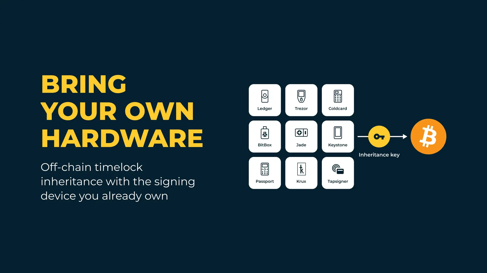

## 要点

- **使用你自己的硬件**：Ledger、Trezor、BitcBox、Blockstream Jade、Keystone、Foundation Passport、Krux 和其它空气隔离的（air-gapped）签名器，现在可以成为 Nunchuk 的链外时间锁方案中的密钥，就像 Tapsigner 和 Coldcard 一样。
- **不需要技术知识**：你的受益人使用一个简短的 “魔法短语（Magic Phrase）” 和继承密钥来取走资金，在 Nunchuk app 里面有逐步指引，如果你需要帮助，还有人工支持。
- **一个设备无需备份口令（Backup Password）**：持有继承密钥的受益人通过签名一条简短的领取消息来证明控制权。在支持的设备上仍然可以使用加密备份。
- **时间锁在链外强制执行**：Nunchuk 的平台密钥会联合签名，但仅在你选择的日期到来之后；你还可以改变日期、继承人和方案，无需移动资金。
- **没有单点故障**： 领取资金需要魔法短语、继承密钥的控制权，以及时间锁解锁。Nunchuk 的服务器永远不会接触到你的种子词。

比特币继承中最困难的部分常常是继承人，而非装置本身。Nunchuk 的继承协议有意设计成，你的受益人可以凭借几个英文词语和一个密钥来领取资金；整个过程在 app 中都有指引，无需知晓关于多签名的知识。这次更新让你手上已有的硬件签名设备就能使用链外的（Flexible）协议。

（译者注：在本文中，“链外” 一词的含义是相关的功能不是依靠比特币的脚本来执行的，而是在用户设定好条件之后，Nunchuk 视条件是否满足来决定是否使用自己的密钥来签名，从而为用户提供功能。）

## 更新内容

Nunchuk 的链外时间锁继承协议现在可以跟你已有的硬件签名器一起工作。继承密钥不再一定得是 Tapsigner 或 Coldcard ，而且其备份也不再非得用 Nunchuk 来存储。

本文将介绍这套链外（Flexible）时间锁协议；在这套协议中，Nunchuk 的平台密钥强制执行时间锁要求。Nunchuk 的[链上自动化协议](https://nunchuk.io/blog/autonomous-inheritance)基于 [Miniscript](https://nunchuk.io/blog/miniscript101)，利用比特币网络自身来强制执行时间锁，已经支持使用你自己的硬件，这个部分不在本文范围内。

本次更新改变了三件事：

1. **使用你自己的硬件**： Ledger、Trezor、BitcBox、Blockstream Jade、Keystone、Foundation Passport、Krux 和其它空气隔离的（air-gapped）签名器，都可以像 Tapsigner 和 Coldcard 一样作为继承密钥。因为在新的版本中，受益人可以通过签名来证明控制权，而不是只能通过解密一个备份来证明，所以更多的硬件可以成为继承密钥。
2. **你可以自己选择如何把密钥交给受益人**。可以直接分享种子词，也可以上传一个加密的备份，或者双管齐下。
3. **持有继承密钥的受益人不需要备份口令（Backup Password）**。他们用设备签名一条简短的领取消息就能证明控制权。不过备份口令这条路对于包含了加密备份的方案依然可用。

保持不变的部分：魔法短语定义你的继承机会、链外时间锁，以及可选的缓冲时间以及通知，直接、间接和联合控制的模式选择，以及在多个继承人之间分割财产的阶段性释放（Phased Rollout）特性。

“使用你自己的硬件” 特性需要使用 Nunchuk app 2.9.0 及更高版本。

**已经订阅了这项服务**？要将自己的继承密钥切换成另一种类型的硬件，请在 Nunchuk 手机 app 中使用 “Key Replacement（密钥替换）” 功能：Wallet（钱包） > More menu（菜单：更多） > View wallet config（了解钱包配置） > More menu（更多） > Replace key（替换密钥）。当你选择替换的是继承密钥时，app 会要求你再次设置继承计划。

## 为不了解技术的受益人打造

你的受益人不需要理解多签名、钱包文件和派生路径 —— 领取资金的流程的每一部分都是围绕这个原则来设计的。

- **他们从词语开始，不是从文件开始**。一个简短的魔法短语就能找到你的继承计划，而 Nunchuk 会为他们恢复钱包信息，所以不需要自己重构。
- **一个密钥就足够**。他们持有继承密钥，加上 Nunchuk 的平台密钥，就可以提供第二个签名。（使用两个继承密钥的继承计划，比如 “[Honey Badger Premier](https://nunchuk.io/individuals)”，则需要同时持有这两个继承密钥。）
- **不需要是钱包的专家**。他们不需要知道比特币钱包是怎么工作的。如果他们愿意使用自己的硬件签名设备来获得额外的安全性，那当然也没问题。
- **App 只询问可以应用的事项**。不适合所选方案或设备的选项会被跳过，每个硬件签名设备都有自己的逐步引导。
- **适时通知**。可以选择 email 来告知他们时间锁何时过期，并且，一旦他们领取资金，就会出现你的个人留言。
- **可以设置代理**。使用间接继承模式，你选择的一个受托人（trustee）可以代表受益人领取财产。
- **他们自己选择把比特币发到哪里**。他们可以直接取出到一个交易所账户中，或者发送到他们自己的一个比特币钱包。如果他们还没有自己的钱包，只需点一下，Nunchuk app 可以为他们创建一个。
- **只需一条消息就能获得帮助**。不论他们遇到什么问题，都可以在 app 中直接联系 Nunchuk 获得帮助。

## 协议的工作原理

使用一套链外的时间锁继承计划来保护一个由 Nunchuk 协助保管的钱包（assisted wallet）。标准模式下的钱包是 2-of-4 多签名装置：你自己持有三个硬件密钥，并指定其中一个作为继承密钥；另外一个密钥是 Nunchuk 的平台密钥。更大的方案，比如 “Honey Badger Premier” ，使用一套 3-of-5 多签名装置，其中有两个继承密钥。本文介绍的是标准方案，也会指出第二个继承密钥会带来的改变。

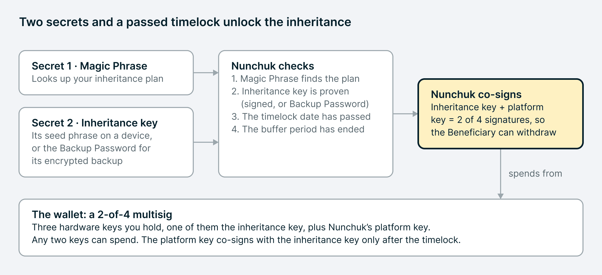-在标准的 2-of-4 集成方案中，如何领取资金：魔法短语定位你的继承方案，用签名或备份口令来证明继承密钥控制权；Nunchuk 检查时间锁是否解锁，然后联合签名-

这里的时间锁是在链外强制执行的。Nunchuk 的平台密钥仅在你选定的日期之后才会参与联合签名，所以在此之前，没人能取走财产，即便拿着领取财产所需的所有秘密值也不幸。因为解锁的日期和继承计划的其余部分存放在 Nunchuk 的联合签名策略中，而不是放在钱包的脚本中，所以你可以变更计划，包括继承人的数量和分配方案，无需移动资金。与此同时，你依然可以像平时一样，用自己的密钥来花费资金。

| **秘密**        | **用途**                                                     | **来源**                                                   |
| :-------------- | :----------------------------------------------------------- | :--------------------------------------------------------- |
| 魔法短语        | 定位你的继承计划。在领取动作开始的时候，受益人要输入这套短语。 | 在你建立继承计划时生成                                     |
| 继承密钥        | 证明领取动作是合法的；与平台密钥一起签名取款交易             | 你自己指定的一个硬件密钥                                   |
| 种子词备份      | 在任何兼容的设备上复原继承密钥                               | 你自己从硬件中记录下来的。Nunchuk 的服务器永远不会请求它。 |
| Backup Password | 解密 Nunchuk 存储的加密备份                                  | 在你创建备份时在你的设备上设置和显示出来的。               |

任何同时持有魔法短语和继承密钥（这两个秘密）的人，都能在时间锁解锁后领取财产。这就是为什么这两者要分开放置，也是为什么装置的其余部分都跟谁持有哪个秘密有关。

## 步骤 1：选择你的继承密钥

在你配置一个新的辅助保管钱包时，你加入三个硬件密钥，并标记其中一个作为继承密钥。Nunchuk 会提供平台密钥，你来决定它的联合签名策略（它要在什么时候参与签名）。

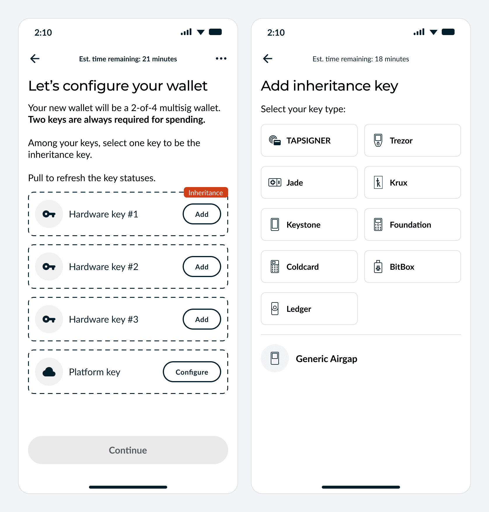

- 左图：新建钱包页面，继承密钥放在第一个空格中。右图：选择继承密钥的设备类型。 -

继承密钥应该是一个你单独存放的设备。只有在万不得已的时候，才能拿它用在日常花费中；不然，就要放在某个安全的地方。放在你的手机中的软件密钥不适合作为继承密钥：必须放在一个单独的、专用的硬件中。

| **设备**             | **如何连接 Nunchuk**                            | **当前的 Nunchuk 是否支持在其中存储加密备份**                |
| :------------------- | :---------------------------------------------- | :----------------------------------------------------------- |
| Tapsigner            | NFC                                             | 可以，这也是用它作为继承密钥的唯一方法（Tapsigner 没有种子词） |
| Coldcard             | NFC、QR、USB 或 microSD 卡                      | 可以：种子词，或者加密备份，也可以两者都用                   |
| Ledger               | 在 Android 系统和桌面版本上可以使用蓝牙或 USB； | 不可以，只能使用种子词                                       |
| Trezor               | Trezor Suite app 或在桌面版本使用 USB           | 不可以，只能使用种子词                                       |
| BitBox02             | 蓝牙（BitBox02 Nova）或 USB-C                   | 不可以，只能使用种子词                                       |
| Keystone             | QR（扫码）                                      | 不可以，只能使用种子词                                       |
| Blockstream Jade     | QR 或 USB 连接桌面版                            | 不可以，只能使用种子词                                       |
| Foundation Passport  | QR 或 microSD 卡                                | 不可以，只能使用种子词                                       |
| Krux                 | 用 QR 加入，用 microSD card 传递待签名交易      | 不可以，只能使用种子词                                       |
| 其它空气隔离的签名器 | QR 或文件                                       | 不可以，只能使用种子词                                       |

每一款设备都有专属的提示，让你知道具体要准备什么（从在一个 Ledger 签名器上安装 Bitcoin app，到从一个 Jade 或 Krux 导出正确的多签名 XPUB ）。你也可以复用已经存放在你的 Nunchuk 账户中的公钥。

**为什么不是所有设备都能加入**？继承密钥必须能够用其参与多签名钱包的公钥来签名一条消息，因为你的受益人必须通过签名来证明自己持有继承密钥。每一款受支持的设备（除了 Tapsigner）必须加载一套标准的 BIP39 种子词（12 词或 24 词，12 词通常就够了）； Tapsigner 则使用现有的加密备份流程。无法签名这样的消息的设备就永远不能用来领取财产，所以不列在内。

**关于密语的提醒**。一个 “密语（passphrase）” 是添加到一套种子词中的额外词语，是可选的，不是必需的。Nunchuk 强烈反对在继承密钥上加设密语，因为它会让复原流程变得更加复杂，并增加你的受益人犯错误的风险。如果你无论如何要使用，请一定把它跟种子词备份一起交给你的受益人。

## 步骤 2：决定如何把密钥交给你的受益人

你自己决定受益人如何拿到继承密钥：可以给 TA 种子词，也可以给 TA 加密的备份，或者两者都给。这个选择一部分取决于你的设备，因为 Nunchuk 现在只对 Tapsigner 和 Coldcard 支持加密备份，对更多设备的支持还在开发中。这部分是新的：在以前，不管你的方案如何，都要使用加密备份。

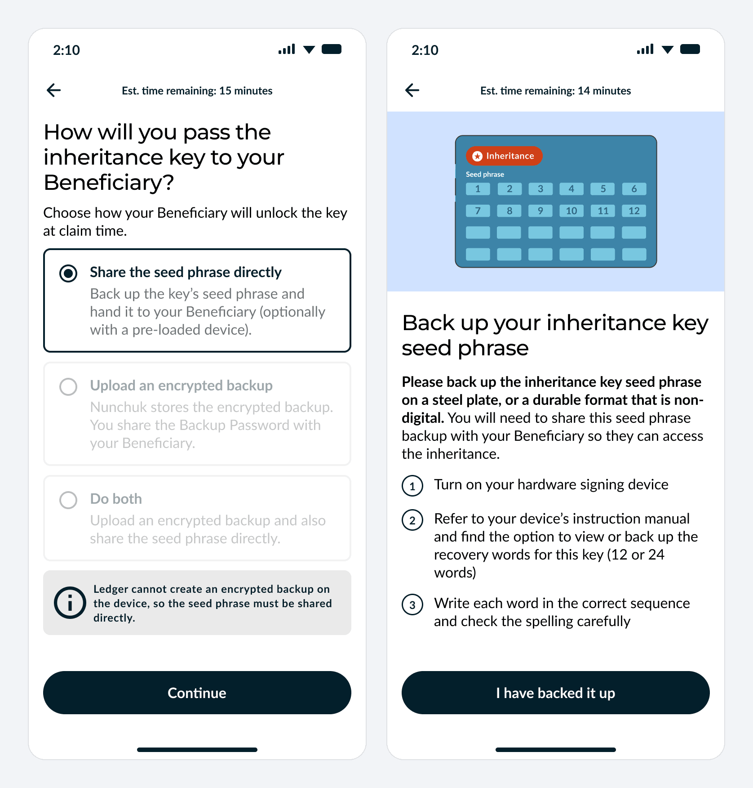

- 左图：对于绝大多数设备来说，只有种子词这一种办法；app 会解释这是为什么。右图：备份种子词。 -

| **选项**         | **你要做什么**                                               | **你的受益人收到什么**                           | **Nunchuk 会存储什么**           |
| :--------------- | :----------------------------------------------------------- | :----------------------------------------------- | :------------------------------- |
| 直接传递种子词   | 在钢板或者其它耐久的非电子设备上写下继承密钥的 12 词或 24 词种子词 | 种子词的备份，可以外加一个已经加载了该密钥的设备 | 无                               |
| 上传一个加密备份 | 在设备上创建一个加密备份，并上传它                           | 备份口令                                         | 加密备份，只能使用备份口令来打开 |
| 两者都做         | 上述两项                                                     | 两种办法都可以走通（证明自己知道继承密钥）       | 加密备份                         |

**绝大部分设备都使用种子词**。 Ledger、Trezor、BitBox、Keystone、Jade、Passport、Krux，以及其它空气隔离的签名器，在当前的 Nunchuk 版本都使用种子词方法。不需要加密备份。你的受益人将需要魔法短语和继承密钥的种子词备份。App 会排除你的设备无法使用的选项并给你解释为什么。

**如果你使用 Coldcard 或者 Tapsigner** 。Coldcard 同时支持两种办法，所以你可以在种子词备份之外增加一个加密备份。这会给你的受益人两种办法（来证明自己持有继承密钥），因为种子词和加密备份文件各有各的故障情形；不过，这只是可选的。Tapsigner 没有种子词，所以一定使用加密备份。

**创建加密备份**。Tapsigner 和 Coldcard 保持当前的用法（加密备份）不变，你要记录备份口令（Backup Password）。它要保存在哪里，则视你使用的设备而定：

- **Tapsigner**：印在卡的背面，有时候会被称为 “备份密钥（Backup key）”。
- **Coldcard**：它是你在创建备份文件时显示的 12 词。

## 步骤 3：验证备份

Nunchuk 会在你开始使用之前测试你备份好了所有东西。使用你自己的设备，意味着你要在自己的设备上复原出继承密钥，而不是参加 app 内的单词测试。

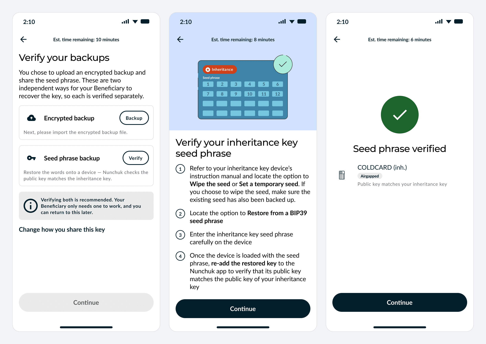

- 左图：一个同时使用两种方法的 Coldcard ，每一种备份都会单独检查。中图：从种子词复原。右图：复原出来的密钥是一致的。 -

**为什么没有词语测试**？因为在搭建过程中，Nunchuk 软件只会收到继承密钥的公钥，而不会知道其种子词。所以 app 无法通过要求你输入具体的词来检查你有没有备份。相反，你自己要向一个设备输入种子词，尝试复原出继承密钥，然后再 app 中重新添加这个密钥，Nunchuk 会检查它跟你最初添加的继承密钥是否一致。 如果一致，就说明你的种子词备份是正确的。

**复原检查的工作原理**。

1. 在存储了继承密钥的设备上，清空种子词，或者加入一个临时的种子词。如果你是清空它，请确保你已经已经备份了它。

2. 在设备上重新导入你写好的 BIP39 种子词。
3. 向 Nunchuk 重新添加你复原出来的密钥。App 已经知道了设备的类型，所以它只会询问你如何连接。
4. Nunchuk 通过对继承密钥的记录来检查你复原出来的密钥。如果不一致，那么你可以检查自己的备份、再次尝试。

**检查加密备份**。你可以自己验证，或者通过 app 来验证；后者会检查你存放在 Nunchuk 软件中的备份可以通过你记录的备份口令来解密。

**可以跳过，但不能关闭提醒**。验证是可选的，也就是说，你可以跳过验证，以后再检查。但是，在你完成检查之前，app 会一直显示你的继承密钥还没有验证过。你只是能跳过检查。任何必需的备份都依然要创建。如果你选择加密备份，你还必须上传备份文件。

## 步骤 4：建立计划

建立好钱包之后，你就可以创建继承计划：它的魔法短语、时间锁日期、在有人发起领取动作时 Nunchuk 应该怎么做。只需要花费几分钟时间。 

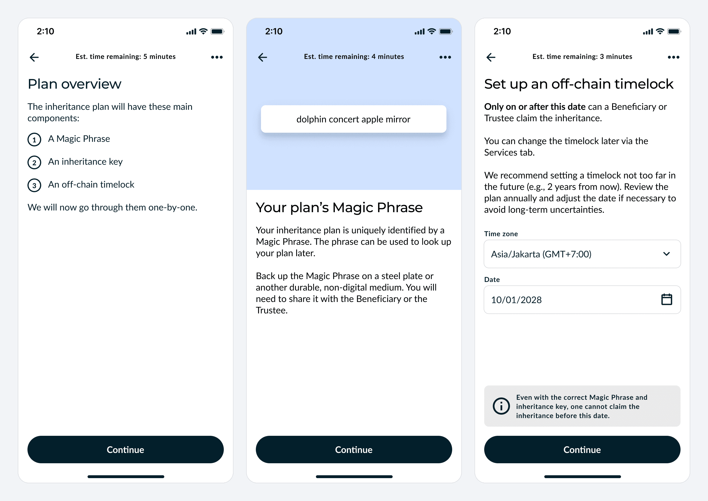

- 左图：计划页面。中图：魔法短语。右图：选择时间锁日期和时区。 -

1. **魔法短语**。Nunchuk 会生成一个简短的词组，用于唯一地识别你的继承计划。请在金属板或别的耐久的非电子媒介上记录它；你可以把它分享给你的受益人或受托人。

2. **继承密钥**。App 会提醒你自己选了哪一种形式的继承密钥。在使用加密备份时，你要记录自己的备份口令。如果使用的是种子词，你需要为你的受益人保管写下来的备份。你也可以直接把加载了继承密钥的设备交给 TA，但电子设备总有出故障的时候，所以还是应该把种子词备份在金属板或其它耐久度十年以上的材质上。
3. **链外时间锁**。选择日期、时区，仅在这个日期之后，领取动作才能成功。Nunchuk 建议设置不是太远的日期，比如两年以后；每年都检查一次。你可以在 “Services（服务）” 标签中改变它。
4. **留言（可选）**。你的受益人在领取资金后，会看到这条留言。
5. **缓冲时间**。在领取人出示秘密值之后，需要额外等待一段时间，资金才能转移：7 天、30 天、90 天或者 180 天；也可以不设。Nunchuk 会在缓冲期开始的时候给你发送电子邮件，从而你可以对未经你授权的领取动作作出响应。
6. **通知（可选）**。可以要求 Nunchuk 在时间锁过期的时候给你的受益人或者受托人发送电子邮件。邮件中绝对不会包含秘密值。
7. **授权**。因为这个计划会改变你的钱包的花费方式，Nunchuk 会要求你用你自己的密钥来授权，通常来说是签名一笔不会移动资金的假交易。

## 步骤 5：分享你的秘密值

最后一步是把领取财产的秘密值交给正确的人 —— 当然是你自己决定要交给谁。

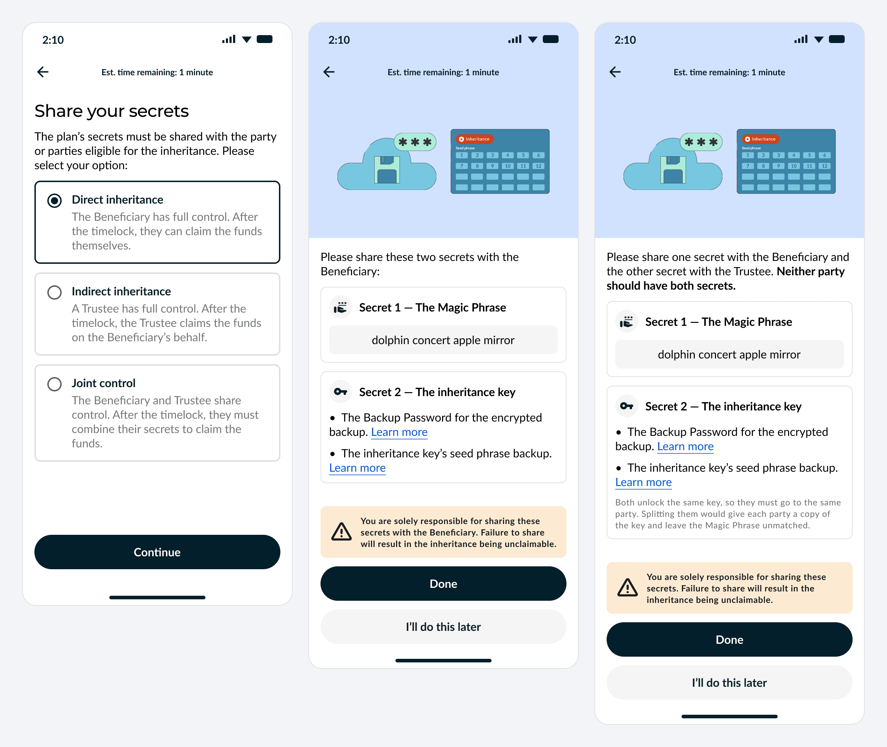

- 左图：三种形成继承的方式。中图：直接继承，可用两种继承密钥形式。右图：联合控制。 -

| **继承方式** | **谁持有魔法短语** | **谁持有继承密钥**             | **谁来领取**                       |
| :----------- | :----------------- | :----------------------------- | :--------------------------------- |
| 直接继承     | 受益人             | 受益人                         | 受益人，在时间锁解锁之后           |
| 间接继承     | 受托人             | 受托人                         | 受托人，代表受益人领取             |
| 联合控制     | 两方之一           | 另一方（不持有魔法短语的一方） | 双方都要到场；任何一方无法独自领取 |

**如果你同时使用两种继承密钥形式**。如果你存放继承密钥的设备既支持种子词、又支持加密备份，那么你可以两者都使用。种子词和备份口令将是得出同一个继承密钥的两种办法，所以在联合控制模式下，必须把这两者交给同一个人。如果两方各有一个，那么持有魔法短语的一方就可以独自领取，也就失去了联合控制的意义了。

**这个步骤完全由你自己完成**。Nunchuk 不会分发你的秘密值，所有邮件都不会包含秘密值。如果你从来没有把它交给别人，那就没有人可以领取你的财产。你可以稍后再处理：计划摘要（plan summary）页面会一直保留一个 “Share your secrets（分享你的秘密值）” 按钮。

## 步骤 6：随时回顾你的继承计划

计划摘要页面会在一个屏幕上完整展现你的受益人需要什么东西、何时能领取财产。在授权之前，你可以检查它；日后也可以随时重新打开。在 “Services（服务）” 页面，你可以随时改变继承计划，无需移动资金；包括时间锁日期、给继承人的留言、缓冲期以及通知设定；并且，使用 “Phased Rollout（分阶段释放）”、继承人的数量和分发比例也可以改变。安全上有重要影响的变更，比如改变时间锁到更早的日期、缩短缓冲期、改变继承人数量和分发比例，必须由你自己的密钥来授权。更小的变更，比如更新你的留言或者通知设定，也许只会让你回答一个安全问题。

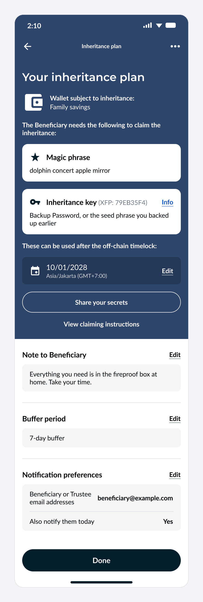

- 一个使用两种继承密钥形式的计划的摘要 -

它会列出：

- **你的受益人需要什么**：魔法短语、继承密钥（以公钥指纹（XFP）来标记），并注明 “可以通过备份口令或者你此前备份的种子词来获得”。
- **时间**：“这些秘密值只能在链外时间锁解锁后使用”，说明日期和时区，还有一个 “编辑（Edit）” 链接。
- **你的设定**：给受益人的留言、缓冲期以及通知偏好，每一项都是可以编辑的。
- **两个快捷功能**：“分享你的秘密值（Share your secrets）” 以及 “视察领取指令（View claiming instructions）”，后者会展示你的受益人要走完怎样的流程。

## 多于一个继承人：分阶段释放

这套链外协议还能在多个受益人之间分割继承物，并按自己的计划分发每一份。这就是 “[Phased Rollout](https://nunchuk.io/blog/phased-rollout)（分阶段释放）” 特性，而它是完全的链外协议。

- **按比例分享**。每个受益人都会得到整份遗产的一个固定的比例，比如 60% 和 40% 。
- **分阶段释放**。一份财产可以分阶段解锁，每个阶段都有自己的日期，直至取走 100% 。
- **为每个继承人分设一个魔法短语**。每个继承人都使用自己的魔法短语找到继承方案，但他们全都需要拿到同一个继承密钥。
- **未领取的份额**。你可以选择将一个无人领取的份额留在钱包中，或者重新分发（在一段时间没有动作之后或者在一个设定的日期之后）。
- **可调整**。因为这套协议完全是链外的，你可以随时改变计划，无需移动资金。

分阶段释放对 “Honey Badger” 和 “Byzantine” 会员可用。这个特性是在 Nunchuk app 2.6 版本加入的，但搭配你自己的硬件来使用它需要你更新到 2.9.0 乃至更高版本。

## 你的继承人如何领取

在 Nunchuk app 中，整个领取过程都有逐步引导，而且，只要你的受益人有需要，就可以联系客户服务获得帮助。你的受益人要从输入魔法短语开始，然后证明自己持有每一个继承密钥，然后取款。只有在抵达和越过时间锁日期之后，领取才能成功。

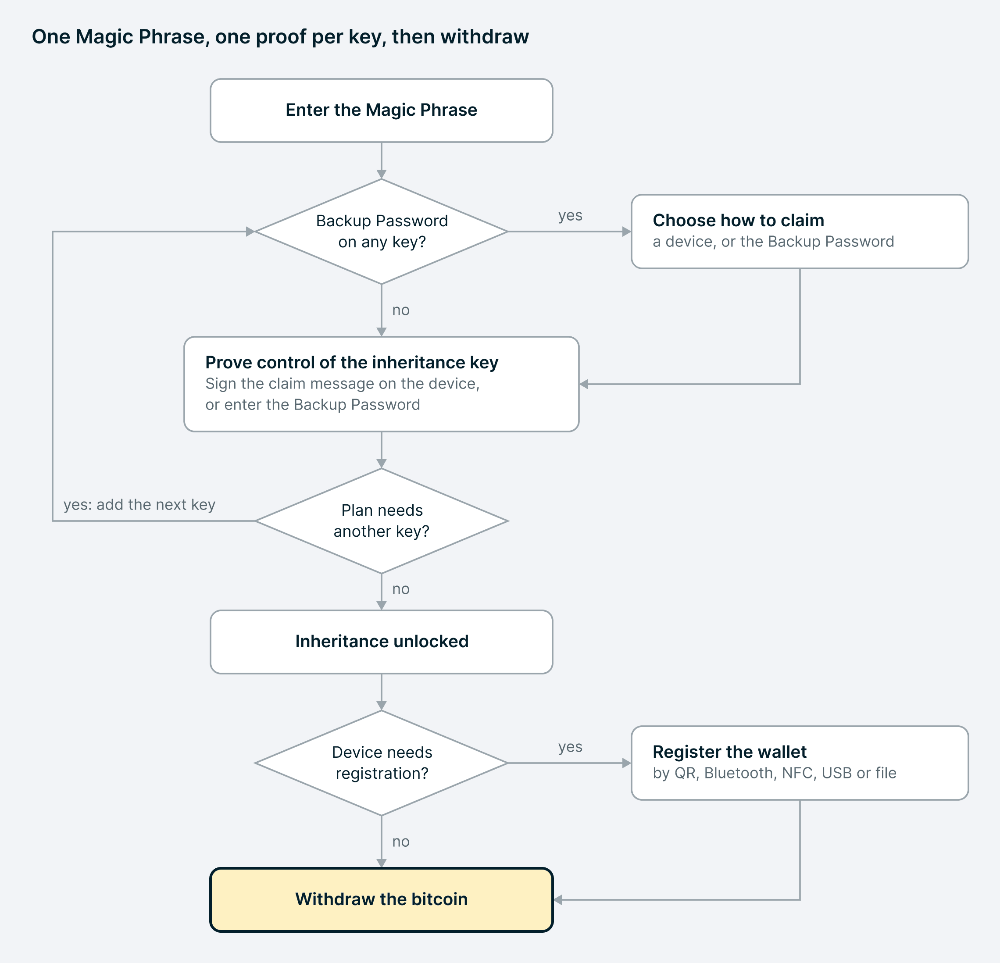

- 领取流程：3 个决定，1 个循环（对使用两个继承密钥的方案而言） -

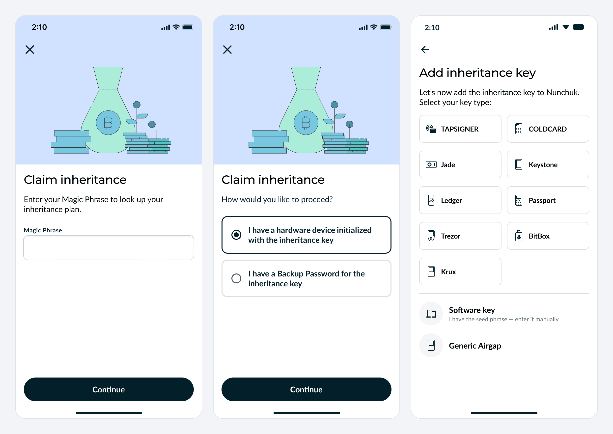

- 左图：使用魔法短语，开始领取流程。中图：仅在带有加密备份时才出现的页面，让用户自选继承密钥的形式。右图：选择设备的类型。 -

1. **输入魔法短语**：在 “服务（Services）” 页面，选择 “领取一份遗产（Claim an inheritance）”。魔法短语会检索出继承计划。

2. **选择继承密钥形式**。如果计划中有任何一个继承密钥是加密备份形式，app 会询问受益人是持有加载了继承密钥的设备，还是持有一个备份口令。如果没有加密备份，就会直接走签名器模式。
3. **使用一个设备证明持有继承密钥**。受益人要选择设备类型、添加它，然后签名一条由 Nunchuk 生成的消息。这个签名就能证明持有继承密钥，而继承密钥无需离开设备。使用你自己的硬件是一种更安全的选择，但 app 也支持导入种子词、复原出继承密钥作为一个软件密钥。
4. **或者使用备份口令**。受益人要输入备份口令，然后 app 会解密对应的加密备份。
5. **为第二个继承密钥重复上述过程**。使用两个继承密钥的方案会要求证明持有另一个继承密钥。受益人证明自己持有每一个继承密钥；也可以使用备份口令来证明持有使用加密备份的任何密钥。
6. **解锁**。App 会显示遗产及其数额。
7. **如有需要，登记钱包**。一些硬件必须先告知一个多签名钱包的信息，然后才能为这个多签名钱包签名。Nunchuk 会分辨是不是这种情形，然后给设备提供相应的方法。
8. **取款**。继承密钥签名，Nunchuk 的平台密钥联合签名，然后就能移动比特币。

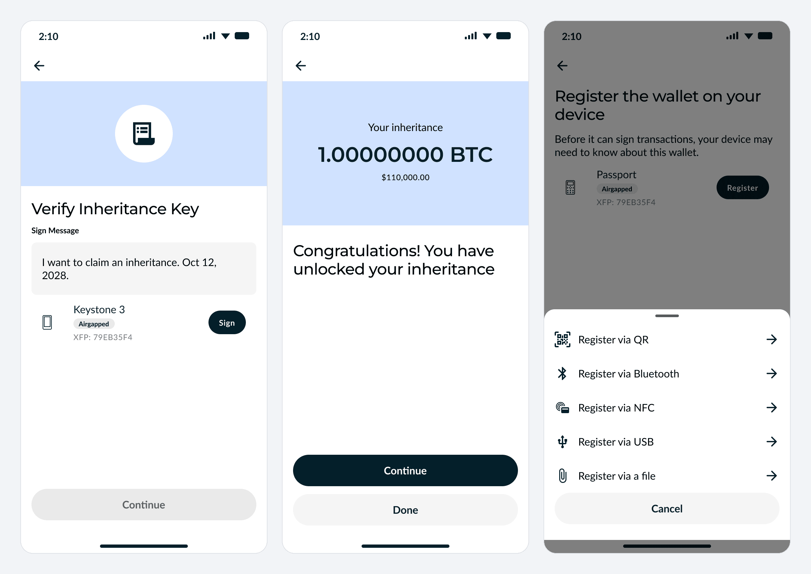

- 左图：在 Keystone 上签名领取消息。中图：解锁遗产。右图：选择如何在设备中登记钱包。 -

## 使用桌面版 Nunchuk

建立方案的过程必须从 Nunchuk 手机版 app 开始。但开始之后，你就可以在桌面版为钱包添加任何密钥，包括继承密钥。这也是为什么你可以添加使用 USB 连接的硬件签名器。

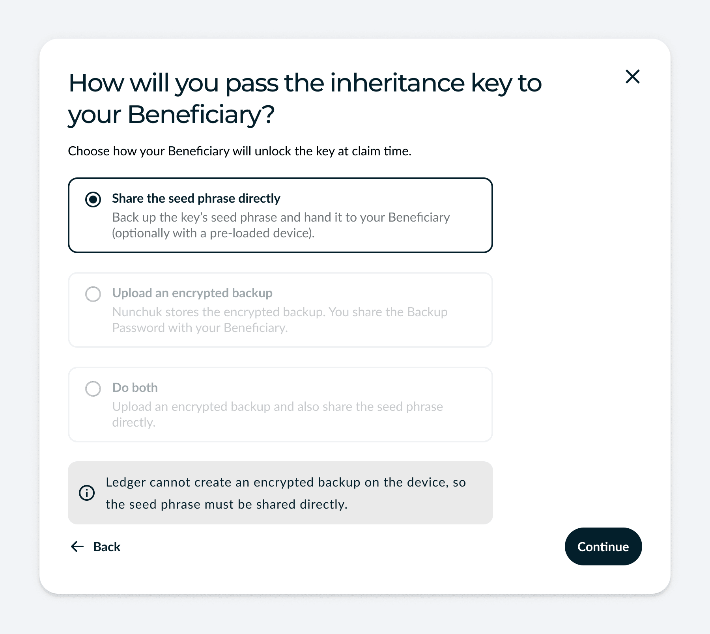

- 与桌面版相同的选择，这里是通过 USB 连接 Ledger -

桌面版选择页提供 Ledger、Trezor、Coldcard、Blockstream Jade 和 BitBox 这几种选择；其它设备类型要通过手机版 app 来添加。多款设备在桌面版和手机版都可以使用，所以你要自己选择如何连接。Ledger 签名器可以通过蓝牙连接手机（在 Android 上也可以通过 USB 连接），也可以通过 USB 连接电脑；Coldcard 可以通过 NFC 或者 QR 码来连接手机，也可以通过 USB 连接电脑；Jade 可以通过 QR 码连接手机，也可以通过 USB 连接电脑。

传递继承密钥的选择和种子词检查在桌面版上是完全一样的。验证加密备份的操作则要在手机版 app 上完成。

## 安全模式

没有任何一个秘密值、任何一方，可以提早拿走遗产。领取操作需要魔法短语、控制着继承密钥以及越过时间锁日期。正常花费则需要两个签名（2-of-4 钱包）或者 3 个签名（3-of-5 钱包）。

| **物件** | **光靠自己能做什么**                         | **做不到什么**                                       |
| :------- | :------------------------------------------- | :--------------------------------------------------- |
| 魔法短语 | 检索出继承计划                               | 签名消息或移动资金                                   |
| 继承密钥 | 作为钱包中的一个密钥，参与签名               | 独自花费：任何花费都需要更多签名                     |
| 加密备份 | 没有备份口令就没有任何意义                   | 揭晓继承密钥                                         |
| 备份口令 | 解密加密备份                                 | 没有备份本身，就什么也做不了                         |
| Nunchuk  | 在时间锁之后与继承密钥一起签名；存储加密备份 | 接收你的种子词、解密你的备份、用一个密钥移动你的资金 |

**Nunchuk 的服务器永远不会收到你的种子词**。如果你使用种子词来传递继承密钥，这些词只会从你的硬件设备传出到你用来备份的纸张或金属板。如果使用加密备份，Nunchuk 只会存储一个自己无法解密的文件。

**继承密钥拥有完整的签名能力**。在一个 2-of-4 钱包中，跟你的其中一个日常密钥一起，就能花费资金，无需 Nunchuk 帮助。这使它成为一个有用的紧急备份，以及为什么你需要像别的密钥一样妥善保管它：安全地存储、跟魔法词语分开放置。在一个 3-of-5 钱包中，继承密钥有两个，需要这两个密钥都参与，才能领取遗产。

**如果种子词泄露**。 传递一个没有加密的种子词，会提高它在你生存期间泄露的概率。光凭一个泄露的继承密钥是无法取走你的资金的。攻击者还需要魔法短语，并且必须等到时间锁解锁。或者，他们将需要拿到另一个硬件密钥，加上你的 Nunchuk 账户 以及/或者 钱包配置文件，这意味着至少还要突破两层安全防线。这就是为什么种子词和魔法短语要分开存放。

**你会得到警告**。在带有缓冲期的计划中，Nunchuk 会在领取操作开始时给你发送电子邮件，并且资金在缓冲器结束之前会保持锁定。

## 常见问题

**我的受益人需要懂技术吗？**不需要，他们只需要魔法短语以及继承密钥，而 Nunchuk app 会引导他们走完每一个步骤。Nunchuk 会为他们复原钱包，要是他们卡住了，他们可以直接在 app 中联系 Nunchuk 的客户服务。

**什么硬件签名器可以用作继承密钥？**Tapsigner、Coldcard、Ledger、Trezor、BitBox02、Blockstream Jade、Foundation Passport、Keystone、Krux，以及其它空气隔离的签名器，都可以。设备必须能够用其参与多签名钱包的公钥来签名一条消除；并且，每一种设备（除了 Tapsigner）都必须加载一个 BIP39 种子词。

**什么硬件签名器可以用作非继承密钥？**Nunchuk 兼容的每一种设备都可以，包括 SeedSigner 和 Portal：Tapsigner、Coldcard、Ledger、Trezor、BitBox02、Blockstream Jade、Foundation Passport、Keystone、Krux、SeedSigner 和 Portal，以及其它空气隔离的签名器。你的其它密钥值签名交易，它们不需要像继承密钥那样通过签名一条消息来证明控制权。

**Nunchuk 会收到我的种子词吗？**不会。Nunchuk 的服务器只持有继承密钥的公开信息，以及，如果用户用的是 Tapsigner 或 Coldcard 备份，则 Nunchuk 只会持有一个加密的文件，这个文件只能用备份口令来打开。

**现在就把种子词交给我的受益人，安全吗？**这会提高这套种子词在你有生之年泄露的概率，但光凭这个继承密钥无法移动你的资金。详见上文的 “安全模式”。必须跟魔法短语分开放。

**我的受益人要领取财产，需要拿到什么东西？**魔法短语和继承密钥；继承密钥可以是一个持有它的设备，也可以是它的种子词，或是一个备份口令。领取操作只能在到达和越过时间锁日期后完成。

**如果我的受益人没有硬件签名器，该怎么办？** 把一个已经加载了继承密钥的设备交给他们，或者如果你上传了加密备份，就把备份口令交给他们。如果他们熟悉硬件签名设备，他们也可以将种子词加载到自己的设备上。Nunchuk app 也支持在本地导入种子词、复原出继承密钥作为一个软件密钥，但使用自己的硬件会更加安全。

**有人能在时间锁结束前领取财产吗？**不能。Nunchuk 的平台密钥只能在世界所解锁后联合签名领取操作，所以即使你拿到了领取财产所需的所有秘密值也不幸。缓冲期会延长领取时间，在缓冲期开始时，你会收到电子邮件。

**我是不是一定要把种子词和备份口令都交给受益人？** 不是。任何一个都已足够，并且，当前只有 Coldcard 签名器同时支持这两种方式。如果你两者都用了，请记得两者要交给同一个人。

**直接、间接和联合控制都有什么区别？**直接控制：你的受益人持有所有秘密值。间接控制：一个受托人持有这些秘密值，并代表受益人领取财产。联合控制：一方持有魔法短语，另一方持有继承密钥，任何一方都无法单独领取。

**我可以把遗产留给多个人吗？**可以，使用分阶段释放特性，每一个受益人都会得到一定比例的财产，凭自己专用的魔法短语来领取，并且每一份财产都可以在多年间逐步释放。

**如果 Nunchuk 跑路了怎么办？**如果我们的服务只是暂时宕机，那么进行中的领取操作会失败，但你的受益人可以稍后再试。如果 Nunchuk 不幸倒闭，那么领取操作就无法完成了，因为领取需要 Nunchuk 的平台密钥的签名。以下两种办法依然可用：你自己的密钥依然可以花费，无需 Nunchuk 协助，所以你可以随时把资金移动到新的装置中。因为 Nunchuk 钱包是在开放的标准上构建的，所以你可以在兼容的软件（比如 Sparrow）中复原自己的钱包，只需使用钱包配置文件以及你自己的密钥，就能满足签名阈值（详见[逐步指南](https://nunchuk.io/blog/wallet-recovery-sparrow)）。想要获得完全不依赖于 Nunchuk 的继承计划，Nunchuk提供了[链上自动化协议](https://nunchuk.io/blog/autonomous-inheritance)，它是比特币网络强制执行的。

**这套方案与 Nunchuk 的链上时间锁继承计划有什么区别？**这套链外协议通过 Nunchuk 的平台密钥来强制执行整个继承方案，包括日期和其它计划细节，比如继承人的数量和分发方案，所以，它可以改变方案而无需移动资金。[链上的协议](https://nunchuk.io/blog/autonomous-inheritance)建立在 Miniscript 之上，时间锁条件是直接写在钱包脚本中的（现在已经支持你使用自己的硬件）。本文只解释了链外协议的部分。

**我能日后再改变时间锁吗？**可以，在 “服务” 页面，无需移动资金就能改变时间锁。但是，改到更早的日期需要用你自己的密钥来授权。

**我应该在继承密钥上使用密语吗？**最好不要，因为这会让受益人的复原流程更复杂。如果你这样做了，要把种子词备份和密语一起交给继承人。

**我能使用桌面版 Nunchuk 吗？**可以，一旦创建流程在手机上开始，任何密钥（包括继承密钥），都可以通过桌面版 app 来条件，这也是添加需要 USB 连接的签名器的办法。 桌面版支持添加BitBox、Coldcard、Jade、Ledger 和 Trezor；其中几款也可以通过蓝牙、NFC 或 QR 码连接手机。

（完）