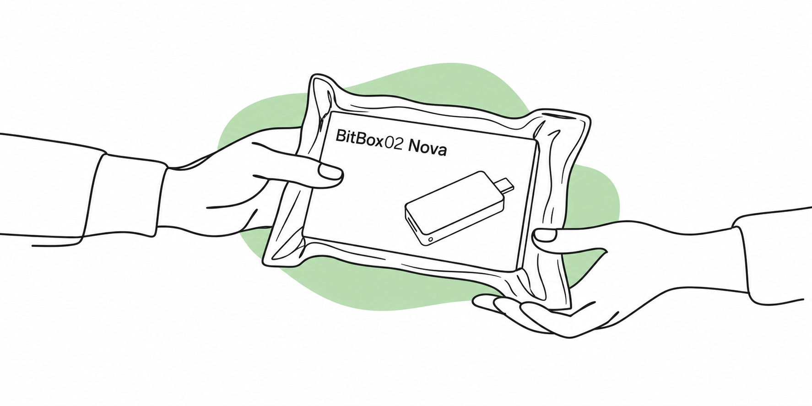
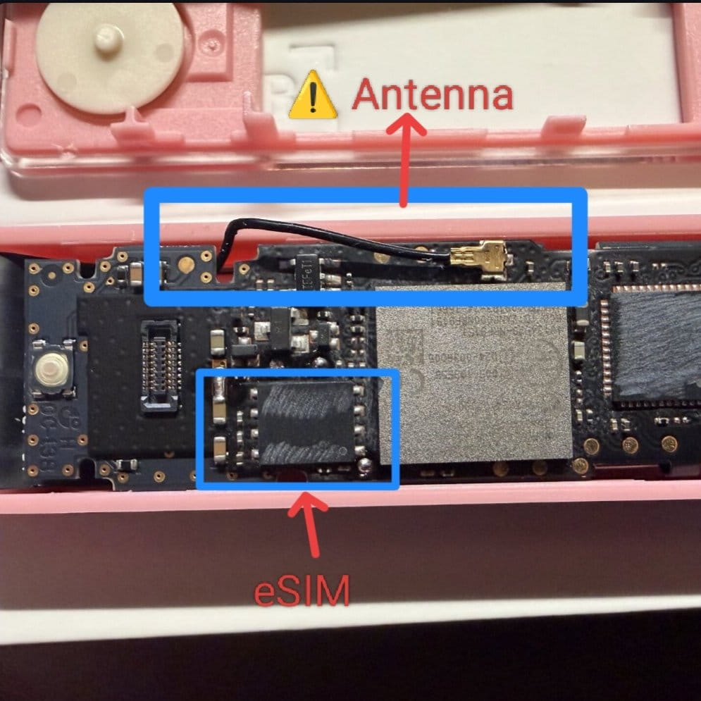
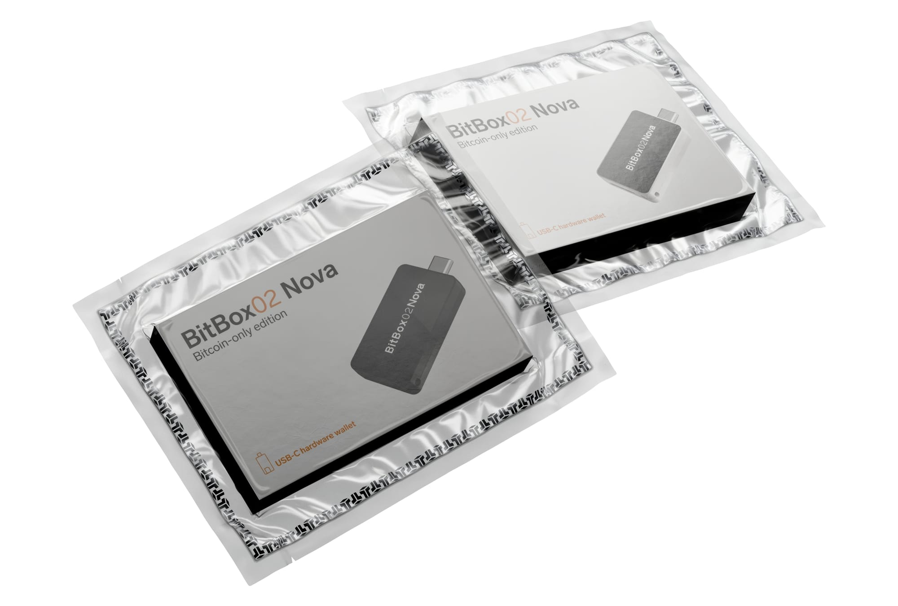
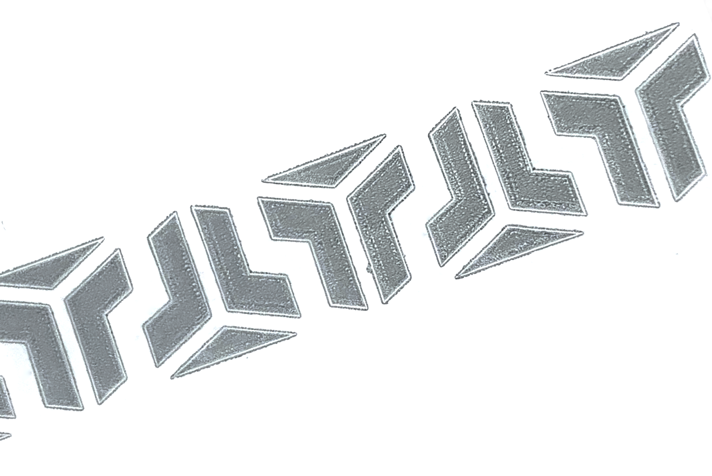
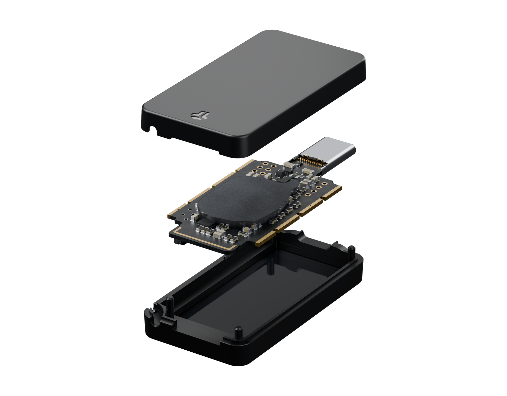
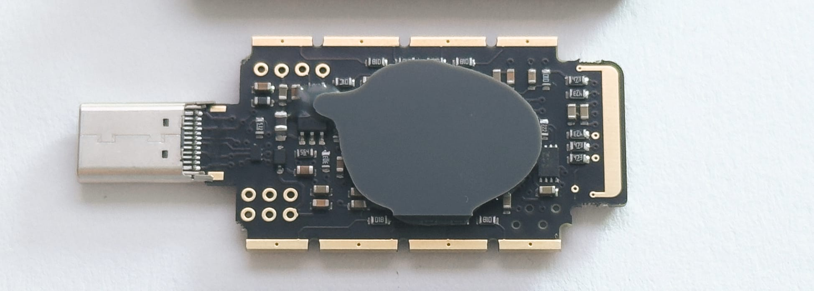

> *作者：Pako*
> 
> *来源：<https://blog.bitbox.swiss/en/from-production-to-first-use-how-we-reduce-supply-chain-risk/>*

一个硬件签名器，它通过了真实性验证，它的固件也是真实的，它的主人也遵循了正常的初始化流程。那么还有人能够盗窃其中的种子词吗？最近对[被篡改的 Ledger 签名器](https://x.com/Ledger_Support/status/2108551100613714002)的检查表明，攻击者添加了能够捕获发送至显示屏的信息的[电子设备](https://www.tibane.net/research/ledger-nano-x-implant)，从而偷走了种子词。签名器本身的运行不受干扰，只是附加的电路通过蜂窝连接传输捕获的信息。这种攻击不依赖于假冒的应用程序或诱使签名器主人在网站上输入种子词。

这阐明了一个重要的区别：**识别电子设备的完整性，与确认其周围没有加入别的东西，是不同的任务**。

在我们之前的[关于供应链攻击的文章](https://blog.bitbox.swiss/en/supply-chain-attacks/)中，我们解释了 BitBoxApp 如何识别真实的 BitBox。在此，我们将介绍围绕该检查的安全措施。

对于攻击者而言，植入一个有功能的电路仅仅是挑战的一部分。他们还需要拿到设备、还需要能够篡改它们但不搞坏它们，以及，将这些设备递送给不知情的用户。

作为一家硬件签名器公司，我们的目标是**让这些步骤变得更加困难**，不仅在一台设备上如此，在尝试对许多设备重复同样的攻击也是如此。

## 发生了什么事？

两周前，亚洲地区多位 Ledger 硬件签名器的用户发现交易从其钱包发出，余额被清空。研究人员发现，受影响的设备上焊接了植入的电路，它们会读取屏幕内容，并通过焊接在一起的蜂窝调制解调器外泄用户的种子词。

- 图片来自 <a href="https://x.com/CryptoTeluguO/status/2109501796301299915">@CryptoTeluguO</a> -

现在看来，显然的是，亚洲地区的一家 Ledger 硬件签名器经销商成功制造出了这些间谍电路，然后将它们安装到了后来出售给客户及其他店铺的设备上。

## 安全，从制造阶段开始

BitBox 硬件签名器在瑞士制造。在工厂装配期间，[我们配置设备的安全保护功能](https://bitbox.swiss/bitbox02/security-features/)，并锁住在成品上不应还能动用的功能。

在这些步骤中，我们会禁用微处理器的调试接口，并配置安全芯片。调试接口帮助工程师们开发和测试产品，但在成品中留着这些接口，会让攻击者有额外的办法能够跟设备交互。制造一个安全设备，意味着要确定开发阶段需要哪些能力、设备的正常运行需要哪些能力，以及，[送达用户的产品必须禁用哪些能力](https://bitbox.swiss/bitbox02/threat-model/)。

## 物流也重要

**直接从制造商订购可以显著降低收到物理篡改设备的风险**。通过我们的[正式商店](https://shop.bitbox.swiss/)购买，可以避免额外的经销商的仓储、点货和退货处理流程。这意味着在设备送达之前，有人接触设备或混入篡改产品的机会更少。

对于攻击者来说，篡改设备还不算完，得真的有人拿这些设备来用才行。混入经销商的库存，可以通过正常的用户购买行为分发许多被篡改的设备，而不必拦截个别交付。直接订购消除了这一额外的接入和分发节点，使得依赖于此的攻击更难大规模实施。

在这里，“退货” 动作尤其重要。看似完好无损的设备可能已被打开并篡改过。如果攻击者可以将其退回、并让它回到可以销售的库存中，那么下一位客户可能会以为它是一款全新的产品。这就是退货处理程序的重要性：包裹看似没有拆封，并不代表里面的设备没有被动过。直接购买，可避免依赖额外零售商的处理程序。

我们商店的订单也使用[中性外包装和发件人信息](https://support.bitbox.swiss/orders-shipping/bitbox-orders-shipping#neutral-packaging-and-sender-address)。这避免了没必要地声张包裹里面是硬件签名器，使得攻击者更难有针对性地攻击包裹。

直接订购并不能消除所有风险，因为履约和配送仍然涉及第三方。但去除额外的零售中间商可以有效地减少干扰机会。偏好在其他地方购买的客户应当使用我们的[经销商目录](https://bitbox.swiss/buy/)，以识别我们的正式销售合作伙伴。无论通过何种购买渠道，请检查包装并遵循下文描述的开箱检查。

## 让物理接触更难

多年以前，我们就在[公开的威胁模型](https://bitbox.swiss/bitbox02/threat-model/)页面承认用户拿到物理篡改设备的风险。供应链攻击**无法完全消除**，但这并不意味着物理防护措施无关紧要。我们采取了一些简单的措施来增加实施攻击所需的精力和代价，同时不损害产品的易用性。将这些简单措施组合起来，就降低了大规模、低成本地实施这些攻击的可行性。

攻击者不仅需要接触到电子元件，还要保证篡改后的设备仍能正常运行、装入外壳，并（在不引起怀疑的前提下）送达收件人。我们的包装和结构，就给这个过程的不同阶段制造了障碍。

### 有图案的真空密封袋

BitBox 会被装在透明的真空密封袋中，袋子的四条边不间断地环绕着独特的灰色图案。印刷和密封接缝提供了可识别的特征，收件人可以与我们提供的[包装指南](https://support.bitbox.swiss/orders-shipping/verifying-the-bitbox02-packaging)进行比对。

- BitBox 设备使用真空密封袋发货。 -

开袋会给攻击者带来了另一个麻烦：恢复未拆封包裹的外观。裂口、中断的密封或改变的边缘，可能会让收件人在接连设备与主机之前停下来。

正确还原成品包装需要专业的真空封口设备，以及匹配的袋子和印刷图案。这不是将盒子放进另一个塑料封套然后密封边缘那么简单。

- 真空袋和灰色图案密封条。 -

并不是不可能拿到这些设备和物料。但它们可以增加攻击的成本和难度，并让拙劣的 打开-重新包装 更容易被察觉。攻击者不仅要考虑包裹内的内容，还要考虑其外观能否通过检查。

### 无法简单扣回去的外壳

BitBox02 和 BitBox02 Nova 的外壳的两半部分，通过在连接销处使用胶水永久粘合。分离两半会破坏这些固定销，从而难以干净地重新安装原始外壳。撬开外壳所需的力道也可能在外壳上留下痕迹。

这一点很重要，因为攻击者想要的是收件人不起疑心、将该设备当作新品接受。接触电路和恢复外壳外观，成为了两项单独的任务，而不仅仅是打开一个可以重复使用的盖子又关上。

连接销的作用并不是让用户自己打开设备来检查，而是让不引人注目的篡改变得更困难。

想要制造出一个外观看似正常、里面已经篡改的设备，攻击者很可能需要投资用于塑料注塑成型的专用工具。这些工具成本高昂，并且需要耗费大量精力才能完善。

### 环氧树脂保护部件

在设备内部，微控制器和安全芯片均覆盖有安全级环氧树脂。这增加了接触芯片的难度，同时也减少了可用于进行侵入式攻击的潜在附接点。此外，这还会减少可以用于安装额外部件的空间。

- 一个已经打开的 BitBox02，覆盖有环氧树脂的区域。 -

### 安全是一个系统

就安全性而言，部分之和大于整体。各项单独的措施共同作用，使得不引人注目的篡改更加困难。有些增加了接触组件的难度；另一些则让重新组装或重新包装变得更加复杂。虽然可以多方面尝试攻击一个设备，但操作、篡改以及损坏的风险仍然存在于每一个设备上。结合设备的购买方式（例如直接从制造商处购买），这会让攻击者实际扩大规模并执行攻击变得非常困难。

## 检查受到物理保护的部件

物理防护措施得到了设备身份和软件检查的补充。

### 固件真实性

每个 BitBox 设备都在出厂设置期间生成了一个设备专用的见证密钥并获得了认证。当设备连接时，BitBoxApp 会向其发送新的挑战，并根据证书来验证经过签名的响应。这项检查会在解锁之前自动进行。复制 BitBox 的外观并不能提供回答挑战所需的密钥。

引导加载程序（负责安装和启动主固件的小程序）也会检查固件签名。新设备在初始设置期间通过 BitBoxApp 安装主固件，而我们的发布流程则需要多位 BitBox 工程师的签名。

### 可复现编译

“[可复现编译](https://github.com/BitBoxSwiss/bitbox02-firmware/tree/master/releases#reproducible-builds)” 提供了另一种形式的验证。[独立的审核员](https://github.com/BitBoxSwiss/bitbox02-firmware/tree/master/releases#contribute-your-signature)可以根据源代码编译出发行版软件，然后拿它与分发的二进制文件进行比较，检查其是否与公开的源代码相对应。这并不能证明代码中不包含漏洞，但它使独立审查更有意义。

这些机制解决了仿冒和软件替换问题。但攻击者植入的组件监控真实设备时，可能不会改变设备的经过认证的身份和固件。**因此，不应让软件验证成功盖过你对物理篡改的未解疑虑。** 

高级用户也可以遵循我们的指南[检查已安装固件的哈希值](https://support.bitbox.swiss/advanced/firmware-hash-bitbox)和[验证 BitBoxApp 下载](https://support.bitbox.swiss/download-installation/verify-bitboxapp-signature)。

**[真实性检查](https://blog.bitbox.swiss/en/supply-chain-attacks/)有助于发现假冒设备。但物理完整性是另一个问题**。 这并不会降低见证（attestation）的效用，只是意味着需要正确理解其结果，并结合其他防护措施。

创建新钱包时，其私钥是在您自己的设置过程中生成的，不是由卖家提供的、也不是在工厂就准备好的。我们关于[熵与钱包生成](https://blog.bitbox.swiss/en/what-is-entropy-and-how-does-the-bitbox-generate-your-wallet/)的文章详细解释了这个过程。也应注意，在创建备份时，要保持私钥的机密性。

## 检查什么、何时结束

在连接新设备之前，请使用我们的[图示包装指南](https://support.bitbox.swiss/orders-shipping/verifying-the-bitbox02-packaging)检查其内袋。寻找裂口、受损接缝或重新密封的迹象。若袋子及密封处保持完好，仅部分真空度损失是可以接受的。如果不确定的话，请保留袋口未开启状态并[联系支持](http://support.bitbox.swiss/)。

请使用[正式 BitBoxApp](https://bitbox.swiss/app/) 并允许真实性检查完成。如果产生警告、无法完成或仍存在其他疑虑，请停止操作。在未解决这些疑虑之前，请勿设置或恢复钱包，勿解锁可疑设备，也勿不要向它（其中的钱包地址）存入资金。

**如果您怀疑设备已被物理篡改，请立即停止使用并断开连接。** 即使设备上已经创建或恢复了钱包，也应遵照此建议。请通过独立开启的正式渠道联系 [BitBox Support](http://support.bitbox.swiss/)，并说明引起您疑虑的原因。我们会首先评估现有信息，调查是否存在合理的篡改嫌疑。根据调查结果，后续步骤可能包括要求送检设备以及在必要时安排更换。这些决定都要考虑具体情形。

联系支持团队时，有用的信息包括购买详情、包装或可见损坏的照片、任何警告消息，以及设备是否已被使用。切勿包含恢复种子此、microSD 备份、口令或密语。对设备有疑虑，并不一定意味着设备中的私钥已经泄露。但是，更换硬件和保护已经泄露的钱包是两件不同的事。如果一个种子本就有被泄露的可能性，即使换用了一个设备，也是无法恢复其机密性的。

如果已确认或合理怀疑存在泄露，则需要将资金转入使用受信任的硬件和软件新建的钱包。重置可疑设备或重新安装其固件是无法应对植入部件的。因此，任何检查或更换，都应配合保护钱包所需的步骤进行，而不能以为检查通过或更换了设备就万事大吉。

## 验证你受到的帮助

物理篡改和[钓鱼](https://blog.bitbox.swiss/en/staying-secure-understanding-and-identifying-scam-emails/)是两种不同的攻击方式。然而，一条关于所谓安全问题的短信，可能就会让你放松警惕，交出你尝试保护的秘密信息。

对于意料之外的联系，请自己打开[正式支持网站](https://support.bitbox.swiss/)。不要使用短信中的网站链接、二维码、电话号码或所谓的建议来验证消息本身。熟悉的发信人名称或有说服力的界面，也不应成为索要种子词的正当理由。

BitBox Support 绝不会索要您的种子词或钱包备份，也绝不会指示您将资金转账至他人提供的所谓受保护钱包。我们的关于[检查 BitBox 联络是否可信](https://support.bitbox.swiss/phishing-scams/verify-bitbox-contact)的指南解释了如何通过全新的、独立发起的查询来验证联络。

*获得协助不能以放弃钱包控制权为前提*。

## 各有各的作用

如果为了自我保管就要逆向工程一个硬件签名器，这是不合理的。

我们的责任是增加攻击的难度，提供验证设备及其软件的有效方法，并说明这些检查的局限性。

我们的目标并不是让用户准备一个检查清单、打完勾就可以无脑相信一个包裹，而是提供一个流程，使制造、物理防护、验证和客户支持协同工作。

当某些事情无法解释时，请在私钥或资金可能进入风险之前停下，并[联系 BitBox Support](https://contact.bitbox.swiss/)。

（完）

