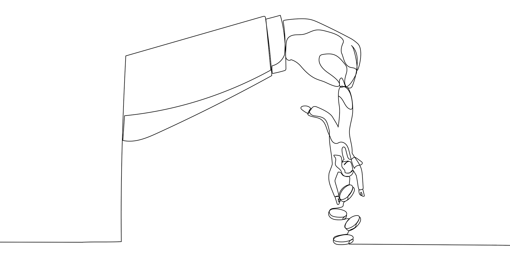
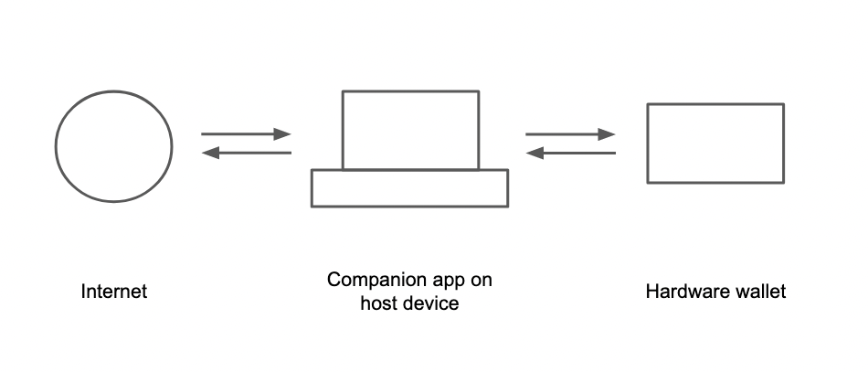
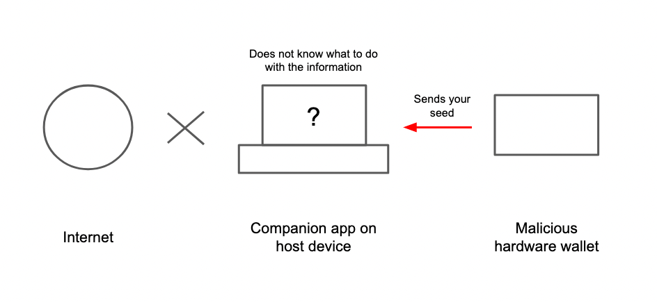
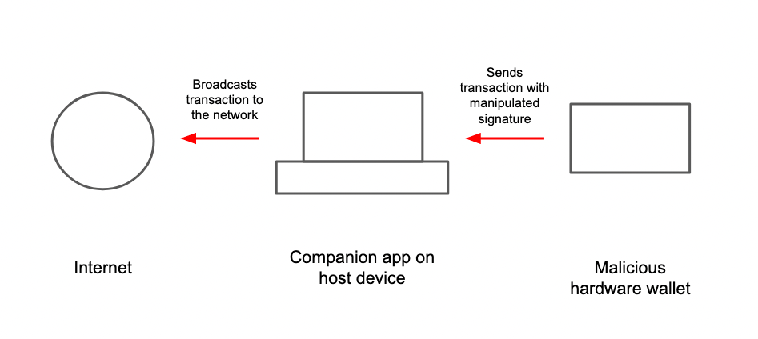
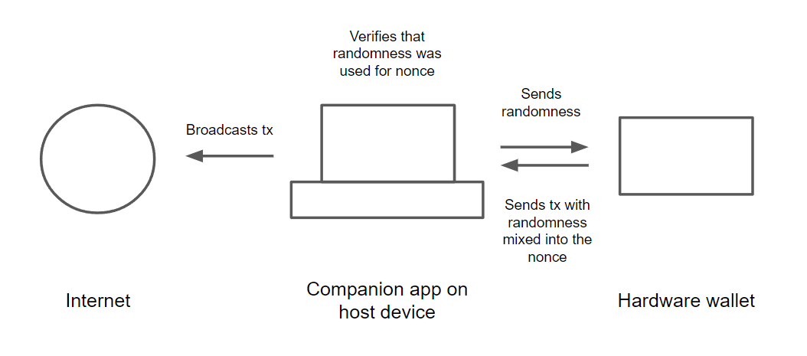

> *作者：Joko*
>
> *来源：<https://blog.bitbox.swiss/en/how-almost-all-hardware-wallets-can-steal-your-seed/>*
>
> *原标题为：“何以几乎每一款硬件签名器都可能盗窃你的种子”。*

为确保硬件签名器始终是保管比特币的最安全办法，人们已经投入了许多努力。在对付外部威胁（比如黑客和窃贼）上，多数厂商都已经取得了不错的成果。

但如果威胁 “**来自内部**” 呢？

如果你的硬件签名器的制造商本身是恶意的，或者被劫持了，你的资金还是安全的吗？

## 开源并不天然等于可以审计

绝大多数硬件签名器的固件（firmware）和引导加载器（bootloader）都是开源的，意味着每一个人都可以看到它们、编译出它们并安装到自己的的设备上。BitBox02 的引导加载器甚至会显示固件的哈希值，让你看到它跟你编译出来、装到设备上的是不是同一个！许多人会说，这意味着代码不可能带有任何后门、开源软件的开发方式保证了设备的完整性。

但这只说对了一半。在现实中，验证你的芯片**实际上在运算什么**几乎是不可能的。没办法看到里面的样子、记录下它做的一切。芯片可能完全是正常的，甚至在启动时展示出合乎情理的固件哈希值，但实际上却运行额外的代码、一直开启后门。

## 使用主机设备作为守卫

开源软件的开发方式在安全性上的意义体现在常规软件上。BitBoxApp 和其它几乎所有硬件签名器的配套 app 都是开源的。这很重要，因为你可以验证自己运行的就是自己编译出来的代码。

- 配套 app 打通硬件签名器与互联网的通信 -

在这里，配套 app 实现了一个重要的功能 —— 也许并不显眼：它是硬件签名器与互联网的信息交换的**守门人**。即使运行恶意代码的硬件签名器要把你种子发送给制造商，这也需要在配套 app 里加上专门的代码，而且很容易被研究者逮到。尤其是，你还有可能使用第三方的软件，比如 Sparrow Wallet 和 Electrum，所以想要随心所欲跟另一方分享数据是几乎不可能的。

- 配套 app 需要知道如何处理得到的信息 -

但是，如果签名器可以绕过守门人，将信息悄悄传递出去呢？

## 使用 “nonce 隐蔽信道攻击” 泄露秘密

当你发送一笔比特币交易时，你的签名器需要创建一个签名。为了创建这个签名， 签名器要先创建一个随机数，也被称为 “**nonce**” ，这个数应该是完全随机的、并且只使用一次。恶意的钱包可以操纵 nonce 的数值，使得交易可以**携带任意数据**，比如种子词的一部分。也就是说，它创建的交易本身就包含了一个隐藏的秘密。

- 恶意交易可以携带敏感数据而不让配套 app 发觉 -

配套的 App 并没要办法验证签名器所选定的 nonce 是真正随机的，又或是包含了一些隐藏的数据。它将只是从硬件签名器收到一笔有效的交易，然后就广播。

因为交易和签名都记录在公开的区块链上，攻击者可以检查这些签名、读取包含在其中的秘密值。[只需两个或四个签名](https://darkskippy.com/)，就足以**泄露一套完整的种子词（12 词或 24 词）**。通过这条隐蔽的信道，制造商可以悄悄收集所有用户的种子，不让任何人发觉。

（译者注：此处链接的是在 2024 年发现的 nonce 隐蔽信道攻击，也是目前最高效的，称作 “Dark Skippy”。）

## Anti-Klepto 协议

为了解决这个问题，BitBox 和 Blockstream 开发了 “Anti-Klepto”（也叫 “Anti-Exfil”）。我们不让 nonce 完全依赖于硬件签名器所提供的随机性，而是让主机设备提供**额外的随机性**。这可以防止硬件签名器的固件操纵 nonce 来包含隐藏的数据。

（译者注：这里的 “主机设备（host device）” 指的是硬件签名器所连接的设备，也就是运行软件钱包（或者说配套 app）、协调整个交易构造和签名流程的设备。）

- Anti-Klepto 向交易混合额外的随机性 -

在广播一笔交易之前，配套的 app 会验证自身所提供的随机性真正被用于创建签名，从而消除泄露你的种子的威胁。

我们正在为 Taproot 地址[开发 Anti-Klepto 支持](https://github.com/bitcoin-core/secp256k1/pull/1140)，因为其签名不同于以往的地址类型。想了解更多关于 Anti-klepto 的工作原理的细节，请[阅读我们此前关于该话题的文章](https://blog.bitbox.swiss/en/anti-klepto-explained-protection-against-leaking-private-keys/)。

## 结论

恶意制造商的威胁看起来很小，但如果是在接下来十年都看不到希望的公司，“**跑路**” 的可能性不容小觑。事实上，作为受害者，这种攻击**几乎是是不可能证实的** —— 这会给恶意人更多的作案动机。

因为硬件签名器的用途是比特币的长期保管，Anti-Klepto 给用户提供了敌意环境下更多的安宁。目前为止，唯二实现了 Anti-Klepto 协议的硬件签名器是 “**BitBox02**” 和 “Blockstream Jade”。

（译者注：截至翻译的日期，实现了此类防御措施的还要加上 “[FrostSnap](https://frostsnap.com/)” 。）

我们强烈建议**其他制造商**也实现这种开源协议，来展示保护用户资金的决心。

## FAQ

**黑客可以使用这种操纵 nonce 的办法来盗窃比特币吗？**

这种攻击需要硬件签名器制造商本身是恶意的（或者被劫持）。如果某人只是攻破了你的电脑，是没有办法利用这种攻击界面的。

**我的比特币是安全的吗？**

很难证明此种攻击在以往出现过。“[Dark Skippy](https://darkskippy.com/)” 成功证明了，这种攻击只需两个签名就能泄露一套 12 词的种子词；只需四个签名就能泄露 24 词的种子词。

**我怎样可以用上 Anti-Klepto ？**

实现了 Anti-Klepto 的硬件签名器会自动在每一个可用的签名上使用它。因为它是集成到 HWI（硬件签名器接口套件），所以跟第三方钱包（比如 Electrum 或 Sparrow Wallet）搭配使用时，也是自动启用的。

**什么硬件签名器支持 Anti-Klepto ？**

目前，只有 BitBox02 和 Blockstream Jade 两款签名器支持 Anti-Klepto 协议。

（完）