> *作者：layertree.tech*
> 
> *来源：<https://layertree.tech/index.html>*

“LayerTree” 让许多人共同分享一个比特币交易输出。谁拥有多少资金，是记录在区块链之外的，这些记录会形成一棵树结构：每个成员的余额都是树上的一个叶子，叶子之上的每个节点，都保存其两个子节点的哈希值以及它们的数额之和，直至最终得出一个树根。共享的交易输出会承诺这个树根。每当要花费这个共享输出，都必须满足一个限制条款 —— 这种脚本会根据承诺的树根来检查一个证据、应用一条规则、然后要求交易重新创建出带有新根值的输出。所以，任何成员都可以随时离开，并且只需要发送一笔交易，没有时间锁，也不需要提前签名交易，也不会有过期时间。运营这棵树的运营者无法拿走用户的钱或者阻止用户离开，而人们可以成群加入或离开，这样每个人都只需要承担一个微小的成本。

## 一棵树的生命历程

下面的图展示了一棵树在协议运行种的变化。这棵树有 8 个槽位，就是位于图片底部的方框；为了便于阅读，每个框种的数额都使用较小的数字。顶部的方框表明在每一个步骤完成后，记录在区块链上的东西（树根）。

（译者注：以下图片皆转译自原网页，使用 mermaid 制图，丢失了部分信息，仅供参考。）

**步骤一：创建一棵树**

一个运营者，也就是运营这棵树的参与者，放入一个 TA 自己的价值 4 的叶子，并在链上支付 4 、形成一个新的交易输出。这个输出的地址会承诺这棵树的树根，就是顶部的一条哈希值。其余 7 个槽位是空的。

（译者注：注意虚线为需要提供的默克尔路径。）

**步骤二：队列（cohort）加入**

四个成员以一笔交易加入这棵树。运营者在链外构造出他们的叶子、形成一棵子树并接枝（graft）到 4 个空的槽位中。限制条款会检查这些槽位是空的、并且输出的价值增加了 16，恰等于注资输入所携带的价值。每一个成员都检查自己在子树上的叶子，然后才给交易注资。

**步骤三：A 在链外给 B 支付**

A 和 B 的叶子都持有一条与运营者的闪电通道。A 给 B 支付 1 ，那么两条通道都要更新，支付是通过运营者来传递的。A 的叶子的数额就是她的通道的容量，这不会因为这样的链外支付而改变，所以树和区块链都不需要变化。

**步骤四：C 证明自己的叶子**

C 希望离开，C 的交易要花费这个共享输出并提供一个证据：C 的叶子及其通往树根路径上的亲属节点。脚本会哈希并加和，一路往上，最终的结果必须跟输出所承诺的根值相等。C 用签名来授权花费。

（译者注：椭圆形边框表示默克尔证据要提供的亲属节点。）

**步骤五：承诺新的根**

脚本会将 C 的叶子原本所在的位置清空，并再次沿着相同的路径返回，这样会得到一个新的根，并让金额总和减少 6 。这笔交易必须重新创建出带有这个树根的输出，并由这个输出持有 14 的价值，并且支付 6 的价值给 C 。这就是整个退出流程：一笔交易、没有时间锁、也不需要其他人的签名。

**步骤六：队列租期结束**

队列中的每个叶子都写明了一个租期（lease）：这是一个区块高度，在此高度之后，运营者可以移除这个叶子、给所有者全额支付。现在，区块链已经越过了 900 号区块，运营者一次性发布子树的所有槽位，从而脚本可以检查每一个叶子的租期，并重新计算子树的节点。

**步骤七：运营者清扫队列**

脚本将子树替换成一个空节点，再次折叠路径， 并给剩余的每一位成员支付其拥有的数额。现在，这个树输出又变成只持有运营者自己的 4 单位价值。被清扫的所有叶子会有共同的路径，所以退出成本会比各个叶子单独退出更低。

## 模块

以下卡片所链接的每个页面，都介绍了本设计的一个部分，它们会遍历同一种树结构的不同方面，并链接到定义它的规范文件。请从 “状态机” 部分开始：其它每个页面都是它的一个实例。

（译者注：各页面非常详细，且带有图例，本译本仅提供各页面的概述部分。）

### 输出中的一个状态机

区块链只存储一个对状态的承诺，每次花费都必须根据承诺来证明旧的状态、应用一条规则，并承诺新的状态。状态自身永远不会完全展示在链上，所以一个输出可以携带许多人的余额 —— 实际上，可以携带任何能够哈希成一个根、同时可以根据脚本能够检查的规则来变更的状态。

### 加入

“加入” 指的是填充树上的空槽位：一个新叶子，或一整个队列（运营者会在链外构造好，并制作成一棵子树，只需一笔交易就能完成操作）。限制条款只检查这些槽位是空的，并且有新的资金注入，所以，每个加入的人要先自己检查树上属于自己的叶子，然后给交易注资。

### 退出

一个成员要退出，就根据被承诺的根来证明自己有个叶子，然后将这个叶子所在的位置转化为空槽位，也只需要一笔交易就能完成操作，只需要他们自己的签名。两个成员可以在同一笔交易中退出，但每个人都需要提供完整的证据，所以，结对退出只能省下交易的固定开销部分。

### 彼此支付

成员们可以在链外相互支付：通过生活在他们的叶子中的闪电通道；或者，可以使用凭证（vouchers），就是签过名的指令，从签名人的余额中产生一个新的叶子。树本身只需要在兑付凭证时变更，然后，一次状态变更会将价值移动到目标位置，而不改变树上的价值之和。

### 互换

一个哈希锁定的凭证，与一个闪电通道内的 HTLC，如使用相同的秘密值，就可以同时结算：揭晓这个秘密值来收获其中一个的价值，就会让另一个也变得可以赎回。HTLC 有过期时间，凭证没有，所以秘密值必然从得到 HTLC 的一方释放，然后是得到凭证的一方兑付。

### 租期与驱逐

一个租期就是一个区块高度，在此高度过后，运营者可以移除一个叶子，不过，前提是将其所有数额支付给其主人。在一笔交易中移除一整个过期的队列，可以在其所有叶子中分享一个证据，所以每个叶子的平均成本会随着队列规模的增加而下降。

### 批量处理

位于一个对称的（aligned）子树中的叶子可以共享一个证据：“队列重写（cohort rewrite）” 操作可以发布重写以前的子树和重写以后的子树，在这一笔交易中，位于这个子树上的成员可以离开、加入、轮换密钥以及彼此支付。还有一种 “分离（detach）” 操作，将整个队列移动到另一个交易输出中，这样在后续退出时，人们就只需要证明一个更短的路径，但是，任何批量处理都无法消除发布数据、授权以及给各个变更的叶子支付这些操作的成本。

### 操作码层级

LayerTree 协议的所有操作都无法在今天的比特币协议上实现：限制条款需要还在提议中、尚未被激活的操作码；而且 LayerTree 无意提议新的方案。为了衡量 LayerTree 对各个提议的渴求程度，我们用四组操作码在同一个树结构上运行了同一种状态转换。

### 扩容效果与比较

一个成员要离开一个 LayerTree 实例时，其交易的大小会随着成员数量的倍增而增加大约 10 vB（虚拟字节）：在 65,536 个成员时，大概需要 540 vB；一百万成员时，大概需要 580  vB；四十亿成员时，大概需要 700 vB 。 如果使用的是交易树结构（译者注：指交易前后相接、形成树结构来表示用户资金状态的构造，比如 Ark），成员每倍增一次，在单方面退出时就要多发送一笔完整的交易。而如果是退出一条闪电通道，那需要花费三笔交易并等待大概一天。在单人非合作退出情形中，LayerTree 会胜过其它方案，只不如裸输出；但在一整棵树上的成员都要非合作退出时，输给所有其它方案。 

### 形式化验证

由限制条款强制执行的规则已在 Lean 4 中被证明是正确的：72 条由机器检查的定理，没有未完成的证明，大约 4,500 代码，不使用外部库。核心的一条定理是，任何持有一个叶子以及树路径的人，都总是可以构造出一条可被接受的退出操作，将叶子中的数额支付给自己，无需其他人的帮助，也不会影响其他人的叶子。这套链外协议，其风险在于排序和时机，它有一个设计好的 P 模型，但尚未开发出来。

## 代价是什么

比特币协议会根据交易的体积来收取手续费，交易的体积用 “虚拟字节（vB）” 来度量。花费一个普通的单一主人的输出，如果交易是单个输入、单个输出，那么交易的体积大概是 111 vB 。下表说明的是一棵深度为 16，容纳 65,536 个槽位的 LayerTree 实例的情形。

- 单独退出的成本是 1,020 vB，大概是普通输出花费交易的 9 倍。代价来自需要发布证据，但证据的大小不会随成员的数量而线性增长。离开同样规模的交易树（比如 Ark 这样的设计），需要大概 2,511 vB 。使用一种专门的默克尔总和树操作码 —— 本代码库指定了这样的一种操作码，并度量了其效果，但还没有人提出这样的方案 —— 退出将需要大概 540 vB ，并且成员数量每增加一倍，交易只需增加 10 vB ；[扩容页面](https://layertree.tech/components/scaling.html)给出了成员一直增长到 40 亿 的效果。
- 加入一个队列，只要这个队列有大概 1000 个成员，那么每个成员就只需负担不到 1 vB  ，此时可由运营者为接枝（graft）注资，各成员在链外给运营者支付。
- 清扫一个过期的队列需要为每个叶子消耗 158 vB（总计 51 个叶子）。
- 在成员间转移价值不需要占用链上空间，因为这发生在叶子中的通道内，或者使用签名的凭证。

这套设计将共享 UTXO 的成本从日常使用转移到退出环节。一个从不离开的叶子几乎完全不需要支付这个成本；退出的用户则需要为发布证据而支付代价。

## 它没有承诺的东西

**没人必须服务你。**

加入需要运营者的签名。得不到许可，你并不会丢钱，但也没有东西保证你一定能加入。

**一个要接枝的子树也可以没有任何意义。**

当运营者构造出一个队列时，限制条款只能看到这棵子树的哈希值，以及它声称的价值之和。如果这个哈希值背后没有真正的树，那就没有人能证明自己在这棵子树上有个叶子，这些价值也就永远锁定。总和依然是平衡的，所以没有通胀，现有的用户也不受影响。保险机制是加入的用户要遵守一条规则：在你给交易注资之前，先在子树上检查你的证明路径。

**一切都要经过一个交易输出。**

每一次状态转换都要花费同一个输出并重新创造出（使用）相同（规则）的输出，所以未确认的状态转换会形成一个链条。比特币的默认转发策略允许大约 25 个未确认的后代交易，这就限制了陌生的人们离开的速度。一次批量处理只算一个未确认的交易。在链条上靠前位置的交易，如果支付的手续费太少，也会拖慢后面所有交易的确认速度。将一个实例分割为多棵树算是一种结构上的解决方案，每棵树的大小都取决于其成员需要的离开速度。

**便宜的驱逐也是便宜的骚扰。**

以每个叶子大约 160 vB 的成本，运营者可以便宜地清理过期的成员。想要可靠保障的用户要选择更长的租期，或者没有租期限制的叶子。

**没有任何操作可以在当前的比特币上实现。**

其中的脚本用到了还在提议中、还没有激活的操作码。[操作码页面](https://layertree.tech/components/tiers.html)列出了这些操作码。

## 这些数字是从那里来的

这个网站列出了所有脚本和见证的大小数据都是实际度量出来的、不是估计出来的；完整交易 “whole-transaction” 的大小遵循规范中的手续费模型，比序列化完成的交易小不到 1%（ 在深度为16 的树的退出交易中，序列化好的交易是 1030 vB，我们计算出来的是 1020 vB）。代码库的 tapscript 模拟器会执行每一个模范脚本并记录其大小 [`spec/scripts/sizes.md`](https://layertree.tech/spec/scripts/sizes.md) 。[规范](https://layertree.tech/spec/layertree.md)的第 11 节，将这些体积转化为完整交易的大小（通过添加手续费输入、一个找零输出以及交易的固定部分）。并且， [`spec/fee-analysis.md`](https://layertree.tech/spec/fee-analysis.md) 将它们转化为手续费的大小数据。与裸输出、闪电通道和 Ark 的对比来自 [`design/cost-comparison.md`](https://layertree.tech/design/cost-comparison.md)，而关于批处理、接枝和收款的图表都来自介绍各个组件的页面底部所连接的设计页面。除非一个页面另有说明，否则这些图表都适用层级完整、枝叶密集、深度为 16 的情形。图示中的数额只用作展示，并且各个节点内的短哈希值都只是为了表明变化而使用的标签，并不是真正的哈希值。

## 本页面使用的术语

**叶子（Leaf）**

一个成员在树上的记录：包含资金数额、可以花费它的公钥，一个租期区块高度以及一个计数器。

**树根（Root）**

树顶的一个哈希值。每个节点的哈希值都涵盖着其两个子节点的哈希值以及数额之和，所以只要叶子改变，树根就会改变。

**证据（Proof）**

一个叶子以及它通向树根的道路上的每一层的亲属节点。从叶子和每一层的表亲一路向上哈希的结果必须是树根（否则就是无效的）。

**折叠（Fold）**

沿着一条路径哈希，以计算出一个树根，一次是使用旧节点来检查证据；另一次是使用新节点来计算新的树根。

**限制条款（Covenant）**

一种脚本，限制了可以花费一个输出的交易的形状，在这里是要求重新创造出一个树输出并承诺正确计算出来的新树根。

**运营者（Operator）**

运行一棵树的一方。TA 许可成员进入，可以移除租期用尽的成员，以及联合签名一些变更。TA 不持有任何人的余额。

**队列（Cohort）**

一群参与者，同时接枝进入一棵对称的子树，通常使用同样长的租期。

**租期（Lease）**

一个写在叶子中的区块高度，运营者可以通过全额支付叶子中的数额来驱逐抵达租期的叶子。

**凭证（Voucher）**

一条由一个叶子的主人签名的消息，让消息的持有者可以事后用主人的叶子中的余额去创造一个新的叶子，无需主人参与。

想要简洁明快的解释，请看 [`CONCEPTS.md`](https://layertree.tech/CONCEPTS.md) ；要了解正式的规则，请看 [`spec/layertree.md`](https://layertree.tech/spec/layertree.md) 。

## 论文

论文有两个版本，都从同一个来源构建：[简短版本](https://layertree.tech/paper/main.pdf)（PDF）基本上就是一个在会议上演讲的长度的论文，15 页的内容介绍了其构造、层级、评估以及跟闪电通道的对比，附录则提供了各个操作的细节。[完整版本](https://layertree.tech/paper/main-full.pdf)（PDF）添加了理想情况的功能以及 UC 模拟论证，每一个谓词以及完整的算法、Lean 的对应论证以及完整的脚本清单。

（完）