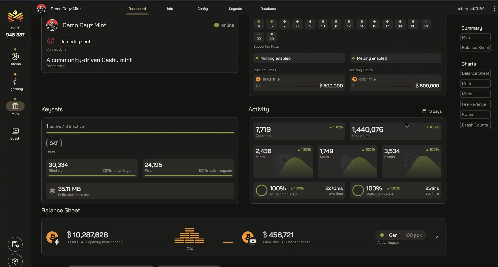
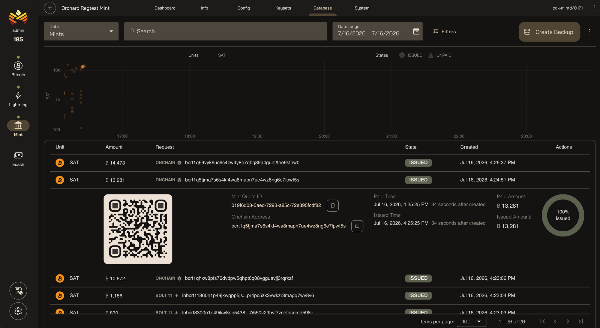
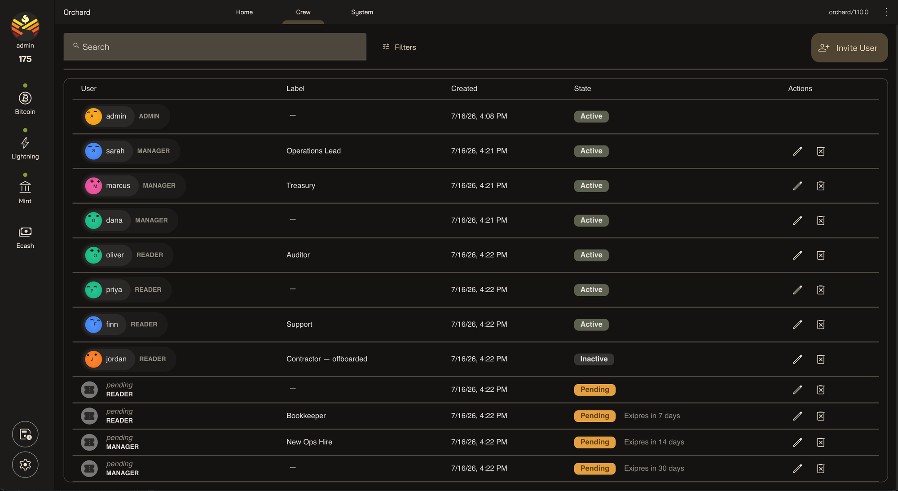
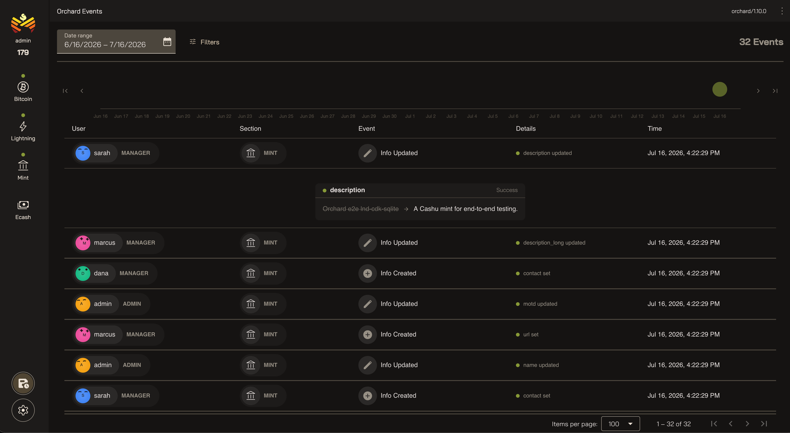
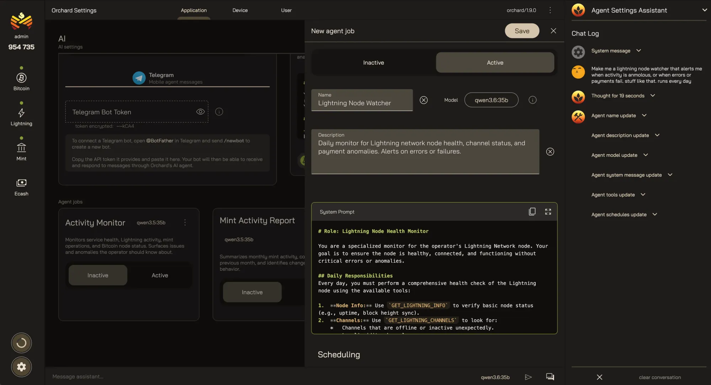

> *作者：Cashu*
> 
> *来源：<https://blog.cashu.space/orchard/>*

**Orchard** 是一款自主运行、免费且开源的网页应用，是为了简化 ecaht mint（铸币厂）管理而设计的。运行一个标准的 Cashu mint 需要一个比特币全节点、一个闪电节点，以及 mint 服务自身。Orchard 将它们连接到一个界面上，让运营者有一个全局的控制中心。

## 必要性是发明之母

如果你运行过比特币或闪电节点，大概你也安装过一大堆配套应用：交易池浏览器、图形界面的管理器、分析工具，等等。这些工具，通过拓展特性、将不透明且孤立的系统后台进程转化为易懂的 web 应用，释放了你的基础设施的更大价值。

但当我们运行第一个 Cashu 铸币厂时，这样的选择真是捉襟见肘，令人心痛。想要搞清楚一个简单的问题 —— 我的余额有多少、这笔支付怎么样了 —— 也会变成繁琐的认为。根本就没有开箱即用的工具。**所以，我们开发出了这个**。

## 今天的自治银行

### 装置灵活性

今天，我们有两种广受支持的铸币厂实现，并且它们也都支持许多闪电节点后端。Orchard 为运营者保留了这种灵活性，所以你可以继续使用现有的装置 —— 不管它恰好是什么。

- **闪电节点实现**：LND、Core Lightning
- **Mints**：Nutshell、cdk-mintd

### 统一的命令中心

比特币节点、闪电节点和 Cashu，一站式全覆盖，所以你可以快速获得你的技术栈中每一层的报告。在 Orchard 中，每一个集成都是可选的，你可以只连接你的 mint，也可以连接全部层级，从而解锁跨层级的特性。

- 比特币网络信息和交易池数据
- 区块高度时钟
- 自治的比特币价格断言机，换算为 USD 价格（UTXOracle）
- 闪电节点信息、热钱包情形、通道余额
- 在铸币厂的现金余额表中的资产端审计（闪电网络流动性）

### 铸币厂管理

关于铸币厂的部分，是 Orch 中最古老也最成熟的部分。其中的视图和工具，都是为了给运营者提供管理一个健康的铸币厂所需的一切：

- 铸币厂面板（一目了然的状态信息以及丰富的时间序列趋势）
- 公开信息以及铸币厂配置变更
- Keyset（公钥集）生命周期和轮换工具
- 数据库浏览，用于排查错误以及下载备份
- 铸币厂系统指标，用于呈现异常、瓶颈和故障

### 邀请你的朋友

你也不必独自承担所有。你可以为你的 Orchard 实例添加用户，只需要使用简单的邀请码就行，还可以为他们赋予许可。每一个 Orchard 都有一个主导者，和任意数量的管理者以及只能了解信息的用户。

### 事件日志

在 Orchard 中，每一个动作都会被记录下来、打上标签：谁做出了变更、变更了什么、何时发生、成功或报错消息。这给了你完整的审计方法，所以绝不会两眼一抹黑。

### 你的比特币智能代理

Orchard 可以激活 AI 特性，只要你连接一个推理引擎。启用和配置之后，可以按两种方式使用 AI：

- 园丁代理：运行有计划的任务，可以通过 Telegram 来联系。
- 感知语境的助手：使用自然语言来控制 UI 。

隐私性主导了我们的许多开发决策，包括避免默认使用第三方 API、支持 Tor 代理、在本地换算价格。AI 也不例外，所以 Orchard 中的 harness 是为使用更小模型的本地推理引擎而优化的。

- **Ollama**：运行在你自己的硬件上的本地模型
- **OpenRouter**：云上运行的模型，使用比特币支付

园丁代理是你个人的 7 乘 24 小时在线的工程师。你配置它可以访问什么工具、定义它要运行的定制化任务。它可以给你发送关于系统健康度的常规报告，也可以提醒你问题。你总是可以用手机来联系它，无论你什么时候有问题要找它。

## 明天的自治银行

故事还没结束。Cashu 生态系统还在快速进步，比特币、闪电网络以及 ecash 工具也需要开发和拓展。以下是我们期待的一些事情：

- 在应用内配置比特币节点、闪电节点和铸币厂连接
- 比特币交易浏览器和对等节点管理
- 闪电节点分析、通道和钱包管理
- 公开铸币厂面板
- 主导者 ecash 钱包
- 链上铸币厂钱包
- 为 AI 智能体而设计的管理工具
- 移动 app

## 培育你自己的花园

关于这个项目，想了解更多，请看 [Orchard 网站](https://orchard.space/?ref=blog.cashu.space)

如果你已经准备好开始了，请看[安装文档](https://docs.orchard.space/?ref=blog.cashu.space)

如果你想建立一个新的铸币厂，请看我们关于打造一个[完全自治铸币厂](https://docs.orchard.space/new-mint/?ref=blog.cashu.space)的指南。

（完）