> *作者：Loïc Morel*
> 
> *来源：<https://wizardsardine.com/blog/guix-nix-reproducible-builds/>*


<p style="text-align:center">- 通过相同的操作步骤来对比两个积木模型是不是一模一样 -</p>


想必你听过那句著名的台词：“别信任，去验证”。我们轻松在区块链数据上应用了这个信条，但很少在我们所用的软件上也作同样的要求。几乎没有人是从源代码编译自己所用的钱包软件的。我们只会直接下载无法阅读的二进制文件，最多，那些谨慎的用户会检查文件的哈希值以及开发者的 PGP 签名。但签名只是证明了谁发布了软件，也不证明软件里面是什么。在能够触及你的比特币的软件上，只要一个篡改过的二进制文件，有时便足以盗走你的所有资金。

> **注**：Liana 的威胁模型已经假设了，运行它的电脑可能已被攻破。这就是为什么 Wizardsardine 推荐各位搭配硬件签名器来使用 Liana 钱包软件。

在本文中，我会解释 “可复现编译” 如何弥补这个缺口、GNU Guix 和 Nix 的工作原理，以及如何自己验证 `Bitcoin Core` 和 Liana 的二进制文件。

## 长话短说

- 你运行的是二进制文件（可执行的文件），而不是源代码：没有 “可复现编译” 技术，就无法证明两者是对应的。
- 可复现编译让每个人都能重新编译出一个发行版软件，并对比指纹。
- Guix 和 Nix 从几百个可以审计的字节启动一个完整的工具链条。
- `Bitcoin Core` 发行版是用 Guix 编译的，并且得到了独立的开发者的公开见证。
- bitcoind-gunix 现在用 Nix 复现了 v31.1 发行版的每一个比特。
- Liana 在所有 3 种操作系统上都可以复现：在 Linux 上使用 Guix（可以冷启动）、在 Nix 上交叉编译为 Windows 和 macOS 版本。
- 如果你想完全确定自己在运行的软件的内容，那就自己从头编译一个。它会花点时间，但你将真正践行 “别信任、去验证” 的信条。


## 你运行的是二进制文件，不是源代码

`Bitcoin Core` 和 Liana 这样的软件，最初是开发者写好的源代码。但你的电脑没法直接运行这些源代码，所以它需要一个翻译为你的电脑处理器可以理解的指令的版本。这个翻译好的版本，我们称为 “二进制文件（binary）”，它才是你真正在自己的机器上运行的东西。

这些指令，在不同的处理器上是不一样的。Intel（英特尔）和 AMD 的芯片，用于台式电脑的那些，以及使用 Intel 芯片的 Mac 电脑，都使用 “x86_64” 指令集，但使用 Apple Silicon 的 Mac 电脑使用的是 ARM64 指令集，两者都无法直接执行对方的指令。操作系统也是如此，因为一个 Windows 程序无法运行在 macOS 操作系统上。因此，我们要为每一个具体的处理器和操作系统组合编译出一个二进制文件。这就是为什么 `Bitcoin Core` 的每一个发行版都要为 8 个组合分别编译，也是 Liana 的 macOS 应用包会同时包含 x86_64 版本和 ARM64 版本到一个文件的原因。

还有，你下载的文件通常也不是二进制文件自身，而是它的一个包裹：一个 `.zip` 压缩文件，或者一个 `.tar.gz` 档案、一个 `.deb` 包裹或一个 Windows 安装文件，它们唯一的作用就是交付二进制文件、把二进制文件放到你的系统内的合适位置。

从源代码到二进制文件的这个过程，就叫 “编译”。源代码要进入一个编译工具链条，然后生成你的机器可以运行的二进制文件。

因此，视察源代码，只是第一步。`Bitcoin Core` 的源代码是公开的，并且每一次变更都受到严格审查，Liana 的也是。但从你在 GitHub 网站上看到的代码，到你点鼠标来运行的最终软件之间，还隔着一整个编译过程，并且这个链条上的每一环都可能被攻击。如果产生发行版的机器是被劫持的，或者如果代码的某个维护者心怀不轨，那么发布出来的二进制文件可能带有源代码中没有的后门。

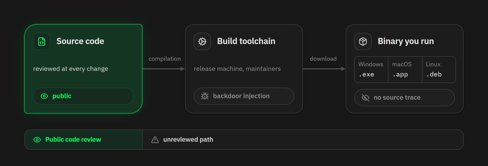

比如说，在 2024  年 3 月，xz-utils 后门（CVE-2024-3094）出现了。这个非常广泛使用的压缩软件代码库当时发布了绑架恶意代码的发行版归档文件，恶意代码藏在二进制的测试文件中，就是在编译时注入的。攻击的目标是 SSH 服务端。引发攻击的脚本只存在于发行版的归档文件中，所以在可读的源代码仓库中根本没有踪影。当时，只差几个星期，它就会进入多个主要的 Linux 发行版的稳定版本中。

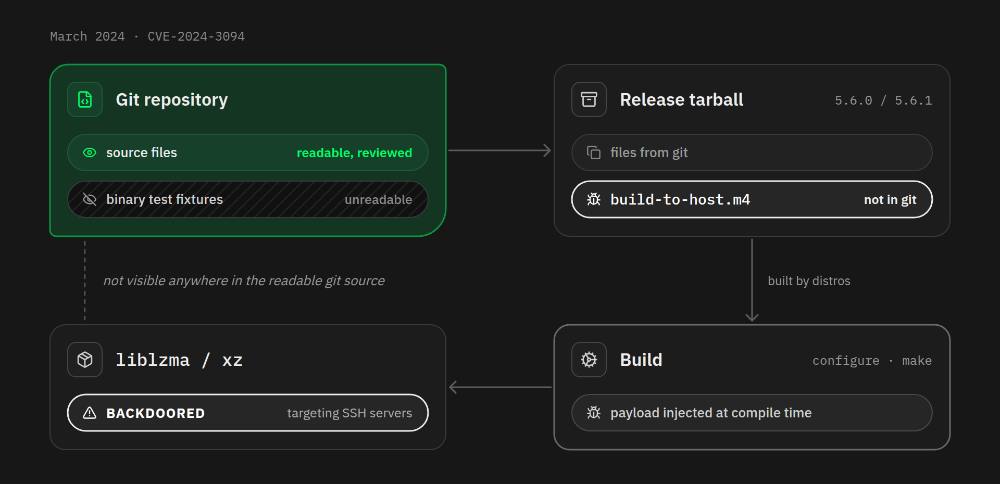

因此，审计源代码是必要的，但还不够。你还需要一种办法，能够信任从源代码到二进制文件的路径。

## 可复现编译

就像前面说的，谨慎的用户会检查他们要运行的软件的真实性和完整性。哈希值是文件的一个独一无二的密码学指纹，它保证了你得到的副本没有（在交付的过程中）被替换，而开发者的签名保证了，这个指纹（所对应的文件）真的是由他们发布的。

检查这两件东西，是我们非常推崇的习惯，但它还不能完全消除你对开发者的信任。它们所证明的，只是你收到的二进制文件确实是开发者签过名的二进制文件。如果他们用于编译的机器本身就被污染了，或者，如果他们变成了恶意的，那他们可能会签名一个带有后门的二进制文件，你的检查依然会报告 “签名完好（Good signature）”。签名的作用是确认发布者的身份，但对于二进制文件和源代码之间的关系，它并没有证明什么。

而这种关系，正是 “可复现编译” 这种技术要证明的东西。

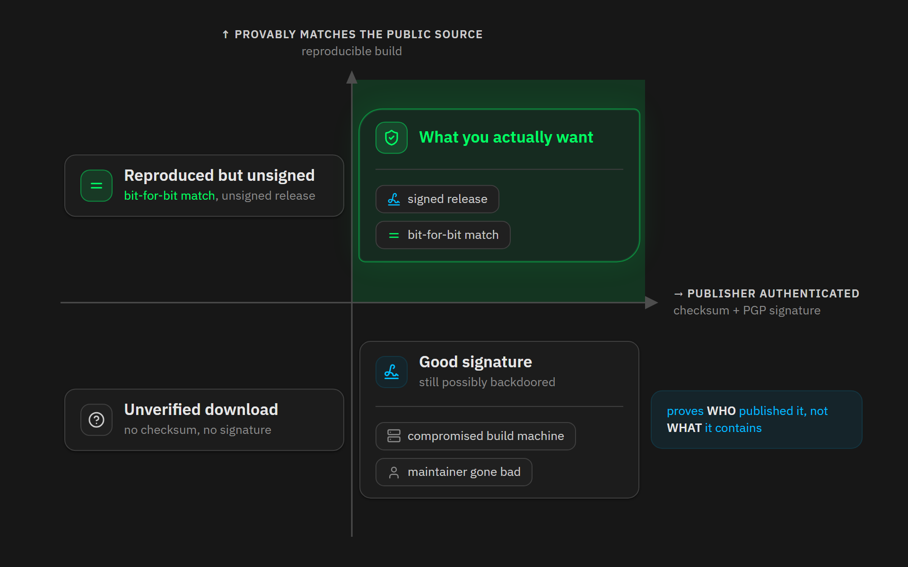

当一个编译过程，在相同的源代码、相同的运行环境和相同的编译指令下，任何人都能重新制作出跟发布的二进制文件完全一样的副本时，我们说这个编译是 “可以复现的”。

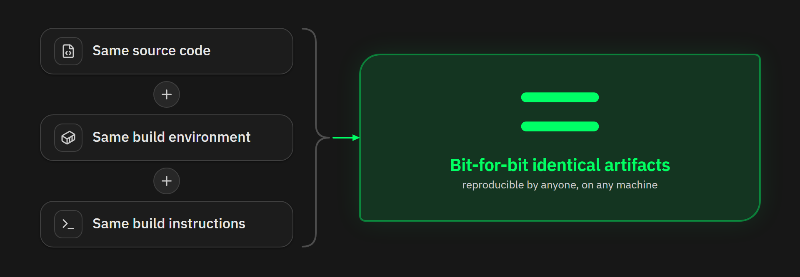

如果一个编译过程是可以复现的，你就不再需要信任制作发行版文件的机器和发布发行版文件的人。多个独立的人可以在自己的机器上按照相同的标签从源代码编译，然后产生哈希值来对比。一旦有一个指纹不一样，就说明有地方出了问题。如果它们全都一致，那么就可以证明，这个二进制文件，跟公开的源代码是对应的。

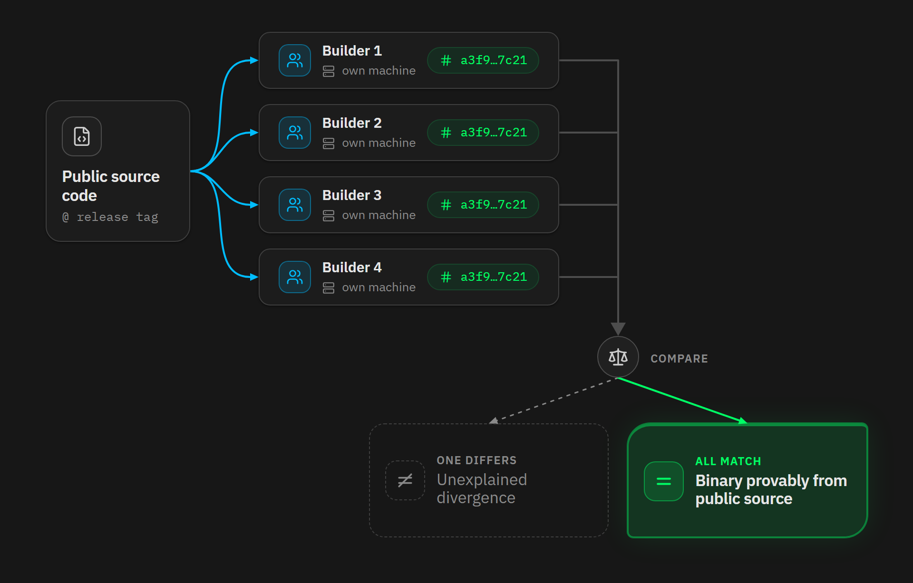

如果你想要 100% 确认软件不是恶意的，复现编译的过程仍然是不够的。它只证明了一个二进制文件跟已经公开的源代码是一致的，但不是说这套源代码本身是可靠的。直接写在代码里面的后门也会一模一样地复现出来。

这个风险，是用另一套机制来对抗的：公开的代码审核。除非你自己读了每一行源代码，不然就还是在信任一些人，只是，这种信任已经放在了最合适的位置，因为，在由多位贡献者发布和审核的、可读的文本中长时间隐藏恶意的代码，比起在不透明的二进制文件中隐藏恶意代码，还是困难多了。尤其是现在还有 LLM（大语言模型 AI）的审核。

所以说，可复现编译并不能替代代码审核，只是提高了你所运行的二进制文件的整个生产流程的透明度。

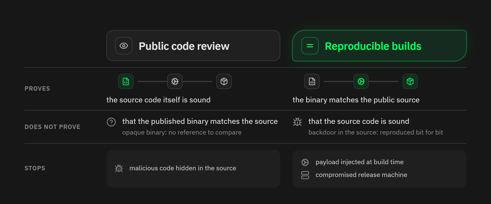

不过，复现一个编译过程，比我们以为的要难，因为一个普通的编译过程充斥着各种偶然的杂音：文件中嵌入的时间戳、来自编译者自己的机器的绝对文件路径，还有文件系统排列文件的顺序。可复现编译系统会找出所有这些问题。它们会修复索引日期、正常化环境、排序文件列表并清除环境中剩余的一切。由此，编译成为确定性的：相同的输入会产生相同的输出，无论在什么机器上。

交付这些完全一样的输入，就是 Guix 和 Nix 这样的软件包管理器（package managers）要做的事。

## Guix 以及 Nix

Nix（由 Eelco Dolstra 创建于 2003 年）和 GNU Guix（由 Ludovic Courtès 于 2012 年推出，建立在 Nix 的想法之上），用数学行话来说，是 “函数式的” 包管理器，它们将编译理解为其声明的输入的纯粹函数。

源代码、编译器、依赖库以及选项，组成了一个显式的输入集合。 编译过程会运行在一个隔离的环境内的 Linux 操作系统中，然后结果会存储在一个从密码学哈希值派生的路径中（该哈希值来自生成结果的完整依赖图）。

因此，整个编译过程完全不会依赖于你的设备恰好安装的东西。两个人编译同一个软件包，只要固定到同一个起始状态，就会在编译器中得到相同的环境。

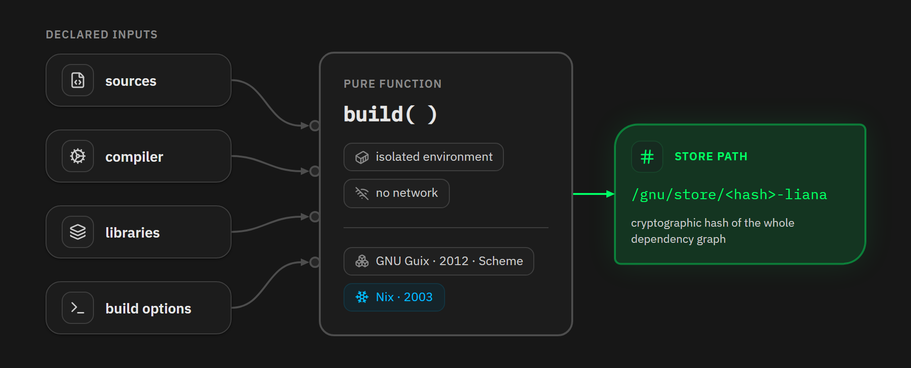

这个属性，让可复现的发行版真正变得可行：无论用的是什么机器，都能编译出完全相同的二进制文件。

## 那编译器是怎么编译出来的？

上面的说法仍有一个漏洞。你的编译环境包含了一个编译器。这个编译器自己也是一个二进制文件，是由一个比较老的编译器编译出来的，那你岂不是可以一直向上追溯，没有尽头？一定程度上，每个操作系统都是从一些没人能直接阅读的二进制文件冷启动的。如果信任一定要有个止境，这个地方到底在哪里呢？

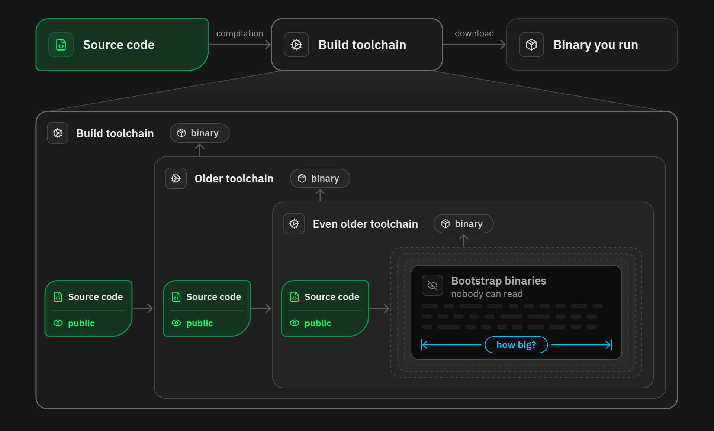

很多年里，Guix 的回答一直是：大约 250 MB 的不透明的、负责冷启动的二进制文件（其中包括 GCC、glibc、binutils 和多种工具）。后来，[“Bootstrappable Builds” 项目](https://bootstrappable.org/)从这点出发开始研究。2019 年，文件大小降低到 120 MB；2020 年，降低到 60 MB。在 2023 年 4 月，Guix 发布了 “[Full-Source Bootstrap](https://guix.gnu.org/en/blog/2023/the-full-source-bootstrap-building-from-source-all-the-way-down/)”。它是一个包含超过 22,000 个软件包的图（graph），所有软件包都根源于一个 357 字节的二进制文件（ 在当前的 Guix stage0 版本中，是 256 字节），以及一个预编译的 Guile解释器，大约 25 MB，来驱动整个过程。

整个链条以级联方式工作。种子文件 `hex0` 只做一件小事：将十六进制的文本转化为二进制，并且它小到人类可以逐个字节地审计它。`hex0` 编译出 `stage0` 工具，后者又编译出 M2-Planet，它是 C 语言的一个子集的编译器。M2-Planet 又编译出 GNU Mes，这是一种小型的 Scheme 语言解释器，还带有一个 C 语言编译器。Mes 编译出带有补丁的 TinyCC，然后是标准的 TinyCC，后者又编译出一个老版本的 GCC，再走完各个中间版本的 GCC，一直产生最新的工具链条，然后其余一切都从此起步。

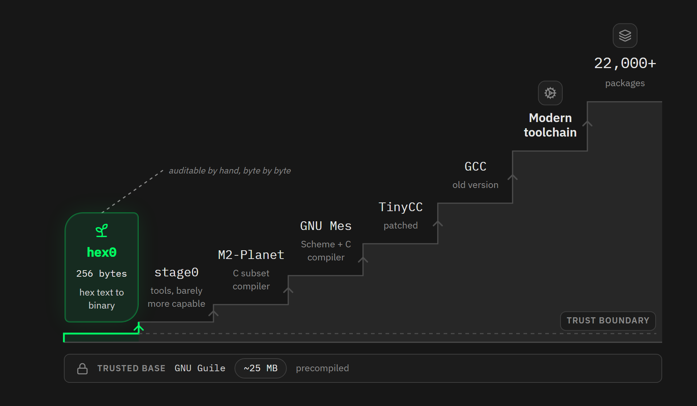

然后 Nix 又加入了这项运动。在 2023 年 4 月，Emily Trau 为 `nixpkgs` 软件包集合创建了一个 `minimal-bootstrap` 软件包，也基于相同的 `hex0`/`stage0` 种子谱系和 GNU Mes 。

在 2026 年 1 月下旬，冷启动已经编程了默认的动作。在 Linux x86_64 和 i686 上，标准的 `nixpkgs` 工具链现在会从极小的 `hex0` 种子开始，旧的冷启动二进制文件已经被移除。

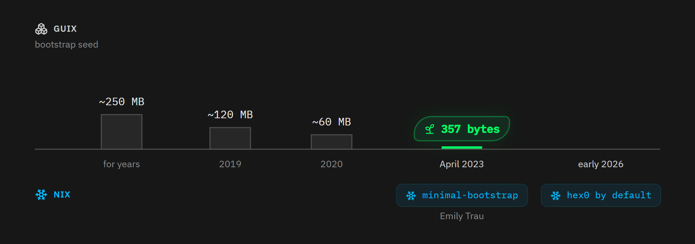

> 注：这两种系统都不是魔法，无法完全消除信任。两者都要信任驱动编译过程的工具（Guix 的后台，继承自 Nix；以及 Nix 的求值器），以及一个持续运行的操作系统内核。Guix 添加了冷启动程序 Guile（大约 25 MB），这个项目本想降低对它的依赖。目标并非完全无需信任，而是将无法审计的字节从几百 MB 降低到一个人能够检查的量级。

## Bitcoin Core：可复现的发行版，公开见证

`Bitcoin Core` 在历史上的大部分时间都产生了确定性编译的发行版，最初用的是 Gitian，这是一个基于虚拟机的系统，依然要信任许多 Ubuntu 二进制文件。但从 22.0 版本（发行于 2021 年 9 月）开始，正式的发行版都是用 Guix 编译的，也是为了收缩信任因素。感谢前面说的 Guix full-source bootstrap 项目，现在工具链自身也是冷启动的，并且是可以审计的。

整个过程都包含在 [contrib/guix/guix-build](https://github.com/bitcoin/bitcoin/blob/master/contrib/guix/README.md) 文档所述的指令中。这些指令会固定一个具体的 Guix 状态（使用 `guix time-machine`），然后在一个离线的容器中编译，使用一条固定的路径和一个固定的参考日期，为 8 个发行目标交叉编译。

然后，各个独立贡献者会在自己的机器上运行相同的指令，然会发布 PGP 签名的校验和清单，作为对公开的 [guix.sigs](https://github.com/bitcoin-core/guix.sigs) 库的 PR 。`Bitcoin Core` 的发行过程要求至少 6 位独立的编译者达成一致，然后才能在 bitcoincore.org 网站上发布二进制文件。

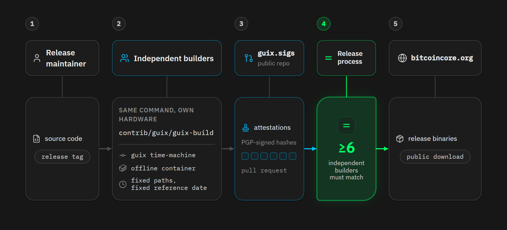

### bitcoind-gunix

还剩下一个问题：现在每个人都是在同一个 Guix 环境内复现出发行版软件的。如果 Guix 自身受到污染，那么每个编译者都会得到一模一样的、错误的字节。

这种反对意见，在 [bitcoind-gunix](https://github.com/0xB10C/bitcoind-gunix) 项目出现后，已经没什么威力了。着是一个个人项目，由开发者 0xB10C 在 2022 年启动，它将 `Bitcoin Core` 的发行链条重新实现为一个 Nix flake，它会从上游源代码重新编译工具链和以来，而不会从已有的 Guix 编译过程复用任何东西。

在 2026 年 5 月，这个项目产生了第一个跟正式发行版完全一模一样的 `bitcoind` 二进制文件，但还是要手动修正几个字节，其中 4 个是直接从正式发行版复制过来的。这些补丁在 6 月中旬就过时了，因为从 7 月开始，这个项目已经为 8 个发行目标复现出了全部 v31.1 发行版。

这个项目很重要，因为这两个软件包生态系统是独立维护的，它们的工具链，基于相同的种子谱系，却是不一样地编译出来的。在现实中，想要在编译时埋入一个后门，意味着要操纵 Guix、操纵 Nix、操纵每一个参与见证的编译者的机器，让他们全都产生完全相同的伪造字节。

## Liana：在两个系统中可复现，可以在 Guix 中冷启动

Liana 也践行相同的哲学，并且已经支持两种系统。在 Linux 二进制文件上，Liana 使用 Guix，跟 `Bitcoin Core` 的方案一样：

- 编译脚本会用 `guix time-machine` 指令固定一个具体的 Guix 状态
- 编译过程会获取每一个 Rust 依赖（根据 `Cargo.lock` 文件）
- 然后在一个 Guix 容器中编译，完全不允许网络连接。

在这个容器中使用的 Rust 编译器来自 Guix 自己的 full-source bootstrap 链条，所以这个 Linux 编译过程不仅是可以复现的，还是可以冷启动的。

至于 Windows 和 macOS 二进制文件，Liana 使用 Nix 。

> 请注意：这并不代表是在 Windows 或 macOS 系统上完成编译过程：一切都从同样的 Linux 机器开始，为这两个平台交叉编译。

在这里使用 Nix，是因为要为这两种目标（Windows 的 mingw-w64、macOS 上的 Apple SDK）交叉编译 Rust 代码，它的生态系统比 Guix 有成熟得多的工具。取舍在于，这里用到的 Rust 工具链是正式的二进制文件，是由 flake 中的哈希值指定的，没有选项也没有时间戳。因此，它虽然是可以复现的，但不像 Linux 二进制文件那样是可以冷启动的。 

> 注：有一类成品是永远无法逐字节比较的：那些为了分发而签名的成品。Windows 下的 `.exe`文件带有一个 Authenticode 签名，而 macOS 应用是用一个开发者 ID 证书签名、然后由 Apple 公司公证的，这些签名是你 —— 作为软件的一名用户 —— （幸好）不持有的私钥签名的。这就是为什么每一个 Liana 发行版都带有这些文件的 `noncodesigned`（未签名）双胞胎：这些没有签名的文件，以及 Linux 和 macOS 归档文件，以及 Debian 软件包，才是可复现的目标。

每一个发行版都带有一个 `liana--shasums.txt` 文件，覆盖所有的成品；这个文件会用 Edouard 的 PGP 公钥（`5B63F3B97699C7EEF3B040B19B7F629A53E77B83`）来签名。Git 标签和代码合并提交也有签名。

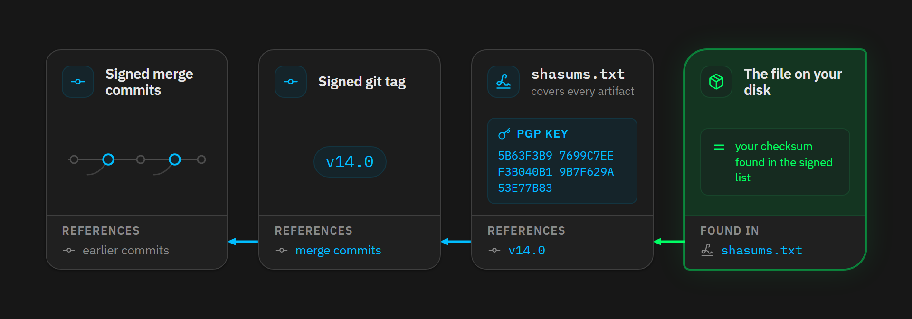

## 如何验证以及复现 Bitcoin Core 和 Liana 的编译？

所以说，“别信任、去验证” 有程度不同的两个版本：

- 检查二进制文件的指纹和签名（只需要两分钟，每个人都应该养成这种习惯：检查你得到的文件就是正式发行的版本），
- 真正复现编译过程（需要花费几个小时、大量的磁盘空间，但你将证明，这个发行版跟源代码是对应的，无须信任发布者）。

Guix 以及发行版工具链都要求使用 Linux 设备。在 macOS 上，没有原生的 Guix 可用：你需要使用一个 Linux 虚拟机。在 Windows 上，两者都可以在 WSL2 内运行。

但是，检查指纹和签名在所有系统上都可以使用。

### 1. 验证 Liana 发行版（所有平台）

转到 Liana 的[发行页面](https://github.com/wizardsardine/liana/releases)，为你正在使用的平台下载对应的二进制文件，然后下载 `liana-14.0-shasums.txt` 和 `liana-14.0-shasums.txt.asc` 文件到同一个文件夹。在下面的案例中，我使用 14.0 版本，也是我为了撰写这篇文章而重新编译的。如果你下载了更新的版本，把下面指令中的 “14.0” 替换成新的版本号。

这三个文件都来自 GitHub 网站，相关的公钥指纹也放在 Liana 代码库的文档中（在 GitHub 上）。所以，如果攻击者接管了这个代码库，或者发布新版本的账号，那么他们可以替换掉二进制文件、用自己的密钥来签名一组新的校验和、将文档中 Edouard 的公钥指纹替换成自己的公钥指纹。换言之， GitHub 是一个单点故障：运行下列命令，你依然能得到 “Good signatre” 的结果，但这个签名来自攻击者。所以，你应该在两个不由 GitHub 托管的网站上检查公钥指纹： Edouard 的[个人网站](https://edouard.paris/)，还有 [keys.openpgp.org](https://keys.openpgp.org/search?q=m%40edouard.paris) 。两者都必须显示 `5B63F3B97699C7EEF3B040B19B7F629A53E77B83` （不然就有问题），这也是下面的命令会显示的指纹。

好了，在你存放这些文件的文件夹打开一个 “终端（Terminal）”（命令行界面）窗口吧。

**在 Linux 系统上**

在绝大部分 Linux 发行版上，都已经预装了 GnuPg 软件。导入 Edouard 的公钥，然后验证对校验和文件的签名：

```bash
5B63F3B97699C7EEF3B040B19B7F629A53E77B83
liana-14.0-shasums.txt.asc
```

结果应该显示 “Good signatre”，并且公钥指纹（key fingerprint）应该如下图所示：

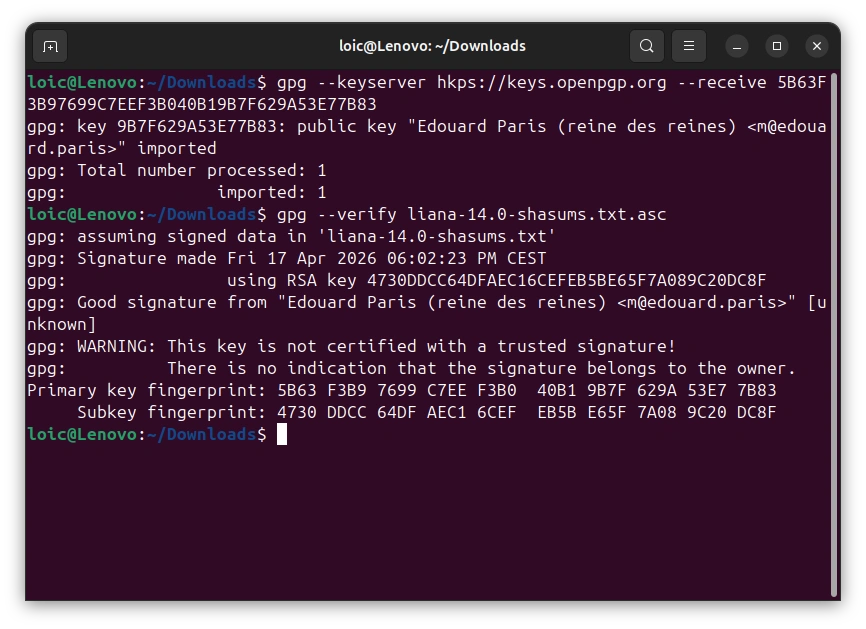

然后检查你下载的文件：

```bash
sha256sum --check --ignore-missing liana-14.0-shasums.txt
```

应该会在你的文件的名字后面出现一个 “OK” 。

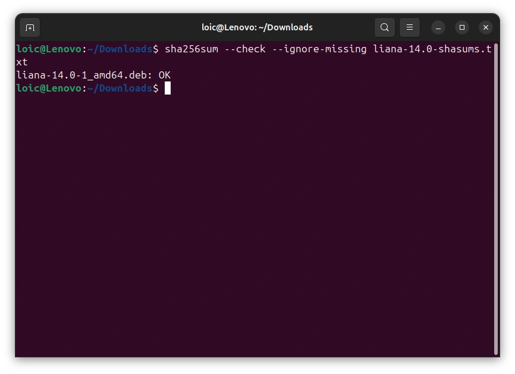

**在 macOS 系统上**

先安装 GnuPG，比如说，使用 [Homebrew](https://brew.sh/):

```bash
brew install gnupg
```

然后要用的命令跟 Linux 系统上是一样的，出了检查哈希值那一行：

```bash
gpg --keyserver hkps://keys.openpgp.org --receive 5B63F3B97699C7EEF3B040B19B7F629A53E77B83
gpg --verify liana-14.0-shasums.txt.asc
shasum -a 256 --check --ignore-missing liana-14.0-shasums.txt
```

你应该能看到同样的结果：先是 “Good signature”，然后是 “OK”。

**在 Windows 系统上**

安装 [Gpg4win](https://www.gpg4win.org/)，它在 PowerShell 中提供了 `gpg` 命令。导入公钥并验证签名：

```powershell
gpg --keyserver hkps://keys.openpgp.org --receive 5B63F3B97699C7EEF3B040B19B7F629A53E77B83
gpg --verify liana-14.0-shasums.txt.asc
```

Windows 没有 `sha256sum` 指令，但 PowerShell 可以计算你的文件的指纹，并在签过名的清单中查找它：

```powershell
Select-String (Get-FileHash .\liana-14.0.exe).Hash.ToLower() .\liana-14.0-shasums.txt
```

这行命令会打印出跟你的文件（的指纹）匹配的一行。如果它没有输出任何东西，那就别运行你得到的二进制文件。

同样的模式也可以应用在 `Bitcoin Core` 上，在你导入开发者的公钥之后，就用发布在 bitcoincore.org 网站上的 `SHA256SUMS` 和 `SHA256SUMS.asc` 文件来检查签名和指纹。

这些步骤，让你可以验证你得到的二进制文件就是开发者发布的、签过名的发行版。换句话说，它们是真实的，没有被替换过。但是，若要验证它跟你看到的源代码是对应的，你必须自己编译。

### 2. 复现 Liana（在 Linux 系统上）

在安装 Guix 之前，你的设备要先准备好两样工具。

Guix 的安装脚本会在启动时检查一些系统工具，如果你用的是 Ubuntu 系统，将缺少其中一样： `newgidmap` ，它是由 `uidmap` 软件包提供的。

Liana 的编译脚本需要主机上安装有 `cargo` 软件，你可以用 [rustup](https://rustup.rs/) 来安装：

```bash
sudo apt install uidmap
curl --proto '=https' --tlsv1.2 -sSf https://sh.rustup.rs | sh
```

现在安装 Guix 。

Debian 系统在 2025 年 9 月从库中移除了它，Ubuntu 从 25.10 版本开始也是一样的（24.04 LTS 版本只保留了一个旧的 Guix 版本，是 2022 年发布的 1.4.0 版本），所以你必须使用正式的安装脚本。先下载，然后运行：

```bash
wget https://guix.gnu.org/guix-install.sh
chmod +x guix-install.sh && sudo ./guix-install.sh
```

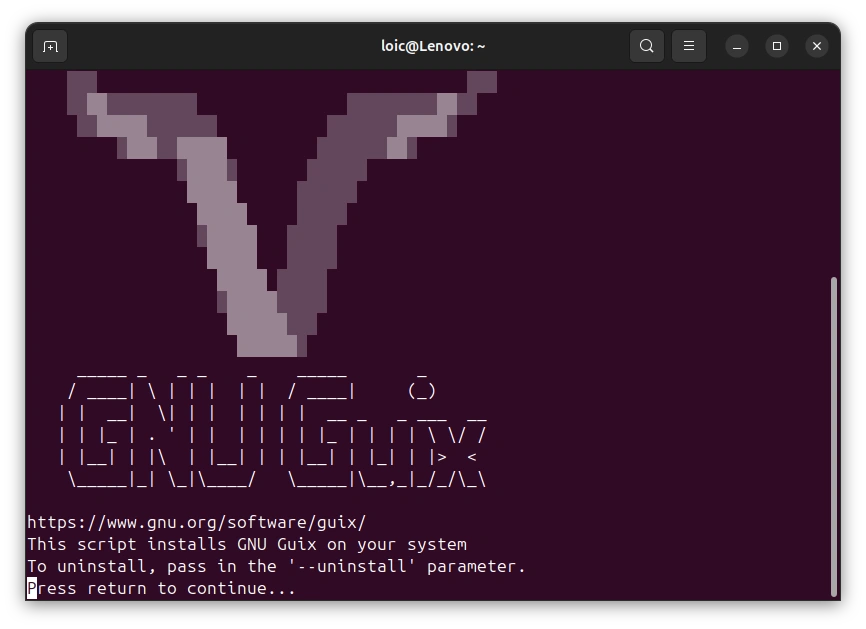

注销当前的会话，然后重新登录系统。检查一切都已就绪

```bash
guix --version
cargo --version
```

然后，拉取 Liana 的源代码（用发行版标签），然后验证这个标签的签名：签名它的公钥跟签名 shasums 文件的是同一个（如果你跳过了上面那一步，请导入 Edouard 的公钥）：

```bash
git clone https://github.com/wizardsardine/liana && cd liana
git checkout v14.0
git verify-tag v14.0
```

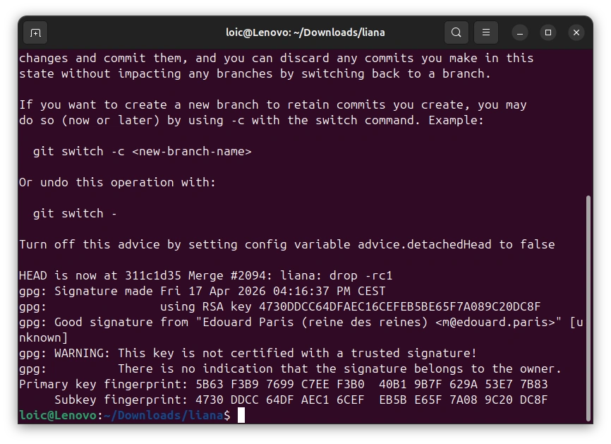

开启可复现编译旅程。一切都运行在一个固定的离线 Guix 容器中。第一次运行需要很长时间，因为 Guix 要建立工具链：

```bash
BUILD_ROOT=$PWD/guix-build ./contrib/reproducible/guix/guix-build.sh
```

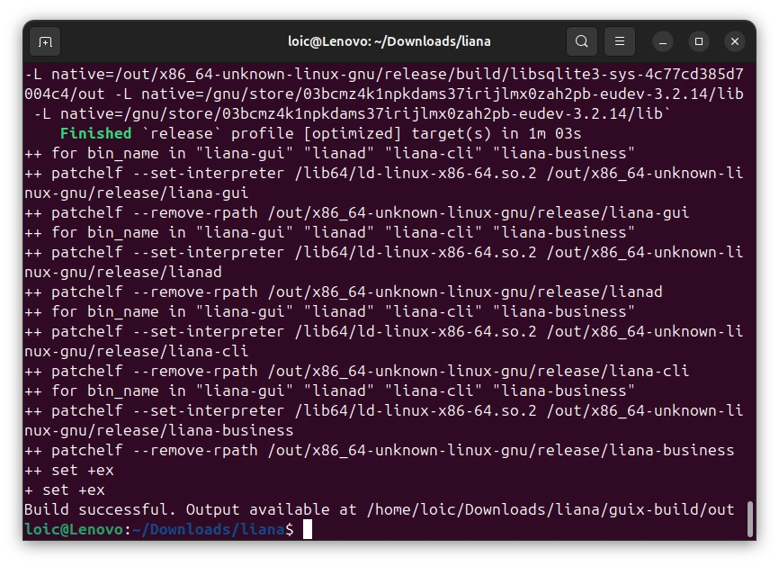

下载正式的 Linux 归档文件，然后抽取出其中的内容：

```bash
wget https://github.com/wizardsardine/liana/releases/download/v14.0/liana-14.0-x86_64-linux-gnu.tar.gz
tar -xzf liana-14.0-x86_64-linux-gnu.tar.gz
```

最后，对比编译出来的二进制文件与你下载到的正式版本：

```bash
for b in lianad liana-cli liana-gui; do
  sha256sum guix-build/out/x86_64-unknown-linux-gnu/release/$b liana-14.0-x86_64-linux-gnu/$b
done
```

指纹会成对出现。在每一对中，你编译出的文件的指纹跟正式发行版都必须一模一样（否则就有什么地方不对劲）。

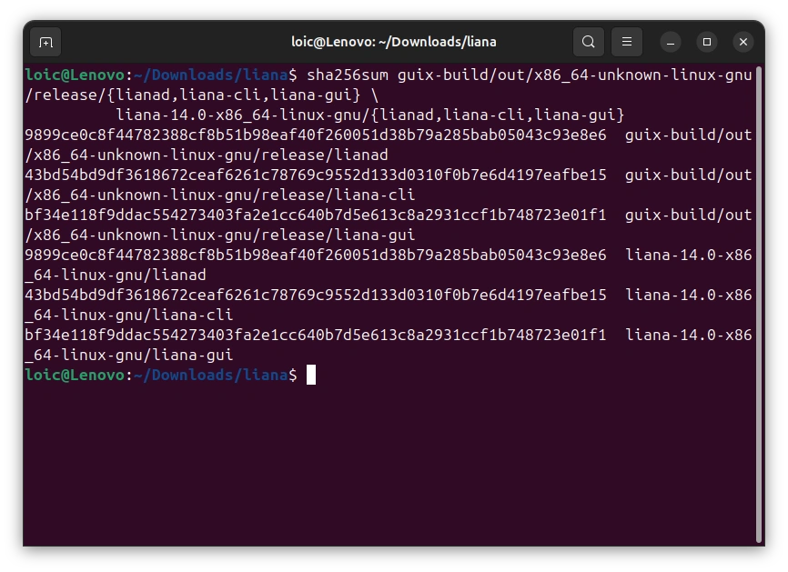

Windows 和 macOS 的成品都是在同样的 Linux 机器上用 Nix 编译出来的（你安装好之后，就运行 `nix build .#liana.x86_64-pc-windows-gnu`；如果你安装了 Xcode SDK，为 Apple 设备编译也是完全相同的）。

要了解更多细节，请见 [contrib/reproducible](https://github.com/wizardsardine/liana/tree/master/contrib/reproducible) 。

### 3. 复现  Bitcoin Core（在 Linux 系统上）

像上面那样安装 Guix 之后，拉取`Bitcoin Core` 在发行版标签下的源代码：

```bash
git clone https://github.com/bitcoin/bitcoin.git && cd bitcoin
git checkout v31.1
```

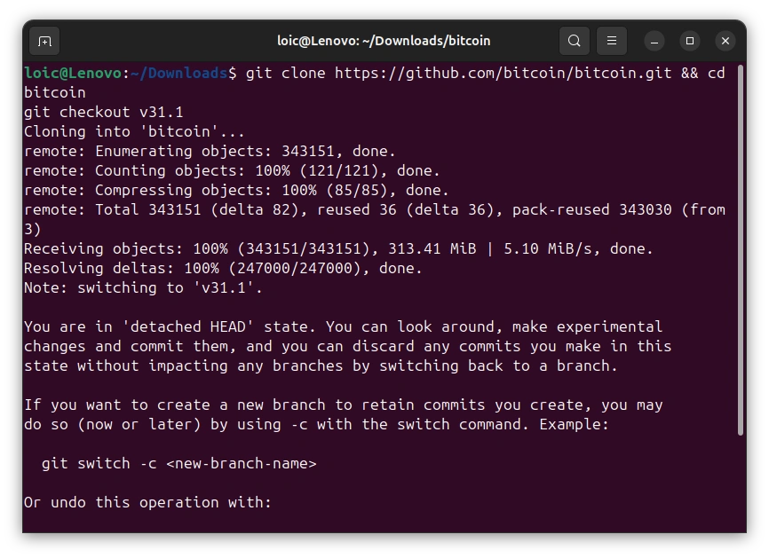

开始编译，限制到单个目标运行系统。你需要预留 24 GB 的磁盘空间（16 GB 给 `/gnu/store`，每多为一个目标编译，就多预留 8 GB），第一次编译需要花费几个小时： 

```bash
env HOSTS='x86_64-linux-gnu' ./contrib/guix/guix-build
```

计算你编译出来的二进制文件的指纹：

```bash
sha256sum guix-build-31.1/output/x86_64-linux-gnu/*
```

然后将它们与其他开发者公开见证的哈希值相对比：

```bash
git clone https://github.com/bitcoin-core/guix.sigs
grep -h x86_64-linux-gnu guix.sigs/31.1/*/noncodesigned.SHA256SUMS | sort -u
```

如果输出为每个文件显示一行、你的文件的指纹也在其中，那说明每个开发者都跟你达成了一致：你独立地证明了发布出来的二进制文件来自公开的源代码。

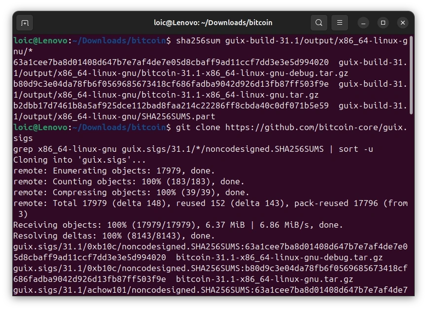

> 抛弃掉 `HOSTS` 变量，你就会给所有 8 个目标编译二进制文件（需要预留 80 GB 的磁盘空间，并且 macOS 目标还需要提取 Xcode SDK）。

## 进阶阅读

- [The Reproducible Builds project](https://reproducible-builds.org/)
- [Guix: The Full-Source Bootstrap](https://guix.gnu.org/en/blog/2023/the-full-source-bootstrap-building-from-source-all-the-way-down/)
- [Bitcoin Core’s Guix documentation](https://github.com/bitcoin/bitcoin/blob/master/contrib/guix/README.md)
- [bitcoind-gunix](https://github.com/0xB10C/bitcoind-gunix)
- [Liana’s reproducible builds](https://github.com/wizardsardine/liana/tree/master/contrib/reproducible)