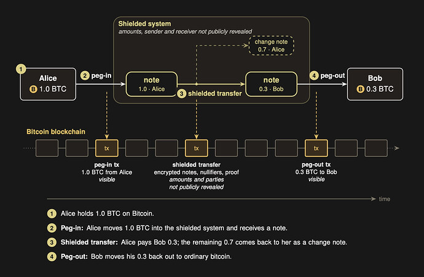

> *作者：nemothenoone*
> 
> *来源：<https://delvingbitcoin.org/t/shielded-bitcoin-private-transfers-on-the-bitcoin-l1/2912>*

本文是对我们的论文《[Shielded Bitcoin：在比特币 L1 上实现隐私转账](https://x.com/allocinitxyz/status/2103124026214568209)》（作者是 Clara Shikhelman、Mikhail Komarov 和 Aleksei Moskvin）的大白话伴读。

比特币提供了无需受信任的中间人的强大所有权保证，但其交易历史是公开的（设计上就是如此）：交易数额、时机和交易关联都是公开可见的，而且关键的钱包常常可以跟真实的人或者机构关联起来。这是一个问题，它严重限制了个人和机构（比如财政部、交易部分）以及公司使用比特币来转账。

我们的论文提出了一个狭窄的问题：能否移动比特币而不公开揭晓转账的数额和对手方？前提是就用今天的比特币，不考虑软分叉和新增区块链，也不依赖于受信任的桥接合约运营者？

“Shielded Bitcoin” 是我们为实现这一效果而提出的元协议。这是第一种在设计上消除了受信任的运营者、互动要求、活性 以及 流动性/退场担保 要求的比特币隐私性架构。

移动比特币进出这套元协议需要在 L1 上使用通过 PIPE 技术实现的安全保险柜，会在之后发布的配套论文中详细描述。

## 一个段落说清我们的想法

在这种元协议中，价值是**票据**的形式存在：小体积的加密记录；每一个票据都持有一些价值，以及一种验证其所有者的办法。这些票据在比特币区块链上不会以可读的形式出现。当某人发起一笔交易时，TA 在比特币区块链上发布一个加密的转账操作，以及证明该次转账合法的一个零知识证据。比特币区块链只存储和排序这些字节，它不理解这些数据，也无需理解。专门的软件会按顺序读取比特币区块链上的转账记录、检查证据并关注票据的共享清单。可以把比特币区块链理解成一个公告栏：人们在上面发布数据并形成排序，而任何人都可以独立地使用Shielded Bitcoin 的规则来确定最终的状态。

## 隐蔽转账如何工作

假设 Alice 要给 Bob 支付。

**1. Alice 为 Bob 密封一个票据**。她创建一个新的票据，带有数额以及 Bob 的收款方式细节，然后加密，这样就只有 Bob 才能打开它。

**2. 她发布一笔转账**。其形式是普通的比特币交易所携带的数据，包含三个东西：加密的票据、一个唯一的序列号（称作 “废止符”）（她花费了多少个票据，就要提供多少个废止符）以及一个紧凑的证据。这个证据会同时说明三件事：她正在花费的票据是存在的、她有权花费它们、进入交易的数额等于交易产生的数额。并且，这不会暴露被花费的票据是哪些、面值有多大。

**3. 任何人都可以检查**。称作 “索引器” 的程序会监控比特币区块链，检查有无这样的转移。一旦发现了，就验证证据并确认没有任何一个序列号在此前使用过。如果这些检查都通过，就向列表添加一个新的票据并记录用掉的序列号。因为一个序列号只能出现一次，所以一张票据不能花费聊次。没有哪个索引器具有特殊的权威：任何人都能用公开的历史来运行同样的检查。

**4. Bob 找到自己的钱**。他的钱包软件会使用其私密的观察密钥尝试打开每一个新的加密票据。绝大部分尝试会失败，因为并不是发送给他的。一但发现可以打开某个新票据，再辅以少量的一致性检查，就可以确定这笔钱是发给他的了。在他以后要花费的时候，也会经历同样的循环。

## 比特币的自主保管

在转账协议中，只有你的花费密钥拥有花费的权限。每一笔转账都带有一个证据，证明花费者有权花费其中的票据，并且索引器会拒绝不带有效证据的任何东西。没有任何一个索引器、矿工或者外在的观察者可以花费你的票据，而前面说的观察密钥也只能观看，不能花费。我们绝不持有用户的资金。也没有运营者代表用户来持有资金。

一个不诚实的索引器可能会拖延给依赖于它的钱包软件服务，或跳过一些数据、提供过时的数据。这可能会让钱包软件崩溃，但不会给索引器花费你的资金的权力。用户总是可以切换索引器，或者自己重新审计已经发布的转账历史。

## 比特币的锚定与脱锚

移动比特币进入这一套隐蔽元协议（锚定）和回转成普通的比特币（脱锚）的办法会在下一篇论文中讲解。我们开发的解决方案使用了 “PIPEs”，这是使用见证加密为来访问比特币签名密钥设定条件的方案。我们绝不持有用户的资金，不论是进入还是退出。配套的论文会详细说明这套机制，并分析器信任属性、机密性、活性以及故障模式。

## 密钥与选择性披露

一个钱包从一个种子开始，为不同的工作任务派生出独立的密钥。一个密钥负责花费，一个密钥是只读密钥，负责侦测入账支付。还有一个只读密钥，可以复原出你的出账支付的历史。你可以把这个只读密钥交出，这不会交出花费的权限。

所以，你可以选择性披露。你可以向一位会计师战士你的入账支付、选择性披露给某个对手方的一笔转账的细节，或者导出一段时期的入账出账的报告。没有全局披露密钥，这些只读密钥都没有花费权限。有两点需要注意。一个裸的视察密钥会暴露它能看见的一切，所以，为了狭义的审计，最好是披露单笔转账，而不是披露整个密钥。而审计师可以检查你给 TA 披露的东西，但披露出的信息并不能证明你已经展示了一切。

## 外部观察者的可见与不可见

| **不会公开披露的** | **外部观察者可以看到的**               |
| :----------------- | :------------------------------------- |
| 数额               | 发生了一笔隐蔽转账（以及它的具体时机） |
| 支付者             | 花费了多少个票据、产生了多少个票据     |
| 收款方             | 手续费，以及携带这些数据的比特币交易   |
| 被花费的具体票据   | 所发布的数据的体积，以及发布的具体时机 |

在这里，“支付者” 的含义是隐蔽交易的发送者；发送携带数据的交易的比特币地址依然是清楚可见的。

Shielded Bitcoin 不会暴露转账的数额、被花费的隐蔽票据、谁收到的新的票据；只会揭晓发生了一笔隐蔽转账、发生的时机，它的数据表象，以及携带这个表象的比特币交易。未来的论文会单独分析在价值进入或离开这个系统时，什么是可以观察到的。

## 这种方法与其它方法有何区别

Shielded Bitcoin 属于意图减少交易信息暴露的大家庭的一员，但不同方法各有取舍。

**CoinJoin、PayJoin 和静默支付**是在比特币现有的交易模式内发挥作用的。它们可以让所有权关系更难探明，但交易结构和大部分交易图依然是可以观察的。

Zcash 是最接近加密票据模型的的先例：加密票据、废止符和零知识证据，允许转账而不让内容公开。Shielded Bitcoin 借鉴了这种架构，但并不引入单独的区块链和共识规则。相反，其状态是从比特币的历史中派生的。

**Glass Coin（曾用名 “暗影 CSV”）**是比特币原生系统中跟我们最接近的。与 Shielded Bitcoin 一样，暗影 CSV 致力于避免转账信息暴露，且无需改变比特币的共识。但它采用的是客户端验证的架构：参与者们各自持有和传递隐私交易的数据和证据，而比特币主要用于防止重复花费。

Shielded Bitcoin 采用了另一种取舍：重构共享状态所需的数据会发布在比特币区块链上。一旦这个系统初始化，一个钱包就能从其自身的密钥以及比特币历史中重构其后续状态，而不是依赖于私下的证据（用户或对手方都可能弄丢这些数据）。

**PIPEs** 解决了另一个问题：这些隐蔽的状态如何连接真实的比特币。这种构造会在我们的配套论文中描述，其设计目标是让我们永远不持有用户的资金；比特币资金的访问权将受密码学的控制，而不是由运营者托管。

这些方法都不是互斥的。只是对同一个问题的不同方向的探索：在不改变比特币（协议）自身的前提下，可以在比特币上实现多好的隐私性？

## 局限性与取舍

有三件事要先说明。

**大的资金量并不天然意味着人数众多**。保持转账内容不可见，并不意味着能杜绝猜测。如果少量用户创建了绝大多数票据，或者钱包软件的动作很明显，那么观察者也许依然可以缩小转账间关系的可能性。发布数据的手续费会带来另一个信号 —— 如果总是同一个可被辨识的比特币钱包来支付手续费的话。我们正在探索减少这些关联的办法。

**锚定和脱锚是可见的**。本论文详细描述了价值如何在隐蔽元协议内部移动。但锚定和脱锚有自身的规范，即将完成，并且本论文不会声明它们的机密性、抗审查性或其它边界属性。比如说，在锚定和脱锚环节暴露的数额和时机，可能会让后续活动被观察出关联。基于 PIPE 的边界设计是为了保证我们永远不持有用户的资金。

**有一个受信任的启动仪式**。我们的范本参数使用的证明系统是 Groth16，它需要一个一次性的启动仪式，并且我们的安全证明也仅在至少一个诚实参与者参与时才成立。其它证明系统牺牲证据的体积、换来无需启动仪式，这里依然有一个待定的部署决策。

还有一些不那么重要的点。绝大部分钱包软件都将依赖于其选定的索引器，而不是自己验证状态；如上所述，不诚实的索引器可以崩溃或误导钱包软件，但无法花费其资金。隐蔽转账有更大的链上足迹（相比普通的比特币交易），但差别在同一数量级以内。具体的足迹取决于转账的规模和发布的方法，所以手续费也会相应增加。

## 下一步

Shielded Bitcoin 详细说明和分析了一个转账系统，它是一个为减少公开暴露的比特币交易信息而设计的元协议的一部分。下一篇论文会解释锚定和脱锚的操作。如果你想了解更多，请看完我们的论文，其中包含了完整的协议规范、正式模型、安全证明，以及对依然公开可见的信息的分析。

欢迎阅读《[Shielded Bitcoin：在比特币 L1 上实现隐私转账](https://x.com/allocinitxyz/status/2103124026214568209)》。

（完）