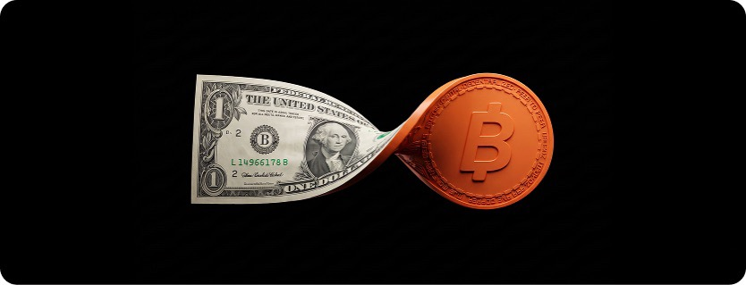

> *作者：ConorOkus*
> 
> *来源：<https://github.com/spiralxyz/bitcoin-payments>*

## 总结

“如果比特币最终只是 ‘电子黄金’，我觉得它就失败了。” —— 这是Jack Dorsey [在 2025 年 1 月的话语](https://www.youtube.com/watch?v=KyFkv5DGeUA&t=1250s) —— “如果它能成为一个人们可以每天使用的货币，那么它就成功了”。不是所有人都同意这种想法。许多比特币人会说，它首先必须作为一种价值储存物获得成功，然后才能指望支付。所以，我们不妨把问题说得更清楚一些：现在走的这条路，究竟会让比特币变得无足轻重，还是不经这样的磨砺就见不到比特币被支付需要的那天？本报告追问了，什么东西正在阻碍比特币支付，什么样的大胆想法能够加速普及。

比特币的支付能力前所未有地强。但变成日常用途，依然有困难。这种情形亟需改变，因为稳定币（stablecoins）已经准备好被大规模应用。

**我们的处境**？在过去 7 年种，比特币的支付技术已经极大提高。闪电网络基础设施已经进入生产场景，自主保管的钱包也已克服了绝大部分复杂性。7 年以前，开发一款比特币支付 app 要花费一年时间以上，需要许多开发者共同努力。今天，任何人都能给 AI 编程工具一个提示词、开发出第一个能用的版本。托管的比特币的集成难度与托管的稳定币差不多，但自主保管的依然难以推广。超过 100 万美国商家可以通过 “Square” 接受比特币支付。但是，很少有人在日常生活中使用比特币来支付，业内大多数人都承认这一点。鸿沟主要在于需求，而不是技术。

**为什么不得不改变**？广大的金融系统正在升级，因此提出了一个尚未有答案的问题：在这场转变中，现在被选择的支付渠道是会变得难以撼动，还是说支付渠道只是跟着人们的支付意愿和接收意愿走、软件会让添加支付渠道更加简单？当大型支付服务商升级支付渠道时，他们正在选择稳定币，而不是比特币。“Stripe”、“Shopify” 和 “Coinbase” 都在开发稳定币，主要的消费者产品中可能会紧随其后。Stripe、“Visa”、“American Express” 和 “Google”  也都加入了一个联盟，准备发行一种新的稳定币 “OUSD”，以及第一种让 AI 代理支付可以几乎完全用稳定币结算的协议实现。开发者会在他们的工具支持的轨道上开发，而钱包软件会支持他们的合作伙伴已经在使用的网络。AI 代理是最清晰的应用场景。它们需要小额的、可编程的支付；闪电网络也能满足，但第一款代理支付工具是围绕稳定币和信用卡建立的。如果这些选择会永远站住脚跟，那么比特币的劣势可能就难以逆转了。如果不会，那么问题就只剩需求了。

**阻碍因素有哪些**？

- **需求**：没有任何一方在推动这件事。持币者们更喜欢储蓄而不是花费，而且比特币的文化还鼓励长期持有。商家们喜欢用美元接收支付（并持有美元），很少接受比特币，新的支付平台也把它晾在一边。
- **价格波动和竞争**：价格波动使得商家很难用比特币给商品标价，而美元稳定币刚好能满足这种需要。
- **政策**：美国对每一笔买卖的税务处理以及待定的监管。

**哪些地方可以改变**？我们要找到革命性的想法：改变要足够大，大到改变比特币支付的模式，而不只是优化。一些值得讨论的可能道路：

- **共享支付渠道**：让人们能够通过同一个闪电网络来支付美元和比特币，并给出一个充分的选择它的理由，这样，比特币离人们已经在用的东西：代理支付、商家清账和金融科技 app ，就只有一步之遥了。
- **让最需要的人能用它来支付**： 自主保管的比特币能够更好地解决面临资本管制或不稳定通货的人的需要。
- **新的花费理由**：让现在的持币人有花费的动力。
- **新的花费方式**：设计产品体验，创造出全新的支付形式，比如给策展人支付、按用量给 AI 服务支付。小额支付的杀手级 app 可能完全不像传统的支付。

我们不知道哪个会有用，甚至可能它们全都没用，所以想听听各位的高见。

**我们想讨论什么**？我们的核心问题是：什么样的新想法，可能创造出一种有前景、可见的计划来加速比特币支付的接受程度？讲得再直白一些：“Meta”、Shopify 和 “OpenAI” 这样的大平台，要等什么时机才会接受比特币？

开发者：提出想法并测试这些想法。支付服务商：分享关于人们如何支付的数据。投资人：为最有希望的实验提供经济支持，帮助需求生长。

这是一个实时更新的文档。请在这个 [GitHub 讨论页面](https://github.com/spiralxyz/bitcoin-payments/discussions/1)分享你的想法或数据，或在 X、Stacker News、Delving Bitcoin 论坛上回复我们的帖子。我们会持续更新这份报告。

## 开放的问题

比特币，作为一种价值储存物，已经很大程度上成功了。但它会不会成为日常使用的货币，却还不明朗，而在乎比特币的人，对于如此少人使用比特币来支付这件事的重要性，也没有一致意见。

**一种观点是：现在这条路就是死胡同**。 Jack Dorsey 和其他人说，如果最终只是电子黄金，它就没有实现它的愿景：成为一种点对点的电子现金。 新的支付习惯正在形成。稳定币正在被集成到人们已经在使用的产品中，而比特币远离日常支付的时间拖得越久，它就越难被接受。一种没人使用的价值储存物，其价值也会完全依赖于人们继续相信它无需日常的应用场景来锚定它。

**另一种观点是：这就是必经的磨练**。许多比特币人都说，货币是一步步演化出来的：最初是一种价值储存物，然后会成为一种交换媒介，最终会成为一种记账单位。人们会花费自己最不信任的货币、储蓄自己最信任的货币，所以今天少人花费，是正常的，因为人们认为它还在升值。波动性也是这个故事的一部分。今天（2026 年 10 月）比特币的市值大概是 [1.3 万亿美元](https://fortune.com/article/price-of-bitcoin-10-21-2026/)，依然不大，大额的买卖就可以冲击它的价格，而且[波动性会随着市场扩大而降低](https://www.fidelitydigitalassets.com/research-and-insights/closer-look-bitcoins-volatility)。按照这种看法，比特币只有在市值再大许多倍、有广而深的市场来博弈价格时，才会变成日常使用的货币。对比特币支付的需要会在人们需要的时候自然到来，比如本地的通货崩溃，或者资金管制道理。现在我们的任务是确保技术准备就绪，在需求到来时能够接得住。

**怎么判断哪一种观点是对的呢？可能有几种信号**：

- 持币人中花费比特币的人比例是在上升还是下降
- 比特币的价格波动性是否会随市场扩大而不断降低（到目前为止，确实都如此）
- 花费比特币的习惯在高通胀或资本管制的地区是否发展得更快
- 当激励终结之后，人们会不会继续花费比特币

无论怎么说，现在投资支付领域的成本，与需求到来时错失良机相比，是微不足道的。本报告剩余的部分会解释什么阻碍了比特币支付的推广、如何推开这些障碍。

## 现状

本报告考虑了两件相关的事情，并会区分我们的发现适用于哪一件：

- **用比特币支付**：人们和企业花费和接收比特币 —— 作为一种货币。
- **比特币作为一种支付渠道**：使用比特币或闪电网络来转移价值，包括美元和稳定币。比如说，“Cash App” 的一个用户可以用美元来支付闪电发票。

重申一下，我们认为比特币的采用会阶段性推进：价值存储、支付渠道、日常货币。比特币已经基本上实现了第一阶段。第二阶段是第三阶段的一种稍弱的形式，但也比今天可用的任何一种开放的支付系统要强。长期目标是第三阶梯，可能要数十年才能实现。

在过去 7 年终，**技术已经有了长足的进步**：

- **基础设施已经成熟**：比特币支付背后的核心软件，从闪电节点到开发者工具箱，现在都已经足够稳定，可以运行在生产环境中并推广。
- **自主保管的钱包也更易用了**：钱包软件现在可以隐藏以往的许多难题，比如管理通道和流动性、离线收取闪电支付。比特币协议的一个广阔的生态系统也提供了不同的特性取舍。
- **集成更简单了**：托管的比特币的集成难度与托管的稳定币差不多，但自主保管的依然难以推广。
- **开发更快了**：一款比特币钱包，或者比特币支付 app，以往要好几个开发者花费超过一年来开发。但今天，有许多的代码库和 AI 变成工具，你只需几个提示词就能开发出一个可用的初版。
- **用户体验提升了**：备份和复原不再依赖于写下种子词。金额可以用 ₿ 符号显示为整数。支付地址可以直接读明白，就像邮件地址一样，并且可以重复使用。一个 QR 码就能同时携带比特币和闪电网络的支付指令。
- **更多团队在开发**：更多团队在基于开源的基础设施开发支付产品，其中有一些（基础设施）是由 Spiral 资助和支持的。

**支付已经可以大规模吞吐**。Cash App 支持闪电网络，超过 100 个美国商家可以通过 Square 来收取比特币支付。在某些付款渠道中，比特币和闪电网络可能比银行和汇款服务更快、更便宜，但通常稳定币还是会更便宜。

**但很少人在日常生活中花费比特币**，业界大多数人都同意这一点。

问题在于需求，而非技术。

## 为什么必须改变

广大的金融系统正在升级。美元稳定币在 2025 年7 月签署的 [GENIUS Act](https://www.whitehouse.gov/briefings-statements/2025/07/the-president-signed-into-law-s-1582) 之后，有了清楚的美国规则，主流的支付公司正在集成稳定币。值此这些公司升级自己的渠道之际，他们选择了稳定币，而不是比特币。到目前为止，稳定币的采用形式有以下集中：

- **稳定币作为消费者货币**：“PayPal” 和 “Venmo” 让用户可以持有、发送 [PYUSD](https://newsroom.paypal-corp.com/2023-09-20-PayPal-USD-is-now-available-on-Venmo) 并用它来支付。Shopify 在 2025 年 6 月[增加了 USDC 清账](https://www.shopify.com/news/stablecoins-on-shopify)功能（使用 Coinbase 和 Stripe）。
- **稳定币作为支付的基础设施**：Stripe [收购了稳定币公司 “Bridge”](https://stripe.com/us/newsroom/news/stripe-completes-bridge-acquisition) ，现在支持稳定币清账和基于稳定币的信用卡。“Open USD” 是一个由 Stripe、Visa、American Express、Google、BlackRock 以及其他超过 140 家公司背书的稳定币，[是在 2026 年 6 月推出的](https://joinopenstandard.com/blog/introducing-open-usd/)。PayPal 和 Fiserv [正在开发让 PYUSD 和 FIUSD 协同](https://investors.fiserv.com/news-releases/news-release-details/fiserv-and-paypal-expand-partnership-advance-stablecoin-payments)。
- 稳定币作为 AI **代理的货币**：[大约 99% 的支付](https://www.coindesk.com/business/2026/08/23/crypto-s-next-billion-users-might-be-ai-agents-and-they-re-paying-with-stablecoins)是通过 Coinbase 的 x402 协议发生的，用的是 USDC 。Google 的[代理支付协议（AP2）](https://cloud.google.com/blog/products/ai-machine-learning/announcing-agents-to-payments-ap2-protocol)支持稳定币（通过 x402）。Stripe 的[机器支付协议](https://stripe.com/blog/machine-payments-protocol)让代理们根据 API 调用来付费，在 Parallel 和 Browserbase 这样的服务上。

Meta 的 Muse 推出了[信用卡和钱包合作伙伴（比如 PayPal 和 Shop Pay）](https://thepaypers.com/payments/news/paypal-partners-with-meta-to-bring-checkout-to-muse-ai-agent)，而不是比特币，尽管 AI 代理需要的是小额的可编程支付，尽管这是闪电网络的初衷。

这就带来了一个问题：在这场转型中，现在被看中的支付渠道是否就此无法撼动？这是有可能的。开发者们会根据他们的工具支持的支付渠道来开发，钱包软件会推出他们的合作伙伴已经使用的网络。但软件也让添加新的支付渠道变得更加容易，而支付可能会单纯跟着走 —— 就看用户想用什么货币、得到了什么货币。如果初步的选择会一直维持，比特币的缺席可能难以逆转。如果不是，那么就只看需求了。

## 什么在阻碍比特币支付？

比特币还没有推出能够同时满足以下几个条件的点对点支付：信任最小化、可以大规模发生、便宜。但是，稳定币正在不如比特币的信任保证下得到采用，这表明，技术并不是妨碍比特币支付的因素。障碍可以分成三类，每一类都是可以解决的。

**需求：双方都没有推动它。**

- **最初怎么获得比特币**：比特币系统自身是不需要 ID 检查的，但在现实中，绝大部分人，都是在登录某个交易所或者 app、提交身份检查（KYC）之后才买到比特币的。几乎没有人是通过支付得到比特币，所以，在花费之前，你先要买到它 —— 这是信用卡和美元 app 都不需要走的一步。
- **持币者们更喜欢储蓄而不是花费**：绝大部分持币者都把比特币当成储蓄、避免花费这种他们觉得会升值的资产，而绝大部分消费者都已经有好用的信用卡了。
- **文化和市场营销**：比特币是由它自身的社区营销和推广的，就跟其他要买入和持有的东西一样。“永远不要卖出你的比特币” —— 这种信条自然没有给花费比特币留下什么空间，而向主流用户强调 “比特币” 又会面临普通的支付方式不会面临的阻碍。
- **消费者太少**：对于商家来说，接受比特币的好处在于手续费更低、更快结算，而不是持有比特币。但消费者需求太少，很少商家认为这点量值得付出努力来集成。并且，也很少支付服务商和电子商务平台默认支持比特币。
- **新的支付平台也把它晾在一边**： 正在推动电子支付的产品（比如 AI 代理），是随着信用卡、钱包和稳定币发布的，而不是搭配比特币或闪电网络，所以他们的用户永远不会把比特币当成一种选择。其中的理由并不是单方面的。部分原因是本节提到的障碍：来自用户和商家的需求太小，波动性、税务和监管不确定性。还有一些跟打造产品的公司自身有关。稳定币的发行者可以从他们跟合作伙伴的储备金利息中分享收益，而比特币没有这样者机制。比特币的名声让一些人心存疑虑。而且，哪怕是使用更新的工具（比如 [Spark](https://www.spark.money/)），自主保管的比特币依然比托管的选择更难集成。

**波动性和竞争**

- **波动性**：比特币的价格波动使得人们难以用它来给商品标价。在它的价格上涨期间，人们就会在花费时犹豫不决，而商家和支付 app 则会立即把它换成美元以躲避风险。波动性可能会随着市场扩大而降低，所以，这个问题可能会逐渐缓解。
- **来自稳定币的竞争**：当人们想用美元来支付和收取支付时，稳定币是能直接满足需要的。稳定币也运行在区块链上，开发者可以开发支付逻辑，比如第三方保管（escrow）或者自动化支付。一些开发者将这种可编程性作为选择稳定币而非比特币的理由。

**政策**

- **税务**：在美国，[花费比特币会被当成卖出了它](https://www.irs.gov/pub/irs-drop/n-14-21.pdf)，所以，哪怕你是买一杯咖啡，也会产生一笔要申报的收入或损失。国会曾提出豁免小额支付的法案，但无一被通过。
- **监管**：[CLARITY Act](https://www.congress.gov/bill/119th-congress/house-bill/3633) 本来尝试为密码货币市场设定规则、保护自主保管软件的开发者，但在 2026 年 9 月的参议院陷入停滞。这让开发支付产品的公司面临更高的成本和更多不确定性。

还有一些技术摩擦力。支付失败的情形让比特币支付更不好预测，但这也无法解释为人们甚至连尝试都不做。

## 比特币的对比对象

比特币和稳定币都有各自擅长的领域。下面这种表格根据对支付有重要意义的属性对比了两者。它还显示了今天大多数人是否关心这些，已经比特币在过去 7 年中的进步。

| 属性 | Bitcoin（包括 闪电网络） | 稳定币 | 人们在乎吗？ | 比特币在过去 7 年中的变化 |
| :--- | :---: | :---: | :---: | :---: |
| **构成开放货币的属性** |  |  |  |  |
| 固定的货币政策 | ✓ | ✗ | 不 | 保持不变 |
| 资金无法被没收或冻结 | ✓ | ✗ | 不 | 保持不变 |
| 任何人都可以使用，无须身份检查 | ✓ | ✓ | 是 | 保持不变 |
| 没有发行人可以在事后要求身份严查 | ✓ | ✗ | 不 | 保持不变 |
| 无人可以阻拦支付 | ✓ | ✗ | 不 | 保持不变 |
| 支付可以保持私密（面对其他人） | Partial | Partial | 是 | 稍有提升 |
| 支付可以保持私密（面对服务商和政府） | Partial | ✗ | 不 | 稍有提升 |
| **使用便利性** |  |  |  |  |
| 方便开发者（托管方案） | ✓ | ✓ | 是 | 大大提升 |
| 方便开发者（非托管方案，大规模交付） | Mostly | ✓ | 是 | 大大提升 |
| 方便用户 | ✓ | ✓ | 是 | 大大提升 |
| 低手续费率 | ✓ | ✓ | 是 | 大大提升 |
| 吞吐量大 | ✓ | ✓ | 是 | 大大提升 |
| 流式支付 | ✓ | ✗ | 目前不关心？ | 大大提升 |
| **接受度** |  |  |  |  |
| 价格稳定 | ✗ | ✓ | 是 | 小幅改变 |
| 广泛接受 | ✗ | 迅速增长 | 是 | 小幅改变 |
| 受欢迎的税法和监管 | ✗ | ✓ | 是 | 稍有提升 |
| **其他** |  |  |  |  |
| 可编程性 | ✗ | ✓ | 不? | 小幅改变 |

三件事浮现出来：

- **比特币在开放货币上领先**。没有发行者可以冻结资金、阻拦支付或改变货币供给量。今天绝大部分人都不看重这些属性，但它们对于面临资本管制或不稳定通货的人是最重要的好处。
- **至于使用便利性，比特币已经基本追上了**。手续费、吞吐量，以及开发者和用户体验，在过去 7 年中都有了重大提升。
- **稳定币在今天大多数人在乎的事情上领先**。它们的优势 —— 稳定价格、广泛接受以及政策清晰 —— 也是比特币进步最小的地方。

短期内，稳定币可能会在新的支付渠道 —— 主要是以太坊、Solana、Tron 和 Base 这样的网络 —— 上承接绝大部分美元支付，不会使用闪电网络。稳定币解决了波动性问题，但也带来了可以冻结资金的发行人，这也是比特币的开放属性依然重要的原因。

## 如何改变这一切

我们正在寻找异想天开的想法：改变要足够大、可以大大加速比特币支付的采用，而不是仅仅优化它。以下是作为讨论起点的四种可能的路径 —— 排序并无含义，都给出了可能的案例。

**共享支付渠道**。让人们能够通过同一个闪电网络来支付美元和比特币，并给出一个充分的选择它的理由，这样，比特币离人们已经在用的东西就只有一步之遥了。比如说：

- **在 AI 支付中使用闪电网络**：与 AI 代理平台和支付标准机构合作，确保在做出关键的设计抉择时，闪电网络 —— 同时支持比特币和稳定币 —— 还被放在台面上。
- **让金融科技 app 默认支持比特币支付**： 大多数人都从来没在自己使用多时的 app 上看到比特币作为一种支付选择。 即插即用的集成方式，应该能让任何金融科技 app 都可以轻松启用比特币以及其他网络和稳定币，让比特币能够呈现在更多人眼前。
- **先考虑支付，再考虑资产**：由于波动性和名声，向商家和主流用户强调 “比特币” 会遇上阻力。而强调一种更便宜、更快的支付方式就容易多了。比如说，给商家提供闪电网络作为一种新的、手续费更低的支付选择，让消费者通过 Cash App 这样的应用，使用美元来支付。比特币，跟稳定币和其他网络一样，运行在幕后，保持隐形状态，直到更多人愿意持有和直接花费它。

**让最需要它的人使用它**。自主保管的比特币最适合那些于面临资本管制或不稳定通货的人。对于这些人来说，比特币的开放属性一直都重要，不是某个时刻才重要。

**新的花费的理由**。给现在的持币者提供花费比特币的激励，比如打折或是支付比特币的奖品。这将能测试出，持币者们会不会因为某个理由而花费，以及，是不是这种激励一停止就不再花费。

**新的花费方式**。设计产品体验，创造出全新的支付形式，比如给策展人支付、按用量给 AI 服务支付。小额支付的杀手级 app 可能完全不像传统的支付。比如：

- **流式支付**：闪电网络可以持续不断地支付非常小的数额，为服务付费，比如说：为点对点的 AI 接口按秒支付。
- **更大胆实验**：app 以新的方式创造和传递价值，从而创造需求而不是等待需求。

**我们怎么知道它有没有用**？实验应该度量多少消费者花费了比特币、他们间隔多久会再次花费比特币，以及花费的数量、价值以及支付在他们的比特币储蓄中的比重。还应该追踪他们在激励结束之后还会不会花费比特币，以及，如有可能，把有能力花费比特币的消费者跟条件类似但没有比特币的消费者比较。单纯用来路由美元支付的比特币不能算在花费数额中。

## 留给读者的问题以及贡献指南

我们尤为关注你们在以下问题上的想法和建议：

- 现在的模式是死胡同，还是让比特币变成支付工具的必经之路？
- 今天人们选择的支付渠道会固定下来，还是只要需求存在，就很容易添加新的渠道？
- 我们遗漏了哪些阻碍？
- 如果你在支付中选择稳定币而不是比特币，可编程性是一个原因吗？比特币或闪电网络需要提供什么特性？
- 比特币应该如何与稳定币和信用卡网络竞争？在哪些地方不必花心思？
- 大平台，比如 Meta、Shopify 和 OpenAI，要如何才会采用比特币？
- 什么养的想法能够改变比特币支付的走向？
- 关于支付量、增长、活跃商家和支付成功率，你有什么数据可以分享吗？

这是一份可以更新的文档。请在这个[讨论页面](https://github.com/spiralxyz/bitcoin-payments/discussions)分享你的想法或数据，或在 X、Stacker News、Delving Bitcoin 论坛上回复我们的帖子。我们会持续更新这份报告。要提出纠正或直接编辑这份报告，请看 [CONTRIBUTING.md](https://github.com/spiralxyz/bitcoin-payments/blob/main/CONTRIBUTING.md) 。

## 参考文献

（略）

（完）