> *作者： Loïc Morel*
> 
> *来源：<https://wizardsardine.com/blog/the-multivendor-multisig-standard/>*

在 Coldcard 签名器安全事故之后，一些人推荐用掷骰子来生成种子词，或者为种子添加一个密语（passphrase）。但两者都不能抵御下一次故障。真正能同时降低失盗和丢失两种风险、而不是顾此失彼的办法，是使用来自多家制造商的设备来组建多签名装置，并使用带有时间锁的复原路径。本文将解释其中的道理，以及在考虑预算的前提下，如何在 Liana 钱包软件中建立这样的装置。

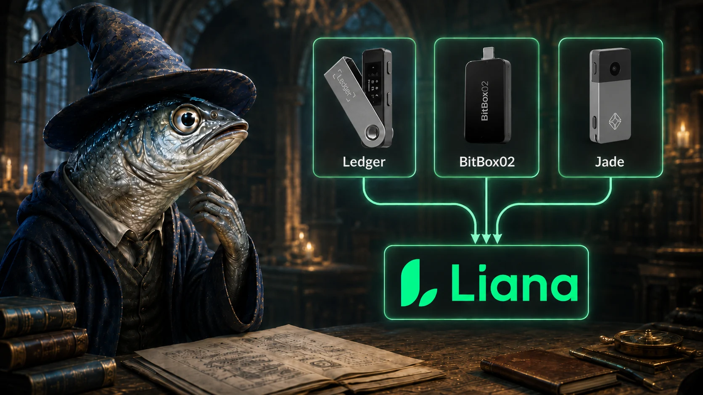

- 来自不同制造商的签名设备连接到一个多签名装置中 -

2026 年 7 月 30 日，一名攻击者榨干了属于 Coldcard 签名器的用户们的总计 1196 个地址，盗走了超过 1000 BTC 。余波一直持续到 8 月 6 日。不同的报告给出的损失数字略有不同，但根据 Galaxy 的报告，大约有 1700 BTC 在一周内被盗；如果算上可疑地址，则高达 2,400 BTC ，总价值超过了 1 亿美元。事故的源头既不是恶意软件，也不是用户操作错误，而是驱动设备的固件中包含了一个简单的随机数生成器（RNG）漏洞，这个漏洞存在了 5 年时间而没被发现。我们已经在 8 月 1 号撰文[介绍了这次安全事故](https://wizardsardine.com/blog/coldcard-rng-vulnerability/)（[中文译本](https://www.btcstudy.org/2026/08/04/critical-coldcard-flaw-what-happened-who-is-affected-and-what-to-do/)），然后在 8 月 11 号撰文[介绍了这个漏洞的技术细节](https://wizardsardine.com/blog/coldcard-vuln-deep-dive/)。

自那以来，推特上一直在流传两种建议：“你应该使用骰子来生成种子词” 以及 “你应该使用一个密语”。这两种动作，确实保护了一些 Coldcard 用户。但是，将它们当成是一种通用的规则，则是错误的推理，我会尝试说清楚其中的道理。

应该问的问题并不是 “什么操作可以保护你免受此次故障的影响”，而是 “如果还有下一个 bug 可能袭击你信任的设备、但现在还没有人发现，哪种安全模式还能成立？”

**我的答案是：使用来自多家制造商的设备来组建多签名装置，并使用带有时间锁的复原路径。**

## 长话短说

- Coldcard 签名器事故（一个 RNG bug）在推特上引发了两种建议：使用骰子来生成种子词，以及，给你的种子词添加密语（passphrase）。两者都能在这次事故中保护用户，但将它们当成一种通用的办法，则是一种仓促的总结，而且有幸存者偏差：这种想法考虑的是最近发现的 bug，而不是如何应对下一个 bug 。
- 使用多厂牌设备搭建的多签名装置，其特性是没有任何一条花费路径可以被来自单一家制造商的设备（所生成的密钥）满足。这是将航空业的冗余安全机制用在比特币上：一个固件、熵采集、签名生成或是供应链的故障只会导致一个密钥暴露，而单个密钥无法满足主花费路径的签名阈值。
- 结合 Liana 钱包软件的带有时间锁的复原路径，这种任何用户都触手可及的模式可以同时降低失盗和丢失两种风险、而不是用提高另一种风险的代价来降低一种风险。
- 完全依靠手动掷骰子来生成种子词的办法在现实中并不存在：没人能手算 SHA-256 校验和，所以，最终这个种子还是要进入一个人们以为无需接触的机器。硬件签名器强制用户输入最少一定数量的掷骰子结果，只能解决一个问题 —— 就是信任这家厂牌的 RNG 的问题 —— 别无其它作用。
- 密语没有校验和，对大小写敏感，很难在离线环境下用真正随机的方式生成，每次花费都要输入（很麻烦），而且在丢失风险上带来了第二个单点故障。它跟种子一样要通过同一个固件，所以无法抵御签名环节的 bug、恶意固件和供应链爆破。
- 泰斯勒定律：多签名难以理解，但是用起来更简单，因为复杂性都在软件层面，不在用户层面。
- 带有复原路径的多签名装置的唯一缺点是：在链上留下更容易辨识的足迹，以及需要定期刷新时间锁。
- 备份的元素有两个，种子词和描述符；（BIP-138）加密的 `.bed` 描述符可以复制到任何地方，不会带来风险。
- 别给自己设障：只要资金损失会给你带来真实的痛苦，就值得使用最好的系统。对于预算紧张的用户，一些多厂牌多签名装置只需你购买一个硬件签名器。

## 什么是多厂牌设备的多签名装置？

“多签名钱包” 的概念是说，这个钱包里的比特币需要来自多个密钥的签名才能花费出去。我们用 “M-of-N” 来表述这种模式：在 N 个密钥中，至少 M 个参与签名，才能花费出去。以 2-of-3 为例，你持有 3 个密钥，需要其中 2 个才能花费（但任意 2 个就够）。

而 “多厂牌设备” 这个限定词的含义是，我们还要看这些密钥是怎么存储的：每个密钥都必须放在来自不同厂牌的一个签名设备中。比如说，我们要用一个 Ledger、一个 BitBox02 还有一个 Jade，而不是用  3 个 Ledger 。我们后面会看到， 带有时间锁的复原路径（在你还会移动资金时保持常关，当你长时间不移动资金后开启）如何成为补充。。

这种限定，在生命攸关系统的工程学中有一个专用名词：相异冗余性（**dissimilar redundancy**）。

为了容忍一个硬件故障，同一个模块多装几个（增设相同的副件）就够了。但是，想要对冲一种设计错误，光复制是不够的，因为如果这 2 个副本都有同样的缺陷，就可能同时失效。因此，冗余的部件必须由另一个团队来设计，使用不同的原料和不同的软件。这就是为什么现代客机的飞行控制依赖于多个电脑，这几台电脑有不同的处理器和单独开发的软件，从而一个 bug 不会使它们全都崩溃。

你可以运用同样的原则来保护你的聪（比特币）。一个基于 3 台 Coldcard 签名器的 3-of-3 装置从定义上来说确实是多签名钱包，但它没有相异性：2026 年 7 月的这场事故可以同时暴露所有 3 个密钥，足以满足阈值、盗窃资金。同样是 3-of-3 多签名装置，使用来自不同制造商的 3 个设备，在遭遇这次事故时还可以保证资金安全，因为只有 1 个密钥暴露了， 但只有这一个密钥就不足以盗窃资金，对攻击者来说没有什么价值。

不过，如果其中一个设备出了故障，那么整个装置的安全余量也下降了：因为可以假设其中 1 个密钥已经暴露了，那么这个钱包现在只能基于 2 个健全设备提供  2-of-2 的对抗失盗的抗性，虽然花费还是需要 3 个签名（但其中一个签名已经唾手可得）。所以，你可以按自己的节奏换掉这个受影响的设备，无需跟攻击者赛跑。

理论上，这些硬件的硬件、固件、随机数生成器、供应链、开发团队都不相同。攻击者若要成功，需要在每一家制造商寻找独立的漏洞，并且总数量达到阈值（对 3-of-3 装置来说是找到 3 个、对于 2-of-3 装置来说是找到 2 个），并且需要同时爆破这些漏洞，从能攻击你的钱包；这显然比单一一家厂牌出现一个漏洞的概率小得多。

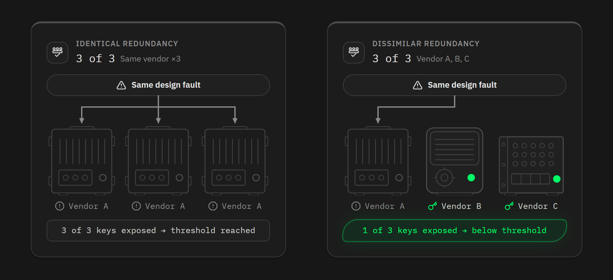

## 没有哪家硬件签名器制造商是无懈可击的

显然，现在的事态是所有人都盯着 Coinkite 公司。Coldcard 签名器事故从后果看是最严重的，但并非个例：

- 在 2018 年，Saleem Rashid [绕过了 Ledger Nano S 的固件验证程序](https://saleemrashid.com/2018/03/20/breaking-ledger-security-model/)；理论上，这让攻击者可以在设备发货时预先写入种子词。
- 同一年，他[重构出了一个 BitBox01 签名器隐藏钱包中的密钥](https://saleemrashid.com/2018/11/26/breaking-into-bitbox/)；
- 在 2018 年底，Thomas Roth、Dmitry Nedospasov 和 Josh Datko（[wallet.fail](https://media.ccc.de/v/35c3-9563-wallet_fail)）通过故障注入抽取出了存储在一个 Trezor One 签名器中的种子；在 2019 年，[Ledger 的安全团队 Donjon](https://www.ledger.com/blog/unfixable-key-extraction-attack-on-trezor) 复现了这种攻击方法。
- 2019 年在[KeepKey 硬件上](https://blog.kraken.com/product/security/flaw-found-in-keepkey-crypto-hardware-wallet)、后来在 2020 年初[在 Trezor One 和 Model T](https://blog.kraken.com/product/security/kraken-identifies-critical-flaw-in-trezor-hardware-wallets) 上，Kraken 在 15 分钟内完成了同样的攻击，所用的工具预计不到 100 美元。
- 在 2020 年，Shift Crypto 证明，[Coldcard 签名器可能会在验证一笔测试网交易时生成主网格式的签名](https://benma.github.io/2020/11/24/coldcard-isolation-bypass.html)；几个月后，[同一设备又被发现没有检测到在一个多签名装置中一个联合签名人的 xpub 已被替换](https://benma.github.io/2021/02/09/coldcard-multisig-vulnerability.html)。
- 在 2023 年，我们的 CEO，Kévin Loaec，[在 Ledger 的 Bitcoin 应用中的 Miniscript 编码中发现了错误](https://wizardsardine.com/blog/ledger-vulnerability-disclosure/)。
- 同年，[Ledger 的 connect-kit npm 软件包被劫持](https://www.ledger.com/blog/security-incident-report)（通过钓鱼前员工）。
- 在 2024 年， [Donjon 通过故障注入读取和修改了一个 Trezor Safe 3 的固件](https://trezor.io/vulnerability/donjon-s-trezor-safe-3-evaluation)。
- 在 2025 年，Blockstream [修复了 Jade 中出现的一个堆栈溢出漏洞](https://blog.blockstream.com/jade-security-disclosure/)。
- 2026 年 8 月，BitBox [披露并修复了 BitBox02 中的 3 个漏洞](https://blog.bitbox.swiss/en/bitbox-08-2026-dixence-update/)；其中一个允许攻击者在成功钓鱼之后，诱骗用户安装恶意固件到一个未篡改的设备上。

> 这个列表只是其中一部分案例。整个生态系统有数十个披露出来的漏洞，我们这里的目标并不是列举所有。还要记得，没有出现在列表中的制造商并不一定更安全，因为安全记录更多是反映得到了审计和发布的案例。

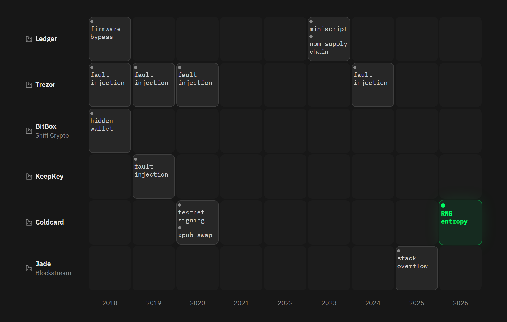

这些事故并不能说明这些厂商是坏厂商，而且，从中得到的结论也不该是我们去找一家完美的厂商吧，因为这样的厂商并不存在。Coldcard 签名器事故以及所有其它漏洞，给我们的教训应该是，要接受这样一个事实：硬件签名器，乃至广义的任何系统，都可能有漏洞。不存在零风险的系统。

但是，保护比特币跟保护其它数据不一样。登录的口令被盗了你可以改，遇到信用卡诈骗你能得到退款，误删文件你可以从备份恢复 …… 但一笔比特币交易，是无法取消的。而且比特币是货币，意味着你多年的努力工作、家人的安全网、自由、创业项目、退休金 …… 这是很难从中缓过来的损失。这就是为什么，在别的计算机系统中可以接受的安全等级，在这里是不能接受的。比特币用户的目标是打造一个钱包，能够从任何一个存储或处理私钥的设备的故障中幸存。

还要注意，相异性难求绝对。比如说，Trezor One 跟 KeepKey 签名器使用同一款 STM32 微控制器。Coldcard 签名器和 BitBox02 也是用同一款安全芯片（Microchip 的 ATECC608）。Coldcard 签名器曾经使用一个从 Trezor 的密码学库派生的库（在导致本次事故的漏洞被引入代码库之前）。所有设备都实现了 BIP-32，而且通常，你都是用同一台电脑给签名设备传输待签名的交易。你可以可以追究更加底层的东西 —— 这些签名设备都使用 secp256k1 椭圆曲线，并且绝大部分都使用同一个 `libsecp256k1` 代码库（来自 `Bitcoin Core` 或者某一个复刻）。

因此，选择来自不同厂牌的设备也不能保证故障模式完全独立。总会有一些元件，是不同品牌的两个设备都使用的（只不过，是较为底层的元件）。但选择多厂牌设备的多签名装置，依然能让你尽可能接近相异冗余性，并且，每少一个共同层级，就少一个共同的故障模式，因此受攻击面也更小。多厂牌设备的多签名装置的优势在于， 只需要这一个决定，就能消除你的钱包的许多单点故障（SPOF）。

（译者注：“单点故障” 指的是只要这一个点出了故障，整个装置就不安全的脆弱环节。）

## 多厂牌设备的多签名装置应对了哪些风险？

为了判断一种安全模式，你要检视弄丢比特币的两种可能：被盗、弄丢。失盗是别人拿走了你的钱；弄丢是再没有人能花费这笔钱，包括你自己。

几乎所有提供给给人的解决方案都是用一种风险来交换另一种风险。密语可以减少失盗，但增加了弄丢的风险。使用单签名钱包、把同一套种子词的 3 个备份放在不同地方，降低了丢失风险，但增加了失盗风险。使用多签名，但使用全体签名模式（N-of-N），减少了失盗风险，但增加了丢失风险，因为你不得不保管多个种子，而且只要弄丢一个，你的资金就全弄丢了。

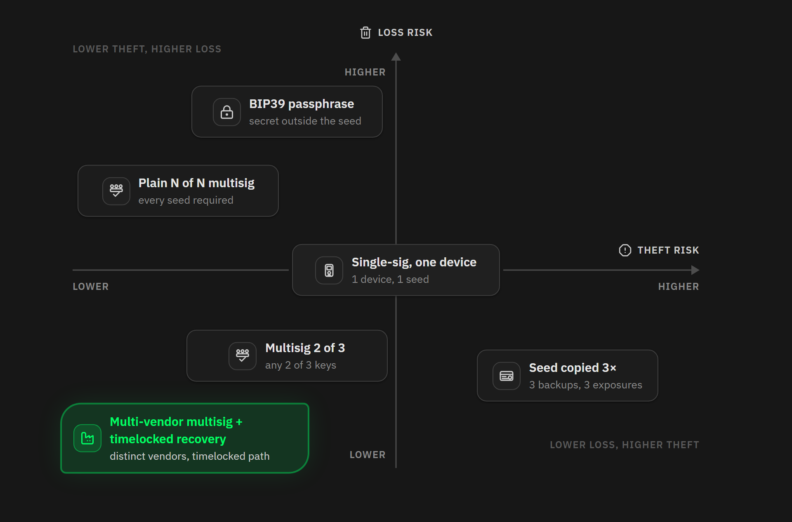

针对盗窃，多厂牌设备的多签名装置比依赖于单一设备多覆盖了广泛得多的风险：

- 像此次 Coldcard 签名器事故一样的 RNG（随机数生成器）漏洞：只有来自 N 台设备中的其中 1 台的种子是可以预测，但这还不能满足花费的阈值。
- 带有故障的或者恶意的固件，无法正确地签名，或者会从签名中抽取初种子：每个设备都只提供所需签名中的一个，也只知道自己存储的密钥。
- 设备在供应链中被篡改。
- 屏幕说谎：一台被攻破的设备可能会显示假的地址，但每个签名器都会检查目标地址以及找零地址（根据注册好的花费策略），并且，你可以在任何一台设备上显示收款地址。攻击者将不得不欺骗你的每一台设备，才能让假地址骗过检查。
- 一个设备或者一台种子词失盗：只有一个密钥，是无法花费的。
- 某一家厂牌的芯片或者安全芯片中带有漏洞：其它设备使用其它款式的芯片。
- 出现了签名 nonce 复用或 nonce 并非完全随机，这会泄露那台有故障的设备私钥：但也只泄露这一个。
- 固件升级中带有漏洞，或者厂家的固件签名密钥被盗（从而可以污染固件升级内容）：只影响这一家的设备。
- 等等。

在所有这些场景中，分析都是一样的：攻击者必须成功在同一时间爆破多个独立的目标。

至于丢失，那就是带有时间锁的复原路径派上用场的时候了。感谢 Miniscript，使用 Liana 软件构造的钱包可以超越固定的 M-of-N 方案。它为钱包定义了一条主要路径，是可以随时花费的；还有一条或多条复原路径，带有以区块数量计算的时间锁，只有在一笔资金长期未移动时才会启用。在实践中，你可以为日常花费设置 3-of-3 的花费条件；如果资金长达 6 个月未移动，则只需 2 个密钥；如果长达 12 个月没有使用，就只需 1 个密钥。弄丢了 1 个设备？不必紧张，你可以等待一段时间，然后用剩下的密钥移动资金。弄丢了 2 个设备？也一样，只是要等待的时间更长。这些条件会写在锁定资金的比特币脚本（地址）里面（通过 Miniscript 来编写），并由比特币网络的共识机制来强制执行。没人可以提前打开一个复原路径。

（译者注：这种最终会降级到只需 1 个设备的花费策略也有一些危险性。）

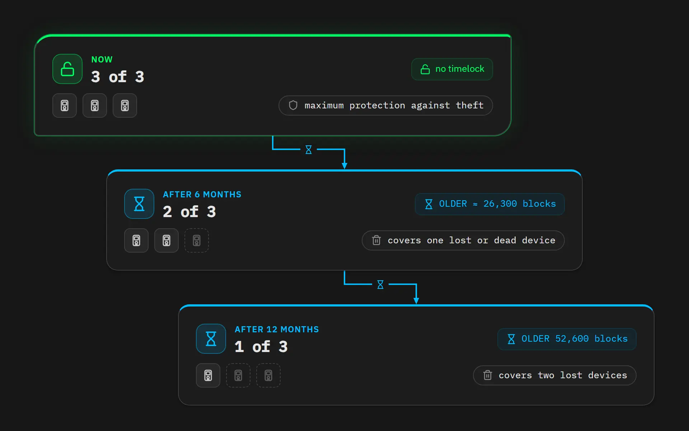

两者的结合，让这个模式非常有趣。多厂牌设备的多签名装置，减少了盗窃风险；带有时间锁的复原路径降低了弄丢风险；两者都增强了，没有恶化，因为复原路径并不是随时可用的。盗窃保护依赖于全体签名模式，而丢失风险则用时间流逝来对抗（而不是用额外的密钥来保护）。没有其它免信任的解决方案能够同时降低两种风险而不顾此失彼。

现在，我们来看看替代方案，以及为什么我认为对比特币用户来说，它们不如多厂牌设备的多签名装置。

## 听起来不错的答案

我们来看看从 7 月 30 日以来流传在 Twitter 上的两种建议。

### “那就掷骰子吧”

面对这次 Coldcard 安全事故，第一种反应是说，问题处在信任这家厂牌的随机数生成器，所以，解决方案是自己采集熵，就用骰子。这分析并没错，但并不完整。现在只有两种办法能从骰子生成种子。

第一种办法是完全依靠纸和笔。将掷出来的点数转化成词很容易，但计算校验和是难题。一套 BIP-39 种子词的最后一个词包含了一个校验和（12 词时是 4 个比特，24 词是 8 个比特），来自熵的 SHA-256 哈希值。手算它，在理论熵是不可能的，会花很长时间，而且出了一点点错误你就要从头再来。

所以在现实种，完全靠骰子和纸币产生种子词的路并不存在。要么最后要靠一个硬件签名器来收尾，那么你就变成了下面要说的第二种方法；要么你最终需要把骰子点数输入一台计算机，最好就是 Tails OS 操作系统并且是离线的，以限制生成过程种的暴露问题，但它依然是一台电脑，有不计其数的攻击面。而且，你竟然把种子输入到电脑中 —— 根据硬件签名器的安全模式，种子永远不应该离开签名器 —— 这是非常糟糕的做法。

BitBoc 提供了[一种办法](https://bitbox.swiss/blog/roll-the-dice-generate-your-own-seed/)来解决校验和问题：先用骰子掷出 23 个词，然后用 BitBox 来为你计算第 24 个词。这就不受我上面这一段的批评，因为是硬件签名器收尾，不是电脑。但只有 BitBox02 能这么做， 哪怕它不是你计划使用的签名器，你也只能求助它；而且，掷骰子这个过程还有来自人自身的风险，这个我们后面再说。

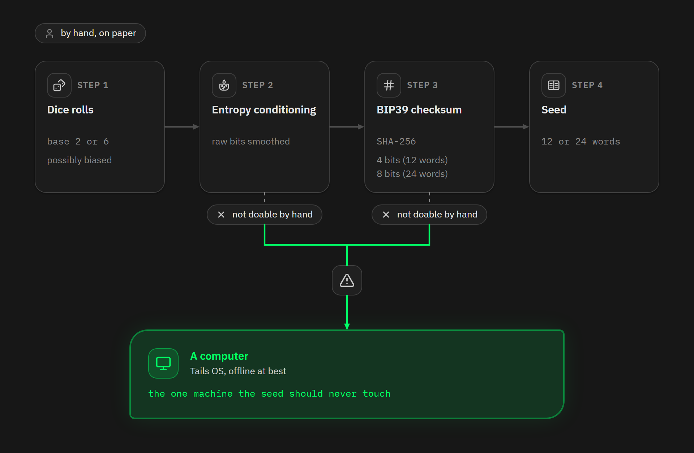

第二种办法是把点数直接输入提供这个功能的硬件签名器 ，比如 Coldcard 或者 SeedSigner 。这要好得多，因为点数的换算和校验和的计算都是在一个设备内完成的，并且，这正是保护了一部分 Coldcard  签名器用户不受此次事故影响的模式。但这里面依然有一个重要的条件：设备必须强制你投掷一定次数，比如， 6 面骰子至少要投 50 次，才能采集到 128 比特的熵；要采集 256 比特的熵就必须投至少 99 次。如果不强制，用户可能会创建出非常弱的种子，自己还一无所知。

即便是发送在一个设备内，种子的质量依然依赖于用户的输入，因为设备只是哈希你输入的点数，不会添加任何熵。问题不在骰子熵。普通的骰子也没问题：[在这个问题上的最大规模的研究](https://link.springer.com/article/10.1007/BF02291418)，投掷了 438 万次骰子，发现精密赌场骰子和理论完美骰子没有区别，只有廉价的带孔骰子才会出现微小的偏倚。危险来自人本身，因为凭感觉、凭记忆输入的点数没有任何熵可言，只有真正投掷出来的点数才有熵，那么，贪方便图快捷而跳过的次数会减少总的熵量；而且，如果投掷过程被他人看到了、记录下来了，也就不再是个秘密。Coinkite 公司在他们的说明书中总结了 3 条建议：使用公平的骰子、私下投掷、投够一定的次数。但在这 3 个方面，每一个方面都可能出现误操作，而且没有警告灯可言。

此外，你还需要证据，确认设备真的将你的点数转化成了种子，并且密钥来自这个种子。如果你要直接检查，避免信任这家厂牌，就要在来自另一家厂牌的第二台设备上重新运行整个计算（如果两台设备使用相同的方法，那么同样的点数输入， 就应该得到同样的种子词，然后导入种子词来对比 xpub）。在这种情况下，你就已经有来自 2 个厂家的 2 个不同设备了，已经走完了搭建多厂牌设备多签名装置的第一步，只不过现在，这两台设备持有同一个种子， 所以任何一个设备有漏洞都会暴露它。有一种比较方便的、间接的检查：先在设备上输入一次点数，然后在电脑的程序上输入一次，确定会得到相同的结果，再从头投掷一轮，这一次就直接输入设备，不再暴露。这样做能捕捉 bug，但不能检查出有选择性错误动作的固件。而且，这些检查自身都比搭建多签名要更加复杂。

而且，即使这些事情都正确地做完了，也只解决了一个问题：信任这个供应商的随机数生成器。它不能帮你抵御不正确签名的固件、说谎的屏幕、供应链攻击、从签名中抽取种子词的攻击，以及任何其它可能出现在依赖于单一设备的单签名装置中的问题。

（译者注：“从签名中抽取种子词的攻击” 指的是一种隐蔽的攻击：在签名过程中，将 种子词/助记词 编码到 nonce 中，随着签名一同发布；从表面看不出异样，但在发布几次签名后，nonce 中的信息便足以让攻击者知晓种子词。一般认为这种攻击的前提是给签名设备安装恶意的固件。）

还要考虑到这些事实 —— 使用骰子来生成种子是复杂的、在电子设备之外几乎不可能正确完成、我们也不想要求每一个初学者都这样做。当人们批评说多厂牌设备的多签名装置很复杂的时候，我回答说骰子生成种子词其实更复杂。

### “那就加一个密语”

第二种建议更流行：使用带有密语的单签名装置。

BIP-39 密语（passphrase）是可以任意书写的纯文本，钱包软件将它作为一个 “盐”，放到从助记词派生二进制种子的过程中（这个种子再用于密钥派生），所以，光知道助记词就不足以派生出实际使用的私钥，也就没法花费钱包中的比特币。需要同时持有助记词和密语才能得出正确的私钥。

这种构造有 3 个直接的后果：

- 其一，密语本身没有校验和。不同的密语会得到不同的二进制种子，全都是有效的，然后得出一个有效的钱包，只不过是空的，没有存资金，整个过程你不会得到任何纠错信息。
- 其二，密语区分大小写和空格。
- 其三，密语是完整的第二个秘密：备份它并不比备份第二把密钥更简单。

规范也要求使用 Unicode 规范化（NFKD），并不是每一个实现都用了：比如说，[bitcoinj](https://github.com/bitcoinj/bitcoinj/blob/master/core/src/main/java/org/bitcoinj/crypto/MnemonicCode.java)会使用原始的密语来派生二进制种子，而其它钱包（比如 [Sparrow](https://github.com/sparrowwallet/drongo/blob/master/src/main/java/com/sparrowwallet/drongo/wallet/Bip39MnemonicCode.java)）遵循了 BIP-39 ，就不是这样做的。结果是，一个包含了 “é” 的密语，在不同软件上可能打开两个完全不同的钱包。

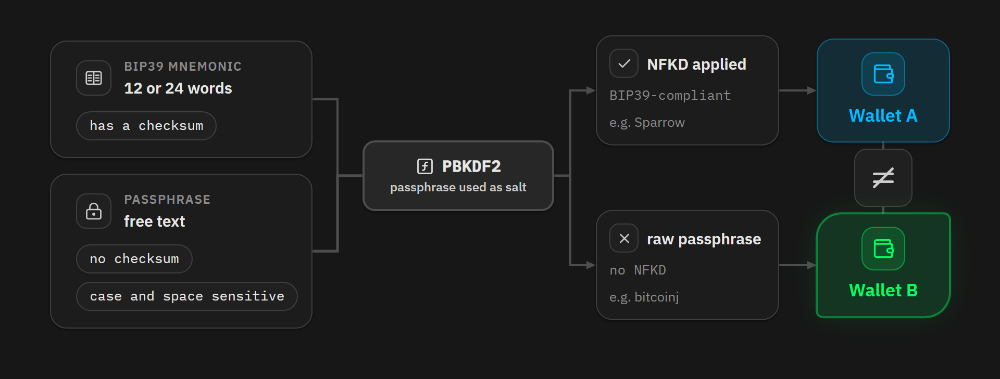

这些东西，对初学者来说并不是显而易见的。如果你想要使用密语，我认为你必须先对 HD 钱包的架构及其实现有个坚实的理解，不然你等于冲向悬崖。

但除了密语本身的工作原理，怎么生成它才是真正困难的部分。密语的强度由它所包含的熵决定，而人本身是糟糕的随机源。为了形成真正的保护，能够应对种子词本身被泄露的情形，密语必须是随机的、离线生成和保存的。这不是凭直觉就能做到的，比如就挑一个对你自己有特殊含义的词，这是不行的。你需要掷骰子或者一种经过证实的办法，而且密语不能输进电脑，也不能用电脑来生成。从 Coldcard 事故后人们发在社交媒体上的帖子来看，我认为绝大部分密语用户都没有遵循这些方法，而且他们的密语都比自己认为的要弱得多。

此外，密语的设计目标不包括让你记忆。若要真正有效，其长度就几乎一定超过你的记忆能力。而且，只记在自己脑子里、不安排任何备份，也是极度危险的。如果你的密语你能熟记在心，很可能它要么不够长，要么不是真正随机。

当然，我们可以假设你会离线生成一个足够长的、真正随机的密语。那么，你要怎么处理它呢？时间会流逝，这个密语也不存在任何设备中；你每次签名都要重新把它输入设备（除非你使用的设备提供存储它的功能，比如 Ledger ，用第二个 PIN 码来保护你的密语）。

在只有两个小小按钮的设备上，输入它并非易事。你必须从长长的列表中仔细选择每一个字符，一个接一个，一次错误都不能犯。输错了？那就从头再来吧。任何尝试过在（比如说） Coldcard Mk 或者 Ledger Nano S 上输入过密语的人，都知道这过程多么煎熬。

有人说如果是日常花费，那么带有密语的单签名装置用起来比多签名装置更方便，我认为这种说法是错的。 多签名装置虽然在搭建的时候要花更长时间，但一旦配置好，用起来会更简单：在运行软件的设备上插入 2 个或 3 个签名设备、签名交易，怎么会比你用两个小小的按钮、输入无法熟记的 40 个字母更难呢？

然后你也必须备份这个密语。它是第二个致命的备份元组，你要 写在/刻在 耐久的材质上，跟助记词分别放置，而且没有重置或者复原机制。换句话说，密语并没有消除单点故障；它创造了另一个单点故障。弄丢了助记词，你就弄丢了所有；但是弄丢了密语，你也同样什么都不剩。密语降低了种子词被盗所造成的影响，这没错。但它倍增了弄丢的风险，而带有复原路径的多签名装置可以同时降低两者，甚至如果你选择不备份种子词，那它的备份更加简单（详见后文）。

最后，还剩一个问题：它到底抵御了什么，不能抵御什么？（就假设它足够长、足够随机）它抵御了助记词被盗的情形， 抵御从休眠设备中抽取种子词的情形，并且，就像这次的 Coldcard 签名器事故一样，抵御厂商的随机数生成器故障（敌手暴力搜索削减的种子词空间）。其它每一种故障都一样通过，原因很简单：密语跟助记词一样，要进入同一个设备、经过相同的固件。使用弱随机 nonce 来签名的固件、故意在签名的 nonce 中泄露助记词的固件，都可以直接抽取经过密语派生的主密钥。设备在组装或发货过程中被篡改、屏幕显示假地址、派生算法故障、攻击者强迫你在他们面前输入密语：所有这些情形中，要攻破的密钥依然只有一个。

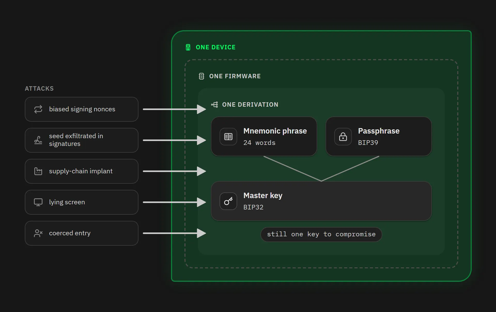

多厂牌设备的多签名装置，相反，在不同设备上生成签名，从而一个被攻破的设备，最多只能泄露一部分信息，每个签名设备都根据登记的花费策略检查目标地址，并且攻击者必须从多个地方收集多个签名。

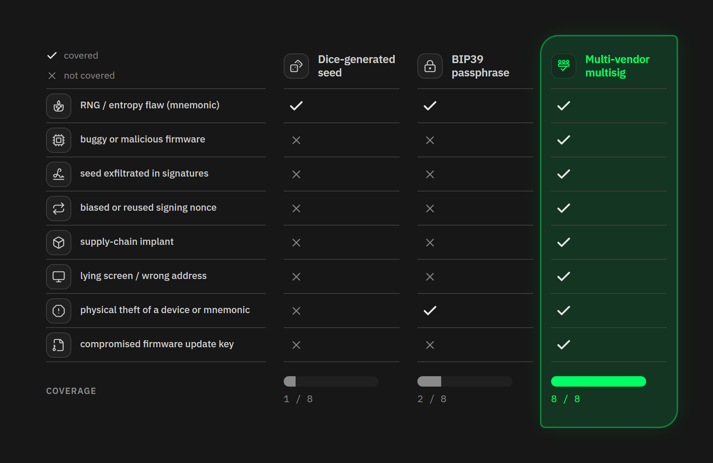

### “最后一个 bug” 谬误

最让我困扰的地方，并不在于这两种建议是没有用的，而在于它们背后的思维方式：“骰子和密语保护了一些 Coldcard  签名器的，所以骰子和密语也能保护你。”这是一种粗暴的总结，是从个案中推导规则，而且有幸存者偏差。我们看到了抵御了这次事故的 Mk3 用户，但也有人因为忘记了密语而受损失、被破解的弱密语，以及跟熵无关的 bug 。

这就是战略学家们说的 “打上一场战役”（后见之明）。教科书里的案例是马奇诺防线：在 1918 年以后，法国想吸取壕堑战的经验，把整个 1930 年代都花在建设与德国之间的防御工事上，希望能守住上一场战争的防线。但在 1940 年 5 月，德国国防军直接从 Ardennes（法国阿登省）和 Belgium（比利时）绕过了这条防线，法国在 6 周内就陷落了。2026 年 7 月的这个事故是一个 RNG 故障，而骰子确实能对抗这种漏洞。但围绕它来建立你的整个防御就如同打造你自己的马奇诺防线：下一个漏洞可能在签名过程中、在显示屏上、在供应链上，没有一个是能通过骰子或密语来防御的。

（译者注：现实被作者不幸言中。在 2026 年 7 月 Coldcard 签名器事故之后，硬件签名器行业发现的下一个重大漏洞是在 Ledger 品牌的签名器在世界多个区域遭到了供应链攻击，发现时间是 2026 年 10 月。其中造成最显著盗窃后果的是从东南亚经销商  CryptoBilis 发出的设备，其中植入了间谍电路，监视设备的屏幕内容并通过 eSIM 通信发回给攻击者。）

一个安全模式不应该用它能不能对抗上一个发现的 bug 来判断，而要看它能不能从下一个漏洞中幸存，而这个漏洞是现在还没有人知道在哪里的。这就是相异冗余性的作用：它不对故障的性质作任何的假设，只假设一个漏洞不太可能同时袭击多家独立的制造商。

## 两个值得重视的缺点

为了做到完全诚实，我这里为之辩护的模式有两个真实的缺点，是需要考虑的。

### 链上隐私性

多签名装置对比单签名（无论使不使用密语）的最明显的缺点，是会在链上留下足迹。当你从一个 P2WPKH 单签名钱包花费时，这笔交易只会披露一个签名和一个公钥，而其他 1000 万个用户都是这样做的。但如果你从 P2WSH 多签名钱包花费，交易就会向所有验证它的节点揭晓完整的脚本：公钥的数量、签名的阈值、 所有的公钥（也包括这次没签名的）；并且，在 Liana 建立的钱包中，还包括复原路径的内容和他的时间锁。这种足迹是非常显眼的。在 2025 年 4 月的整个  UTXO 集中，[根据 mempool.space 网站的报告](https://research.mempool.space/utxo-set-report/)，P2WSH 输出只占所有 UTXO 的大约 1% ，而 P2WPKH 的比例是 26.5% 。你在一个小得多的匿名集中，而且甚至在这个集合里面，你的钱包也有其它钱包不具备的特性。

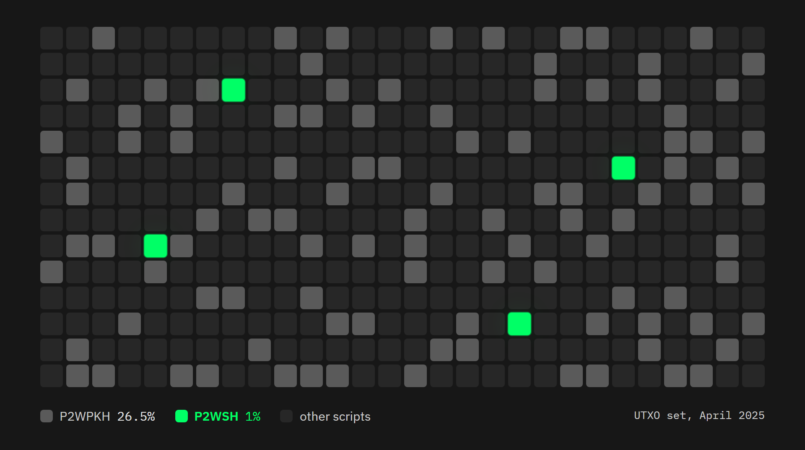

Taproot 能缓解这个问题，但也不能完全消除。Liana 已经支持 Taproot 输出（从 version 5 开始）。 如果主路径只有一个密钥，那么这个密钥会成为内部密钥，日常花费就通过这条密钥路径。但只要这个主要路径是一个多签名，密钥路径花费就还做不到：这需要签名聚合技术，在 Liana 中支持 MuSig2 之后就能实现，但现在还在开发中。目前，主要路径的多签名只能通过一个脚本树叶子来实现，而这样花费会暴露整个叶子的内容（这条路径用到的密钥以及阈值），虽然其它路径和时间锁还是隐藏的。这比 P2WSH 要好，但其足迹依然很独特，并且是在一个较小的全球匿名集里面。

我认为，我们要从两个方面来看待这个缺点：

- 一方面，这其实是个取舍，而且绝大部分人应该会倾向于安全性（我认为这是对的）：更容易辨识的链上足迹不会直接让你损失比特币；而在依赖于单个设备的单签名装置中，一个固件漏洞就可能要了你全部的比特币。
- 另一方面，这并不意味着多签名在隐私性上难以管理，而且，你总是可以用一个热钱包装点小钱，这样保持隐私性会简单得多。保持隐私性需要多加小心，因为你的起点更容易识别。

### 刷新钱币

第二个缺点来自复原路径。复原路径会在一笔钱长期没有动用时开启（以区块数量为单位）。所以，为了让它保持关闭，在倒计时结束前，你就要移动它们：这就是所谓的 “刷新”，你从钱包发起一笔交易，转回钱包内的地址，用主路径签名，这样会重置这个 UTXO 的倒计时。你需要支付一笔普通交易的手续费，而且要记得这么做。请注意，这样的时延有个最大值，而且并不是由 Liana 软件决定的。比特币的相对时间锁编码在 nSequence 字段，有  16 比特的空间可用，因此，其最长锁定时间就是 65,535 个区块，大约 15 个月时间。这是一条共识规则，对所有比特币软件都适用，并非 Liana 的设计选择。

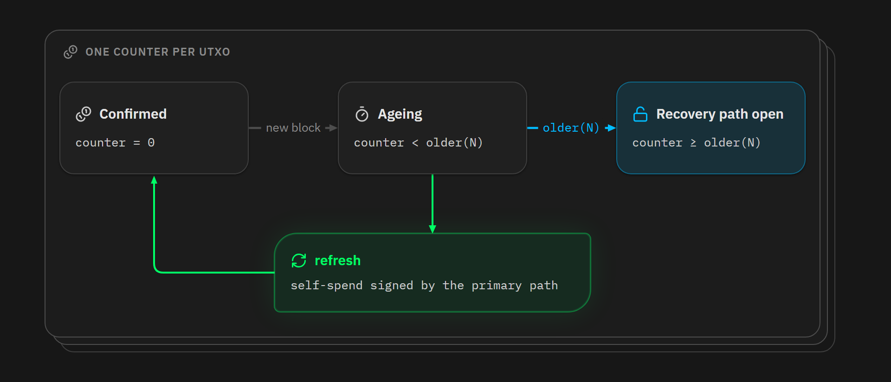

这个缺点，我认为，有其积极的一面。在传统的比特币储蓄模式中，你是保管好一个种子词，然后 5 年不动它；但等你真的需要它的时候，你可能完全不记得这些东西是怎么回事了。刷新模式迫使你要打开钱包，插上你的设备，签名一笔交易，每隔 6 个月、12 个月或者 15 个月就要做一次。这是一种强迫的检查：你可以验证你的设备还能正常启动、你依然知道如何使用它们。这样来看，刷新其实是你的保管装置的维护成本：每 6 个月到 15 个月发送一笔交易，可能低于任何银行账户或是保险的年费。你永远不检查的钱包，也是一个在你需要的时候才显示它的状态的钱包。

## 难以理解，但易于使用

接下来是我经常听到的一种说法：带有复原路径的多签名装置更加复杂。确实如此。理解一个 3-of-3 装置会在你钱包没有动作的 6 个月之后变成一个  2-of-3 装置，这需要不少历经，比理解 “一个种子加一个口令” 难得多。但是，你要区分理解它的复杂性和使用它的复杂性，而且在第二点上，多签名装置是全面胜出的。

拉里·泰斯勒（Larry Tesler）是人机交互学的先驱，在 1980 年代中期提出了一个定律，后来以他的名字命名，可以说是复杂性转化的定律：每一种应用都包含着一种无法简化的复杂性，无法隐藏也无法消除。问题只在于，是谁来承担它，是软件还是用户。

我们用这个透镜来看看这两种模式：

- 密语的复杂性在代码中是很简单的：它只是给一个密钥派生函数加一个盐。所有的复杂性都被推到了人这边：通过离线的随机源生成密语；在每次花费时重新输入；备份这个不带校验和的秘密值、要放在耐久的材质上、而且不能跟种子词放在一起；写下钱包的主指纹，以检测输入错误 ……
- 带有复原路径的多签名在代码上是复杂的：Miniscript、描述符、相对时间锁 、路径管理，但全部都放在 Liana 软件中、在签名设备的固件中。但同时，用户看到的东西是非常简单的：普通的 12 词或 24 词种子词组，每个都有自己的校验和，一个描述符文件可以复制到任何地方，交易签名只是让你插入设备、检查后点击确认。

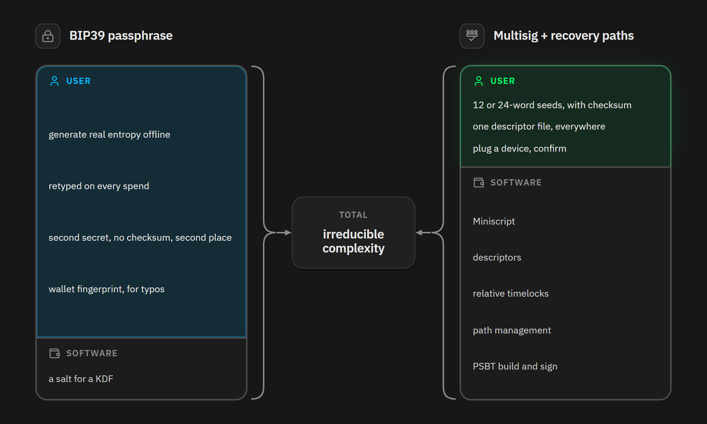

## 多签名备份起来并不复杂

多签名装置的备份的复杂性，在 5、6 年前是真实存在的：建立一个多签名钱包，意味着你要理解光有种子还不够，你需要保管好所有签名密钥的 xpub 以及派生路径。否则，你可能在弄丢一套种子词之后，因为缺少一段公钥信息而无法找回你的资金（尽管你还有两套有效的种子词）。而且在此之上，软件之间没有标准化的操作流程。

从那以来，描述符已经改变了一切。一个描述符就是一种标准化的纯文本，包含可以完整描述这个钱包的信息：脚本的类型、每一个密钥的扩展公钥以及它的来源、阈值、复原路径以及它们的时间锁。因此，通过 Liana 来创建的钱包只需要备份两个东西：种子们（主要花费路径的每个密钥都需要备份一套种子词，除非你自己选择不备份，这个我后面会说），然后是描述符。

请注意，这两件东西本身的风险级别并不相同。种子词需要保持机密：无论谁知道了它，都可以代替你签名，所以你需要保持尽可能少的副本。但描述符只算隐私信息：知道它的人并不能花费你的任何一分钱，只是能知道你的余额和钱包的历史。因此，正确的策略是少备份种子词、多备份描述符。唯一你需要顾虑的因素是隐私性，因为把明文的描述符放在互联网服务上会暴露你的储蓄数量。

这就是加密描述符的作用。从 version 13 开始，Liana 会在创建钱包时默认产生一个 `.bed` 文件（名称来自 “比特币加密描述符” 英文首字母），这个方案已经成为一个标准 BIP-138 的草案，是由 Pythcoiner 撰写的，启发来自 Salvatore Ingala 。原理是这样的：与其再加入一个加密的密钥（这个密钥又需要备份），不如用描述符中包含的公钥（的 xpub）来加密。 这些 xpub 中的任何一个都足以解密它（而你必然持有至少一个），因为它们可以从你的种子词重新派生出来，或者从你的设备读取。没有新的秘密需要保护。最终得到的是一个文件，得到它的人，如果不知道钱包中的任何一个 xpub，就不能解密它，因此，你可以复制这个文件到别的地方，而不需要小心翼翼：Google Drive、邮箱、U 盘、你的电脑、家人的电脑 …… 备份描述符的问题也不再是个复杂性问题，而变成了一个冗余性问题，而解决它并不需要任何额外成本。

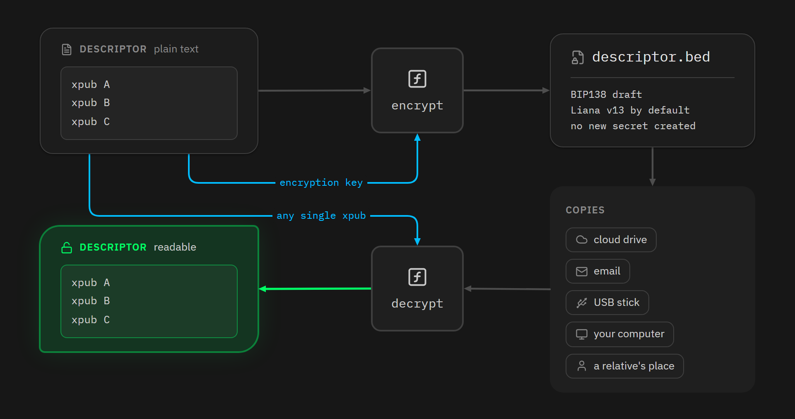

## 多签名对个人来说并不昂贵

最后是价格问题。购买 2 个或 3 个来自不同厂商的硬件签名器，是一项投资；有些人断定，这表明多签名只适合那些兜里有不少钱的人。我并不认为这里有条线，金额超过这条线，多签名才有意义。唯一的界限反而是在下面：如果硬件签名器的价格高出你的储蓄数量太多，那么任何装置都没有合理性，你只要用移动端钱包就行了。但除了这种情形，正确的问题并不是 “我有多少钱”，而是 “弄丢它会怎么样”。只要弄丢它会给你带来很大的痛苦（不论是个人财务上、心理上还是让家人心痛），那么它都值得你用自己可以合理搭建的最好的安全系统，而今天，这样的最好系统就是基于多厂牌设备的多签名装置， 加上带有时间锁的复原路径。

而且，多厂牌并不意味着你要增买多个设备。我下文描述的第一种配置，只需要你买一个，然后就可以用你存放在电脑上的一个密钥来补充，这样就已经能够打败单签名装置了，不论这个单签名钱包用不用密语，在失盗和弄丢风险两个方面都胜出。

## 根据你的预算，在 Liana 中创建钱包

纸上得来终觉浅。这里介绍 5 种配置，从最便宜的到最完整的。所有模式都内置在 Liana 钱包安装器种，使用 “自建（Build your own）” 模式，你就能自由定义每一条路径、阈值和时延。

Liana 支持任何实现了 Miniscript 的硬件签名器，并且我们会随着他们加入而尽快支持。目前的支持设备如下（截至 2026 年 8 月 17 日）：

- Ledger：Nano S Plus, Nano X, Stax, Flex, and Nano Gen 5 。
- BitBox：BitBox02 and BitBox Nova 。
- Jade：Jade, Jade Plus, 以及 Jade Core（请注意，Jade 仅在 SegWit 模式下支持 Miniscript，在 Taproot 模式下不支持）。
- Specter DIY 。
- Krux 。

不论你选哪一种，规则都一样：不应该有来自哪一家厂商的设备（创建、保存）的密钥可以单独满足一条花费路径。关于主要花费路径，这应该永远成立。至于只需一个密钥的复原路径，只要你在倒计时结束前刷新你的 UTXO ，就能保持这种状态。

### 1. 单个硬件签名器搭配一个热密钥

这是入门级别的配置，只需要购买 1 个硬件签名器。主要花费路径是一个 2-of-2 装置，由这个硬件签名器和一个热密钥（放在联网设备上，由软件持有的密钥）组成；这个热密钥就放在你的电脑上，Liana 就能直接在安装器里生成。复原路径是同样的两个密钥的 1-of-2 装置，在长期不活动的 12 个月后启用（大约 52,600 个区块）。

热密钥放在一个联网的计算机上，它的12 词助记词明文存储在硬盘上。单独来看，它的安全性要远远弱于硬件签名器种的密钥。但它从不单独使用，所以是可以接受的。要在复原路径启用之前盗走你的资金，攻击者需要同时攻破你的电脑和你的硬件签名器，而一个 bug 能同时袭击一个主流的桌面操作系统和一款专用设备的固件，是非常小概率的。这就是广泛意义上的多厂牌：这两个部分既没有相同的代码，也没有相同的攻击者。

如果明天，你的硬件签名器就被发现了了 Coldcard 签名器这次安全事故一样的漏洞，攻击者可以搜索出你的种子词，但没有你的电脑的密钥就用不了，因为复原路径现在还是关闭的；而如果是基于相同设备的单签名装置，不论是否使用密语，都有可能被盗。

在丢失风险上，复原路径能派上用场：如果你的电脑开不了机了，那么你会弄丢热密钥的助记词，但硬件签名器自身足以在 12 个月后拿回资金；反过来，如果硬件签名器被你弄丢了，你的热密钥也能做到相同的时（当然，你得保留着你得描述符）。

平时，这种钱包是很容易管理的，因为花费就需要来自硬件签名器的一个签名以及来自热密钥的一个签名（这个 Liana 自己就能添加进去）。你只需要插入设备，检查之后确认，就跟传统的单签名钱包体验一样。

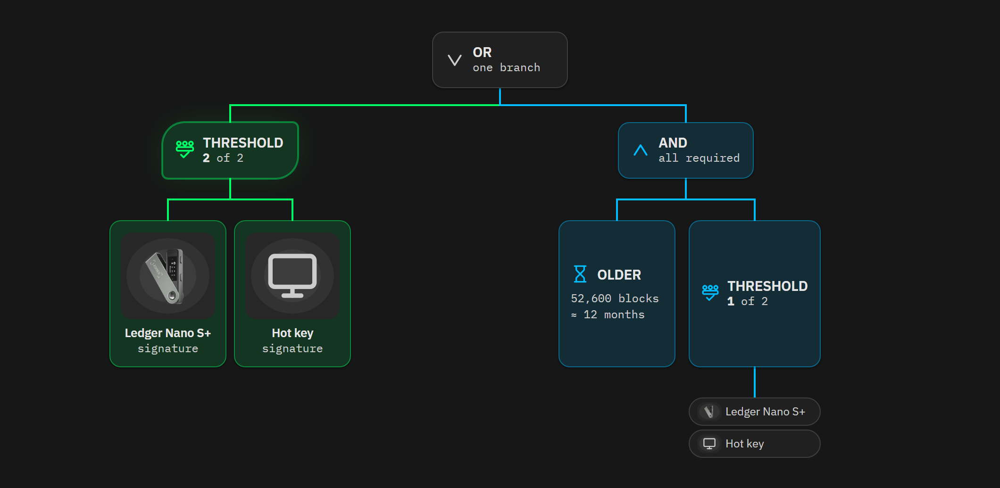

### 2. 递减式多签名

如果你可以持有多个设备，那么最通用的配置是 “*递减式多签名* ”。主要花费路径是来自 3 个不同厂商的 3 款硬件签名器的 3-of-3 多签名了。第一条复原路径会在（比如说）6 个月不活动之后，启用一条 2-of-3 多签名花费路径；第二条复原路径，则是在 12 个月之后，启用相同密钥的 1-of-3 多签名。

平常的 3-of-3 已经提供了应对失盗的最强等级：来自 3 家不同厂商的 3 个设备，很难同时攻破。在 6 个月后，启用的 2-of-3 可以覆盖一个设备丢失或出故障的风险。而 12 个月后启用的 1-of-3 装置，可以应对 2 个设备丢失的风险。甚至你还可以添加一条带有时间锁的继承路径，加入属于你的亲人的第 4 个密钥。

一家厂商出现的一个漏洞，比如 2026 年 7 月的这次，既不能满足 3-of-3 ，也不能满足 2-of-3  。

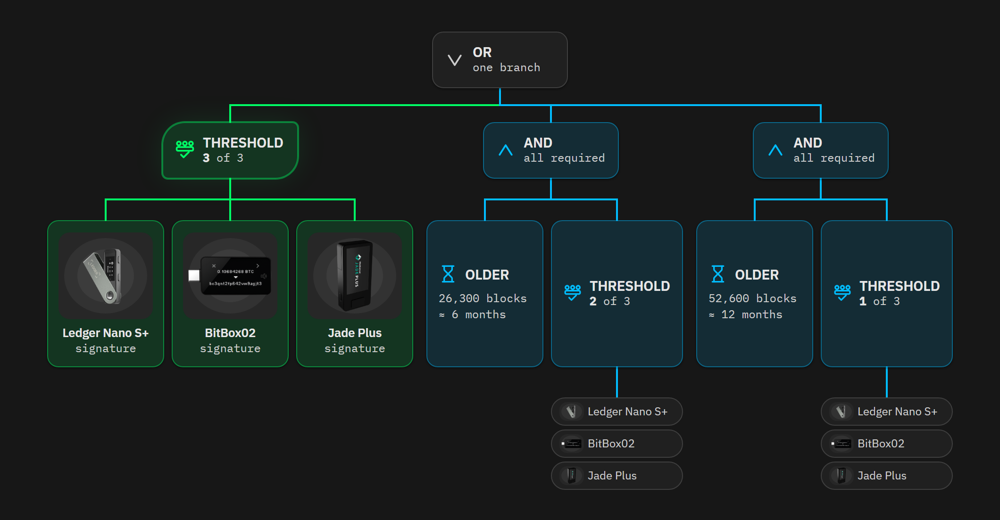

### 3. 拓展式多签名

拓展式多签名的做法相反：它不是随时间逐渐降低阈值，而是加入密钥。主要花费路径是你的设备的 3-of-3 多签名。而在 *n* 个月不活动之后，启用一条复原路径，允许另一个密钥签名，形成 3-of-4 多签名；再过 *n* 个月，再许可另一个密钥签名，形成 3-of-5 多签名，这个密钥可以是一家服务商的密钥（只要你愿意）。

这种模式的用意在于，从钱包启用开始，花费的权力不可能用更少的密钥来获得。阈值一直是 3 ，只是加入更多密钥，这适用于额外的密钥由其他人持有的情形：这些在复原路径启用后才能签名的密钥无法独自行动，可签名的密钥中的任意 2 个结合也不能花费，需要 3 个才行；当你丢失 1 个设备时，第一条复原路径启用你就能恢复资金；如果你弄丢了 2 个设备，还有第二条复原路径。

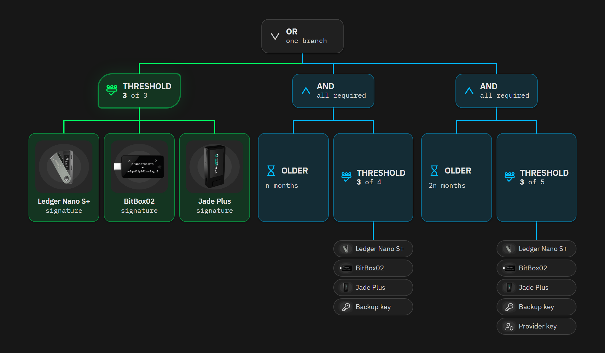

### 4. 带有一个单独复原密钥的多签名装置

也并不是一定要在复原路径中复用放在主要花费路径中的密钥。你可以为日常花费设置一个 2-of-2 花费路径或者 3-of-3 花费路径，但在资金未移动的 12 个月之后，启用放置一个完全不同的密钥的复原路径。这个密钥可以是你的，存放在别的地方，这可以保护你在摧毁你的所有签名设备的灾难中不丢失资金；或者，可以是你的继承人的，只要你保持活动能力、刷新自己的 UTXO，TA 是没有花费你的资金的能力；也可以是某个人，你把密钥交给 TA ，这样 TA 无需你也无需任何第三方，就能取出你的资金。

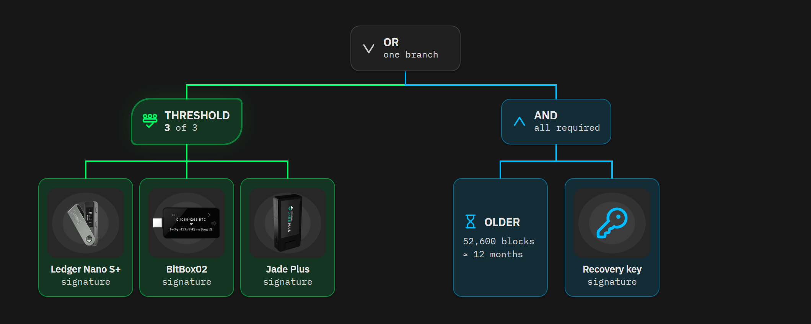

### 5. 无种子的多签名

最后一种配置也许不算自成一种模式，更多是配置 1、2、4 的结合体，它直接回答了那些认为多签名对个人来说 “多此一举” ，因为倍增了需要保护的种子词的数量的人。

使用带有时间锁的复原路径，主要复原路径不需要备份种子词。在实践中，你可以配置好你的硬件签名器，根本不写下他们的 12 词或 24 词（或者你可以先记录，但在完成初始化配置之后毁掉备份），只备份复原密钥的种子词，以及描述符。这就是我说的 “无种子”：主要花费路径的密钥只存在于设备中，不存在于别的地方。

你得到的成果是，人身攻击的界面被削减到最少。家里不放金属助记词板，也不会有人能拍个照然后拿走你的资金。盗走你的设备的窃贼，得到的只是有 PIN 码保护的黑盒子，而且，在带有安全芯片的款型中，将没有已知的办法能从中抽取出私钥（当然，不应该在同一个地方存放主要花费路径的所有设备）。

与此同时，你只需要等待复原路径启用，然后转移资金到新的钱包。

你失去的是恢复一个用于主要花费路径的设备到原样的能力：如果一个设备坏了、或者你忘记了 PIN 码，或者一次升级清空了它，你都只能走复原路径，需要等待你自己设好的时延。

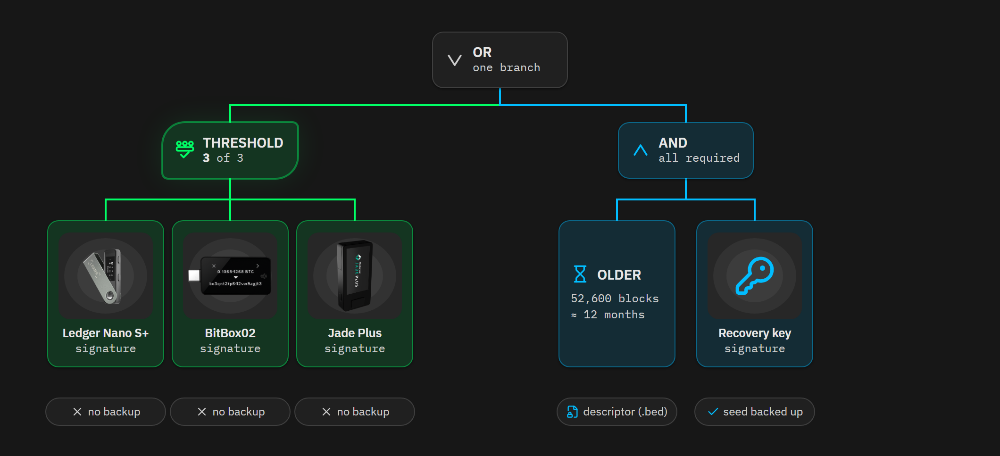