> *作者：Juan Galt*
> 
> *来源：<https://bitcoinmagazine.com/culture/top-bitcoin-blockchain-visualizers-for-your-home-and-office>*

人们常常用非常抽象的词语 —— “密码学货币”、“电子黄金”来介绍比特币，希望这些比喻可以让这种货币系统中的电子奇迹对普通人来说更加可感、更加真实。这些比喻究竟有没有用，难以断言，但它们绝非唯一想让比特币不仅仅是个资产符号的尝试。

过去几年里，出现了许多比特币图像化工具、区块浏览器以及以美观优先的交互界面，让密码货币看起来更鲜活，成了你可以挂在墙上驻足欣赏、甚至可以像听窗外鸟鸣那样听的东西。有时候，比特币人会把这些工具连接到可以操作的实体设备上，变成招待客人的谈资。

本文将介绍最好的一些比特币图像化工具，包括从价格显示器到节点和交易池数据的图像化工具；也许它们可以妆点你的家，甚至启发你（叫 AI 帮你）开发一套新的。

## 区块浏览器网站

重中之重，区块浏览器网站。区块浏览器网站没准是窥探比特币世界的最标志性的窗口，它从这个行业刚刚起步的时候就出现了，一直在扮演链上交易的公开见证人。用户可以在发送比特币支付之后，将交易 ID 或者收款地址粘贴到网站的搜索框内，然后就能查到这笔交易的带有密码学认证和时间戳的收据，可以轻松分享给收款方。今天，绝大部分钱包软件都提供区块浏览器网站入口，就放在交易数据界面，好让用户可以轻松从其它 app 或网站验证支付已经发送。

## Mempool.space

第一款重要的区块浏览器网站可能是 [Blockchain.info](http://blockchain.info/) ，它也是一个网页端钱包，并且业务已经扩展到广大的密码货币行业的许多领域。但在它之外，在仅服务比特币（Bitcoin-only）的市场上，[Mempool.space](http://mempool.space/) 可能是这个小众市场上浏览量最多的网站，它为比特币经济体提供了美观且清晰的视图。

除了给用户提供基本的交易数据，比如一笔支付是否已经在链上确认，这个网站还让用户可以评估手续费市场，从而避免为链上交易支付溢价；甚至，它可以让你看到下一个区块即将挖出的交易类型（占比）。Mempool.space 由一个开源的后端实现，所以用户可以在产出的机器上运行，作为自己的家用全节点之上的一层。如果是这样，这个自己运营的网页就会成为用户对网络的独一无二视角（基于节点的[交易池](https://bitcoinmagazine.com/tags/mempool)）的一个界面。

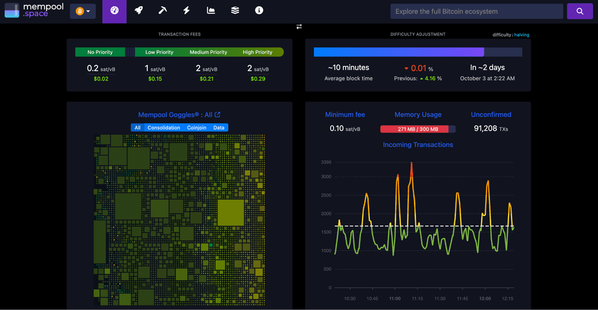

### ExploreTimeChain.com

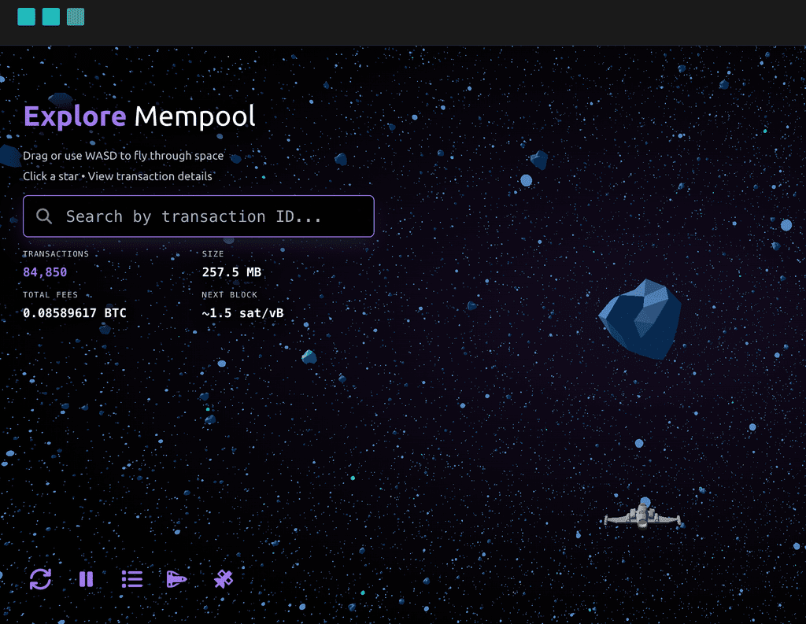

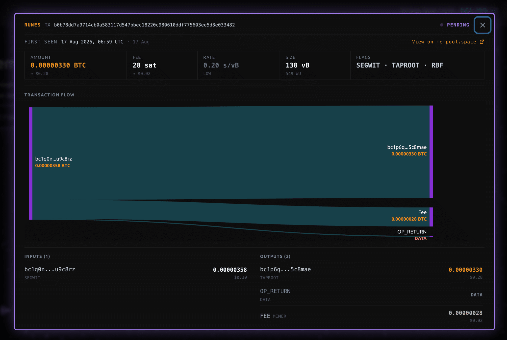

迫不及待想上月球了，那就使用 [ExploreTimeChain.com](http://exploretimechain.com/) ，它由一个完全以太空探索为背景的界面，只不过这个太空位于 “时间链” 上（“时间链” 是中本聪最初为比特币这种系统选择的用词，[见于代码的早期版本](https://bitcointalk.org/index.php?topic=382374.0)）。这个界面接收交易 ID、公开地址，等等作为输入，然后你就可以看到关于它们的重要细节和数据。但是，你也可以手动驾驶飞船在区块星际空间中飞行，每个星球都是一笔交易。此外，在这个网站上，你还可以[在一个 “3D 链条” 上观看每个区块](https://exploretimechain.com/block/960288) —— 这个名称，名副其实到有点刻意了。

（译者注：“登上月球” 是 “希望价格大涨” 的隐喻说法；作者此处是一语双关。）

[Tesseractb](https://tesseractb.com/) 也让你可以浏览区块链作为一个 3d 空间，启发来自超立方体。界面右下角的小小搜索按钮让你可以输入交易 ID 和其它数据、进入你感兴趣的某个地址或区块，所以它货真价实是个区块浏览器网站。

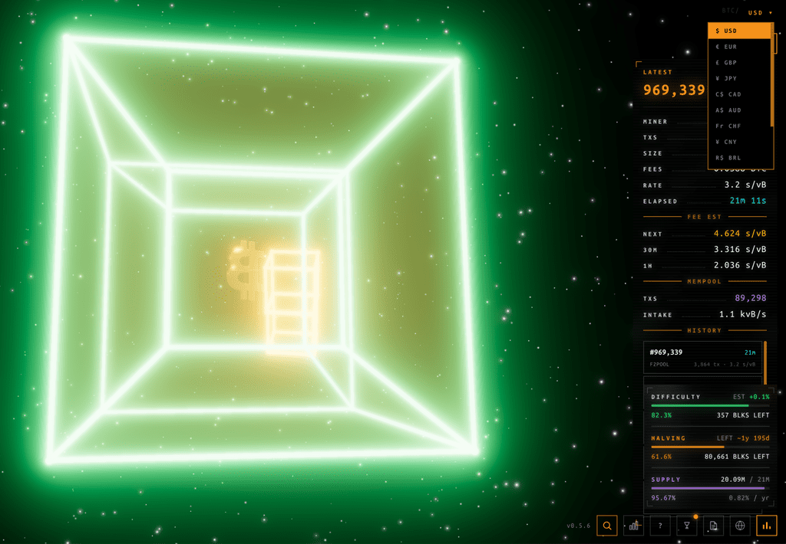

- 此图来自 <a href="https://tesseractb.com/">Tesseractb</a>  -

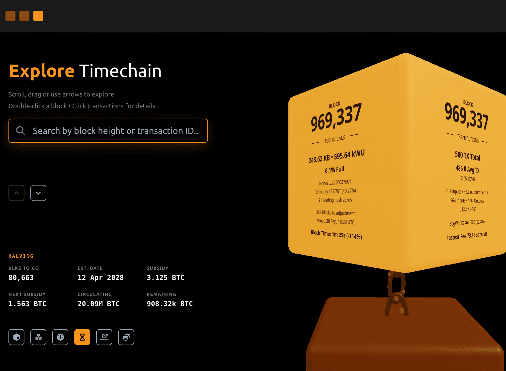

- 此图来自 <a href="http://exploretimechain.com/">ExploreTimeChain.com</a>  -

### Symphony.iohk.io

[Symphony.IOHK.io](https://symphony.iohk.io/) 项目，是另一个有趣的、把区块浏览变成游戏的 3D 界面。网站接收交易 ID 和区块号作为输入，让用户可以浏览时间链。它的 3D 设计不止体现在视觉上，也体现在听觉上，它的配乐是合成的，让你感觉自己像个外星人，在浏览银河系。整个 3D 空间可以用一个电子游戏那样的控制器和键盘来探索，而且 —— 它甚至兼容 VR 。

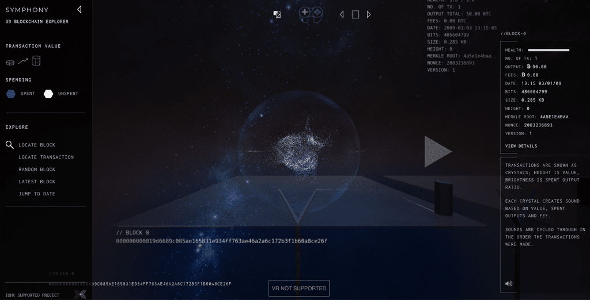

### The Anatomy of Bitcoin

“Anatomy of Bitcoin” 网站也是值得一提的[区块浏览器网站](https://anatomyofbitcoin.com/explorer/transaction)。虽然这个网站的绝大部分内容就是一个数据科学项目，艺术品味是极简主义，但它使用 [Pedro](https://x.com/pedromvpg) 开发的技术站是与网络实时同步的。网站接收交易 ID 后会返回交易数据的 3d 或 2d 图像，不过，执行这些操作的界面在菜单中藏得有点深。

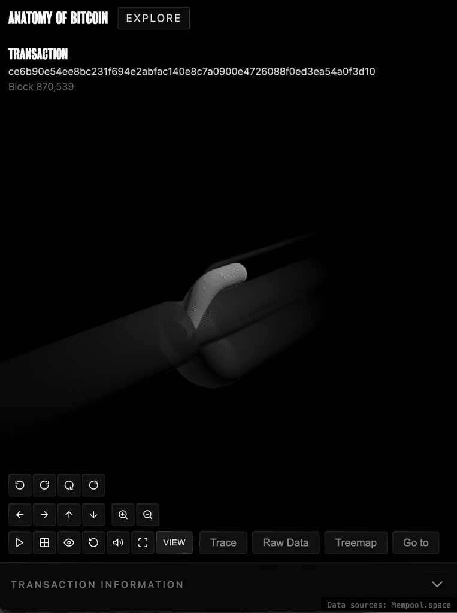

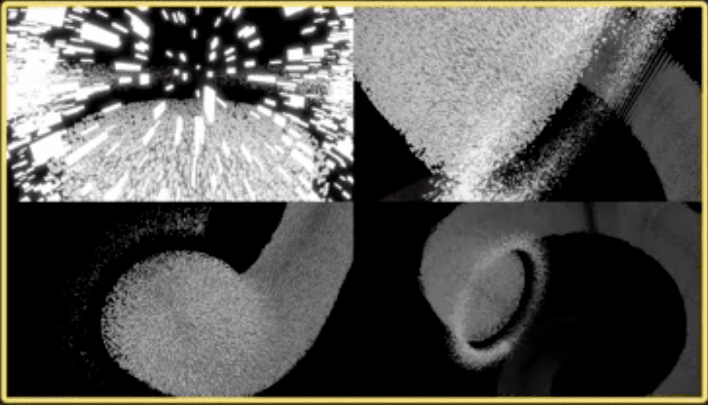

这个项目的神奇之处在于它的技术后端。它是使用 MIT 许可的比特币系统  3d 建模工具，覆盖了整个系统的几乎所有层级，从比特形式的私钥的密码学，一直到节点网络拓扑、区块链数据，以及 UTXO 集的动态状态。它是数据科学的令人惊讶的成果，而且其它项目也许可以采用它来进一步开发。

这个网站有个初衷，是制作一部电源，以视觉形式向人们介绍比特币，也发布了一些预告片和介绍路线图的演讲，但当时融资受阻，所以没能拍出一步电影；事后来看，它可能是如今要宣传比特币的重要方式。希望有人能复活这个项目、复刻它并做出自己的作品。 [这个网站](https://anatomyofbitcoin.com/)提供了许多内容和灵感，去看看吧！

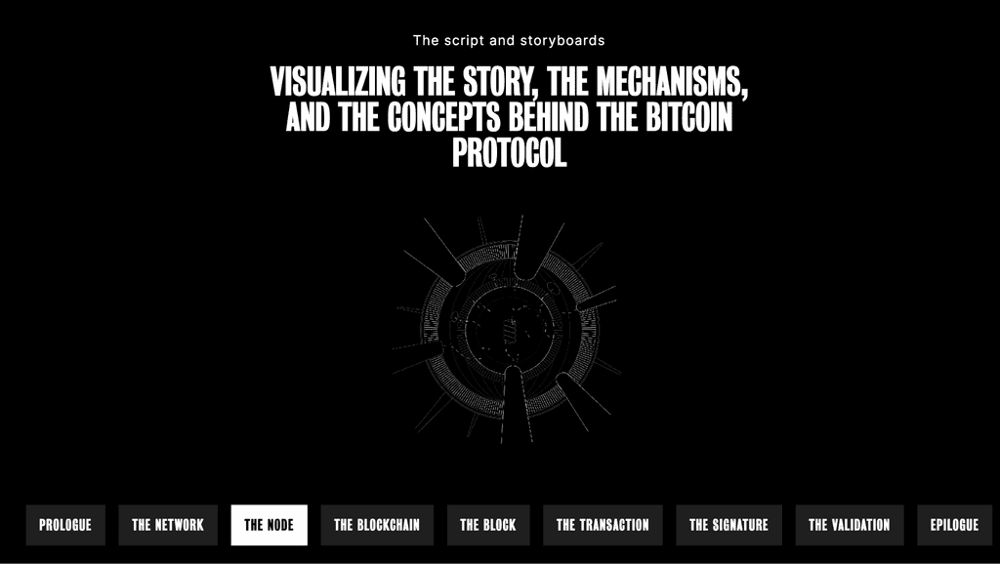

## 交易池图像化工具

不过，一些交易池图像化工具并不是区块浏览器，它们并不想给你关于具体交易的数据，而只想让你对链上的交易流趋势有个感觉 —— 不论是从数据科学角度还是艺术交易。

### Mempool.JHoenicke.de

在这些交易池图像化工具中，最著名的一个可能是 Jochen Hoenicke 博士的交易池数据网站。这个网站在线已经至少十年了（从 2026 年往回数）。它是比特币上的交易池活动的历史性数据集，是研究员和比特币历史学家的无价之宝。

Hoenicke 是一位德国的计算机科学家，在比特币世界中因为其[白帽子安全研究员](https://bitcointalk.org/index.php?topic=581411.msg9774894#msg9774894)身份而知名；后来成为了 Trezor 的密码学家，现在则为 [Certora](https://jochen-hoenicke.de/)（一个智能合约技术公司）效力。他的网站所用的脚本放在 [mempool.jhoenicke.de](http://mempool.jhoenicke.de/) 上，是[开源的](https://github.com/jhoenicke/mempool?tab=AGPL-3.0-1-ov-file)（使用 AGPL3 许可）。这个网站对于理解下一个区块可能多拥挤或多空旷极为有用，因此也让你可以预估要给交易支付多少链上手续费。

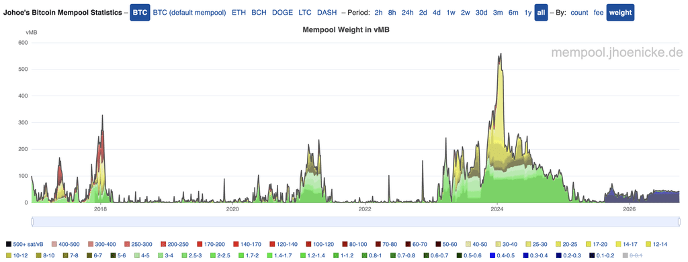

### demo.GetNotZero.com

[GetNotZero](https://demo.getnotzero.com/) 模糊了实时仪表盘和业余矿工的界限：它提供了一套新颖的、橙色为主的密码朋克视图，带有许多指标。他们的样品仪表盘显示下一个区块的哈希率估计、下一个区块的预期交易数据、挖矿难度、价格、下一次区块补贴减半的倒计时，等等。这套仪表盘的核心是邀请你使用家庭电脑来尝试挖矿。以前，用笔记本挖矿让一些人变得非常复用；今天，这样的概率已经很小很小很小了 —— 但不是零。

这就是这个网站的用意。要是你走运，[独自挖出一个区块](https://bitcoinmagazine.com/news/solo-bitcoin-miner-defies-1-in-100000-odds)呢？那可是 3.125 BTC 啊，全部进入你个人的、自主保管的钱包、没人问你为什么，也没有 KYC 。你要是玩彩票，你可能会惊讶：[独自挖出一个比特币区块](https://bitcoinmagazine.com/bitcoin-mining/bitcoin-lottery-mining-better-powerball)的概率居然那么高！这个项目设计得很好看，也让挖矿显得非常简单。

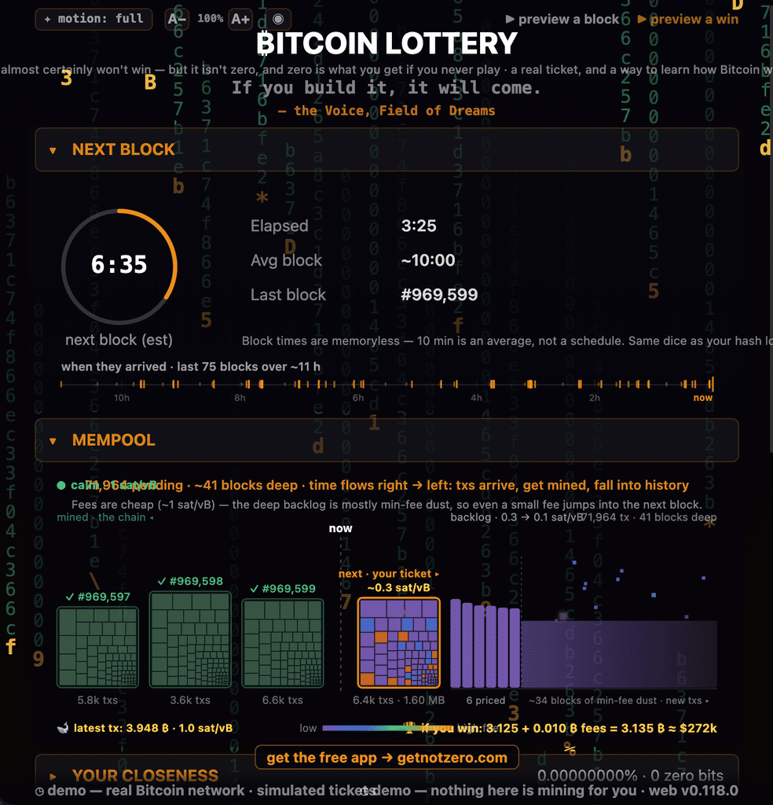

### TxCity.io

在交易池数据上搞点有意思的：[txcity.io](https://txcity.io/v/btc-eth) 将比特币和以太坊交易池表现为动画《南方公园》里的一个公交车站。这个网站把隔离见证交易画成中本聪时代区块空间（车厢）的额外一节车厢，并将等待进入这两个车厢的交易画成南方公园里的人物 —— 他们在等待下一班车（区块）。在比特币和以太坊之外，这个网站还提供许多其他传统的密码货币 —— 给实在有兴趣的人看。

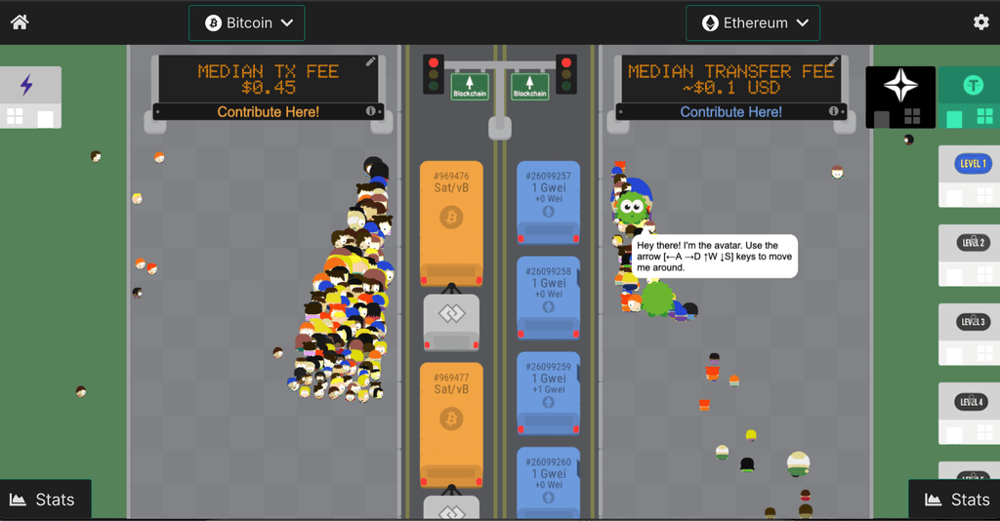

## 音乐交易池！

除了趣味图像，一些艺术家还尝试把链上活动表现为音乐。这些界面给比特币自由市场的自我组织的混乱谱成上了音符，创造出了奇妙又悦耳的旋律。当然了，这需要艺术上的润色。

### Proof of Sound 

最闪亮的音乐交易池网站可能是 “[Proof of Sound](https://www.proofofsound.co.za/)”。这个网站给不同的交易和交易池事件赋予了音符。新挖出的区块也有自己专门的音符。同时伴有一个合成波（synthwave）的 3D 图像，非常适合作为屏幕背景。音乐可开可关，但我经常一边听一边在里面看。这个网站甚至有许多定制化的选项，你可以找出最喜欢的交易池背景音乐体验。

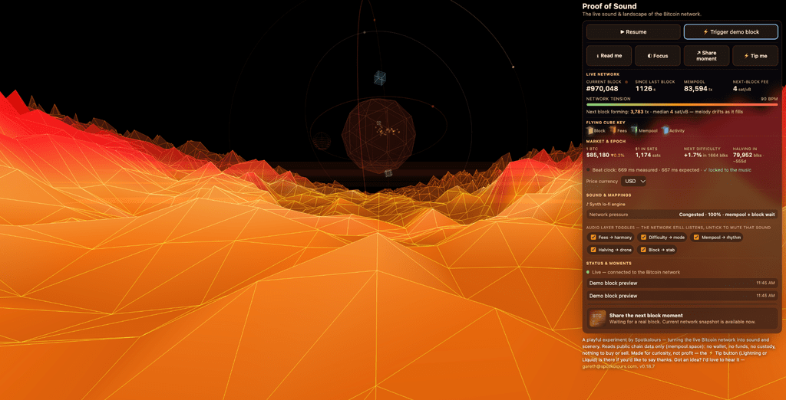

### Bitlisten

采用相同的概念不过是极简主义方法，[Bitlisten](https://www.bitlisten.com/) 给交易池中的每笔交易赋予了一个铃声，声音大小取决于交易规模。结果是简单但流畅的背景音乐。默认的乐器是钢片琴（celesta），但也可以改成其它乐器，完全改变得到的音乐。视觉效果可以再好一些 —— 它显然是在 AI 氛围编程时代以前的作品。但它也是开源的，所以任何人都可以做出修整，只要你有兴趣。

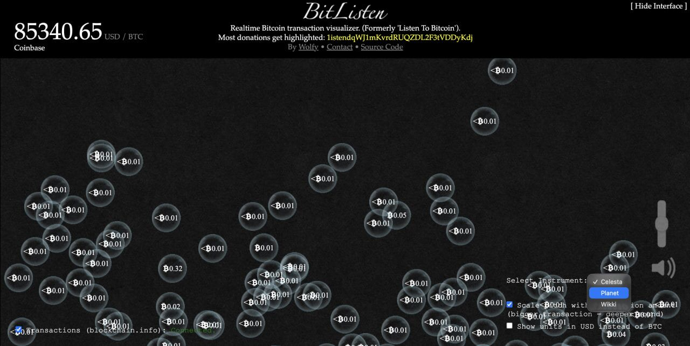

### Phenomenal Gumption

设计上类似于 “Proof of Sound ”，但带有更加精准的音乐体验，[这个匿名的 Netlify app](https://phenomenal-gumption-18de7b.netlify.app/) 网站提供了耐听的背景音乐和图像化工具，让你眼睛耳朵都离不开交易池。链上活动主要表现为视觉，而且非常丰富；它的 read me 文档说，由于合成波对链上事件做出反应，所以每一刻都是独一无二的。同时，音乐是精心制作、专业处理的，而不是由交易池中的自我组织的混乱决定的。

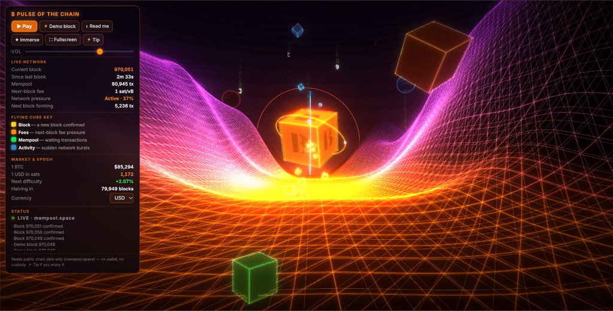

### OmPool

最后一个，但不能小瞧的是 OmPool 界面，它是 [Pat Riley 给 Omarchy OS 设计的](https://x.com/_rileyio/status/2096373222153351193)。这款操作系统在那些想要逃离 Apple 和 Windows 围墙的用户那里非常流行。这个界面本意是作为操作系统上的一个控制板，让用户可以视察，也可以在后台运行。这套软件是[开源](https://github.com/pat-riley/ompool)的，而且，你可以在它的[宣发推特](https://x.com/_rileyio/status/2096373222153351193)上看到，UI 非常漂亮，很适合 Omarchy 的自顶向下设计，同时，也会有来自交易池的悦耳声音。

（完）